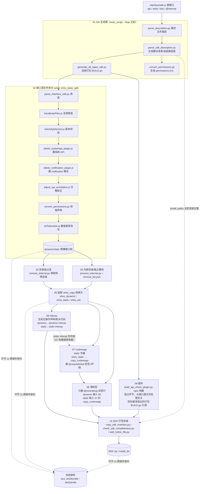

# 全链路汇总总览（源接口 → SDK 产物）

本目录把 `interface/sdk-js` 源接口，经 GN 生成期与 ninja 各 action，
最终打包安装为 SDK 产物的完整链路整理为一条流水线文档。

- 本文件：**脚本总览 + 11 个环节速览 + 全链路流程图**。
- `01`~`11`：按 GN 执行顺序（`11` 为跨部件契约维度），逐环节说明**涉及的脚本、输入输出、处理流程图**。
- [12-entry-flow-map](./12-entry-flow-map.md)：补充**入口视角**——从 SDK 描述文件
  23 条入口出发，看安装位置、开关联动与「23 条入口只命中 5 种流程」，不占用流水线环节编号。
- 脚本总览与全流程图表见下文，逐环节详情见 `01`~`11` 分篇。

---

## 1. 全链路流程图

从源接口到 SDK 产物，按 GN/ninja 执行顺序自上而下：

> 环节 01 是「生成菜单」，环节 02~08 是「后厨加工」（接口源文件处理），
> 环节 09 是独立插件构建（不依赖接口源文件），环节 10 按菜单把产物落盘；
> 环节 11 是贯穿 02~10 产物、面向**外部部件**的依赖契约（非流水线步骤）。

> **06/07/08 三者速记**：
> - **06 interop**：生成互操作声明（dynamic 用 declgen、static 用 ets2panda），在加工副本上删 `@noninterop` 成员；
> - **07 runtimeapi**：static 专属，删 `@unpublished` 标签+声明（对外发布版），另保留一份内部 API 副本给 ets-loader 运行时；
> - **08 清标签**：在最终安装副本上只删 `@noninterop` **标签行**（声明保留，与 06 删成员不同）。
> 构建顺序：`06 static interop → 07 runtimeapi → 08 清标签(static)`；08 的 dynamic 输入直取 05（与 06/07 无数据依赖）。

---

## 2. 11 个环节速览

| 文件 | 环节（GN 顺序） | 输入 → 输出 |
| ---- | ---- | ---- |
| [01](./01-00gn-generation-overview.md) | GN 生成期 | 描述 JSON → `out/<产品>/gen/build/ohos/sdk/ohos_sdk_modules.gni`、安装路径表、打包 `BUILD.gn` |
| [02](./02-00interface-split-overview.md) | 接口源文件拆分 `ohos_base_split` | `interface/sdk-js` → `out/<产品>/sdk-interface/{dynamic,static}/sdk-js` |
| [03](./03-directory-filter.md) | 目录级过滤 | 接口树 `api/` → `out/<产品>/ohos_declaration/ohos_declaration_{ets,ets2,common}` |
| [04](./04-internal-dirs-modules.md) | 内部目录 / 独立模块 | 接口树子目录 → `out/<产品>/obj/interface/sdk-js/<target>` |
| [05](./05-assembly.md) | 装配 | 环节 03/04 产物 → `out/<产品>/ohos_dynamic`、`out/<产品>/ohos_static`、`out/<产品>/ohos_ets` |
| [06](./06-interop.md) | interop 互操作 | `out/<产品>/ohos_dynamic_two` / `ohos_ets` → `out/<产品>/sdk-interface/dynamic-interop`、`static-interop/{declaration,bridge}` |
| [07](./07-runtimeapi.md) | runtimeapi / `@unpublished` | `out/<产品>/ohos_static` → `out/<产品>/obj/interface/sdk-js/copy_runtimeapi*` |
| [08](./08-label-cleanup.md) | 清 `@noninterop` | 装配目录 → `out/<产品>/obj/interface/sdk-js/ohos_build_{dynamic,static}_sdk_*` |
| [09](./09-plugins.md) | 插件（独立环节） | 插件源码 → `out/<产品>/gen/interface/sdk-js/gen_api_check_plugin`、`gen_api_transform` |
| [10](./10-sdk-packaging-install.md) | SDK 打包安装 | 各模块产物 + 安装路径表 → SDK zip |
| [11](./11-cross-part-interfaces.md) | 跨部件对外接口（`sdk:` 契约，横切维度） | 13 个对外 GN 目标 → 外部部件依赖 |
| [12](./12-entry-flow-map.md) | **入口视角**（非环节） | 23 条描述文件入口 → 安装位置 / 开关联动 / 5 种流程 |

> `12` 是阅读视角的补充篇，不占用流水线环节编号，也不出现在第 1 节流程图中。

---

## 3. 脚本总览（按 GN 执行顺序）

> 下表为按环节压缩的脚本总览；**归属领域**按脚本的维护/责任方标注：`build` 仓 → `编译构建`、
> `interface/sdk-js` 仓 → `sdk`、语言工具链（如 ets2panda）→ `语言`。
> 个别例外：01.1、02.0 代码在 build 仓但由 sdk 提供并维护；权限转换（01.4 / 02.7）归属安全领域（负责人：陈念）。
> 每个环节的详细脚本、输入输出与流程图见 01~10 分篇。

### 环节 01：GN 生成期（`build/ohos/sdk/BUILD.gn` 的 `exec_script`）

| #    | 归属领域 | 脚本                                                                              | 输入                                                                         | 输出                                                                                   | 处理内容                                                             |
| ---- | -------- | --------------------------------------------------------------------------------- | ---------------------------------------------------------------------------- | -------------------------------------------------------------------------------------- | -------------------------------------------------------------------- |
| 01.1 | sdk | `build/ohos/sdk/parse_description.py`                                           | `build/ohos/sdk/ohos_sdk_description_std.json` + `--sdk-build-public/--sdk-build-arkts` | `out/<产品>/sdk-interface/ohos_sdk_pub_description_std.json`                         | 按 public / arkts 开关裁剪条目，`ets/dynamic/` 前缀改写为 `ets/` |
| 01.2 | 编译构建 | `build/ohos/sdk/parse_sdk_description.py`                                       | 描述文件 + `build/ohos/sdk/variant_to_product.json` + `--platforms`                     | `out/<产品>/gen/build/ohos/sdk/ohos_sdk_modules.gni`、`ohos_sdk_install_paths.json`、`generated_sdk_types.txt` | 展开为 GN 变量、校验 `BUILD.gn`、处理占位符、生成安装路径表        |
| 01.3 | 编译构建 | `build/ohos/sdk/generate_all_types_sdk.py`                                      | 01.2 产物 + `build/ohos/sdk/type_to_display_name.json`                                    | `out/<产品>/gen/build/ohos/sdk/BUILD.gn` + `out/<产品>/ohos-sdk/<os>/<type>/oh-uni-package.json`                                  | Jinja2 渲染每个 SDK 类型 × OS 的打包目标                            |
| 01.4 | 安全领域 | `build/ohos/sdk/convert_permissions.py` → `interface/sdk-js/build-tools/permissions_converter/convert.js` | 权限定义 JSON + 接口目录                                                     | `api/permissions.d.ts`                                                               | 生成权限声明文件                                                     |

### 环节 02：接口源文件拆分（action `ohos_base_split`）

| #    | 归属领域 | 脚本                                                               | 输入                            | 输出                                      | 处理内容                                      |
| ---- | -------- | ------------------------------------------------------------------ | ------------------------------- | ----------------------------------------- | --------------------------------------------- |
| 02.0 | sdk | `build/ohos/sdk/parse_interface_sdk.py`                          | 源仓接口 + 各开关               | `out/<产品>/sdk-interface/{dynamic,static}/sdk-js` | 调度下面 7 个 Node 工具，产出两棵接口树       |
| 02.1 | sdk       | `interface/sdk-js/build-tools/handleApiFiles.js`                                  | 源接口目录                      | 接口树                                    | 复制源接口并按开关/`@arkts` 标签拆分        |
| 02.2 | sdk       | `interface/sdk-js/build-tools/checkApiVersion.js`                                 | 接口树 + `--versionNumber`    | （报错）                                  | 可选：`@since` 超版本上限报错               |
| 02.3 | sdk       | `interface/sdk-js/build-tools/delete_systemapi_plugin.js`                         | 接口树 + `--sdk-build-public` | 接口树                                    | `sdk_build_public == "true"` 时整段删除 `@systemapi`                 |
| 02.4 | sdk       | `interface/sdk-js/build-tools/delete_notification_plugin.js`                      | 接口树（public）                | 接口树                                    | `sdk_build_public == "true"` 时删除 notification 模块并清理引用         |
| 02.5 | sdk       | `interface/sdk-js/build-tools/adjust_api_annotation.js`                           | 接口树                          | 接口树                                    | 修正 JSDoc 注解 `[since x-y]` 区间          |
| 02.6 | 安全领域 | `build/ohos/sdk/convert_permissions.py` → `interface/sdk-js/build-tools/permissions_converter/convert.js` | 权限定义 JSON + 接口树          | `permissions.d.ts` / `.d.ets`         | 两棵接口树各生成一次权限声明                  |
| 02.7 | sdk       | `interface/sdk-js/build-tools/intToNumber.js`                                     | dynamic 接口树                  | dynamic 接口树                            | 仅 dynamic：`int/long/double` → `number` |

### 环节 03：目录级过滤（`ohos_declaration_ets` / `ets2` / `common`）

| #    | 归属领域 | 脚本                                    | 输入                                   | 输出                                                    | 处理内容                                |
| ---- | -------- | --------------------------------------- | -------------------------------------- | ------------------------------------------------------- | --------------------------------------- |
| 03.1 | sdk       | `interface/sdk-js/remove_internal.py` | 接口树 `{dynamic,static}/sdk-js/api` | `out/<产品>/ohos_declaration/ohos_declaration_{ets,ets2,common}` | 全量拷贝，跳过 `remove_list` 特殊目录 |

### 环节 04：内部目录 / 独立模块（`ohos_copy_internal` ×9）

| #    | 归属领域 | 脚本                                     | 输入                                 | 输出                                   | 处理内容                                                            |
| ---- | -------- | ---------------------------------------- | ------------------------------------ | -------------------------------------- | ------------------------------------------------------------------- |
| 04.0 | sdk       | `interface/sdk-js/remove_list.json`    | —                                   | —                                     | `base` / `global_remove` / `sdk_build_public_remove` 三类规则 |
| 04.1 | sdk       | `interface/sdk-js/process_internal.py` | 各实例源目录 + 规则 + `--ispublic` | `out/<产品>/obj/interface/sdk-js/<target_name>` | 按规则做文件级过滤/挑选后拷贝，多实例并行                           |

### 环节 05：装配（`ohos_copy` 纯拷贝，无脚本）

| #    | 归属领域 | 环节 | 脚本                                | 输入            | 输出                                                                   | 处理内容             |
| ---- | -------- | ---- | ----------------------------------- | --------------- | ---------------------------------------------------------------------- | -------------------- |
| 05.1 | —        | 装配 | —（`copy.gni` 的 `ohos_copy`） | 环节 03/04 产物 | `out/<产品>/ohos_dynamic`、`out/<产品>/ohos_static`、`out/<产品>/ohos_ets`、`out/<产品>/obj/interface/api` | 纯拷贝合成待打包目录 |

### 环节 06：interop（互操作声明 / 胶水代码）

| #    | 归属领域 | 脚本                                                                                                                                        | 输入                                  | 输出                                                  | 处理内容                                                     |
| ---- | -------- | ------------------------------------------------------------------------------------------------------------------------------------------- | ------------------------------------- | ----------------------------------------------------- | ------------------------------------------------------------ |
| 06.1 | sdk       | `interface/sdk-js/arkui_interop_copy_dynamic.sh`                                                                                          | `out/<产品>/ohos_dynamic`                      | `out/<产品>/ohos_dynamic_two`                                  | 复制加工副本                                                 |
| 06.2 | sdk       | `interface/sdk-js/process_label_noninterop.py` → `interface/sdk-js/build-tools/process_label_noninterop.js` → `interface/sdk-js/build-tools/process_global_import.js` | `out/<产品>/ohos_dynamic_two`                  | 原地                                                  | `--is-pre true`：删 `@noninterop` 成员 + 清理全局 import |
| 06.3 | sdk       | `interface/sdk-js/run_compile_declgen.py` → `interface/sdk-js/build-tools/declgen.js`                                                                   | `out/<产品>/ohos_dynamic_two` + declgen 工具包 | `out/<产品>/sdk-interface/dynamic-interop`                     | 生成 dynamic 互操作声明                                      |
| 06.4 | sdk       | `interface/sdk-js/compile_ets_ts.py`（配 `compile_ets_ts.json`）                                                                        | `out/<产品>/ohos_ets` + ets2panda driver       | `out/<产品>/sdk-interface/static-interop/{declaration,bridge}` | 编译静态树，生成互操作声明与胶水代码                         |
| 06.5 | sdk       | `interface/sdk-js/process_label_noninterop.py`（`--is-pre false`）                                                                      | interop 产物                          | 原地                                                  | 收尾：删 component 目录、补 GlobalESValue 导出               |

### 环节 07：runtimeapi（static，删 `@unpublished`）

| #    | 归属领域 | 脚本                                                                                    | 输入                                      | 输出                                                 | 处理内容                                                 |
| ---- | -------- | --------------------------------------------------------------------------------------- | ----------------------------------------- | ---------------------------------------------------- | -------------------------------------------------------- |
| 07.1 | sdk       | `interface/sdk-js/copy_runtimeapi.py` → `interface/sdk-js/build-tools/delete_unpublished_plugin.js` | `out/<产品>/ohos_ets` / `out/<产品>/ohos_static` | `out/<产品>/obj/interface/sdk-js/copy_runtimeapi` + `out/<产品>/obj/interface/sdk-js/copy_runtimeapi_runtimeapi` | 生成两份副本，一份 `tag-and-api` 删标签+声明，一份保留 |
| 07.2 | 语言     | `arkcompiler/ets_frontend/ets2panda/bindings/diagnostics.py`                          | `out/<产品>/obj/interface/sdk-js/copy_runtimeapi`                       | `.stamp`                                           | 校验删 `@unpublished` 后声明无语法错误                 |

### 环节 08：清标签（`ohos_handle_declaration_template`）

| #    | 归属领域 | 脚本                                                                                     | 输入                                                                 | 输出                                        | 处理内容                                            |
| ---- | -------- | ---------------------------------------------------------------------------------------- | -------------------------------------------------------------------- | ------------------------------------------- | --------------------------------------------------- |
| 08.1 | sdk       | `interface/sdk-js/delete_arkui_label.py` → `interface/sdk-js/build-tools/delete_label_noninterop.js` | `out/<产品>/ohos_dynamic/{api,arkts,component,kits}` 或 `out/<产品>/obj/interface/sdk-js/copy_runtimeapi/{api,arkts,kits}` | `out/<产品>/obj/interface/sdk-js/ohos_build_{dynamic,static}_sdk_{api,arkts,component,kits}` | ArkUI 相关文件只删 `@noninterop` 标签行，声明保留 |

### 环节 09：插件（ui-plugins，独立环节）

> 独立环节：与接口源文件处理无关，不需要 `ohos_base_split` 等接口源文件处理；
> 产物由环节 10 安装到 `ets/static/build-tools/ui-plugins/lib`。

| #    | 归属领域 | 脚本                                           | 输入                                                                                 | 输出                                            | 处理内容                       |
| ---- | -------- | ---------------------------------------------- | ------------------------------------------------------------------------------------ | ----------------------------------------------- | ------------------------------ |
| 09.1 | sdk       | `interface/sdk-js/build_api_check_plugin.py` | `interface/sdk-js/build-tools/compile-plugins/{api-check-plugin-static,api-transform-static}` + npm | `out/<产品>/gen/interface/sdk-js/gen_api_check_plugin`、`gen_api_transform` | npm 构建两个静态插件工程再拷贝 |

### 环节 10：SDK 打包安装（build 仓，`copy_and_archive` 模板）

| #    | 归属领域 | 脚本                                         | 输入                                         | 输出                                                            | 处理内容                                    |
| ---- | -------- | -------------------------------------------- | -------------------------------------------- | --------------------------------------------------------------- | ------------------------------------------- |
| 10.1 | 编译构建 | `build/ohos/sdk/copy_sdk_modules.py`       | `out/<产品>/gen/build/ohos/sdk/ohos_sdk_install_paths.json` + 各模块产物 | `out/<产品>/packages/ohos-sdk/<os>/<sdk_type>-<os>-<arch>-<version>.zip` | 按安装路径表拷贝到 `install_dir` 再打 zip |
| 10.2 | 编译构建 | `build/ohos/sdk/check_sdk_completeness.py` | `sdk_delivery_list` + 打包产物目录         | `check_sdk_completeness.txt`                                  | 校验交付清单文件是否齐全                    |
| 10.3 | 编译构建 | `build/ohos/sdk/add_notice_file.py`        | `sdk_notice_txt` + 打包产物目录            | stamp                                                           | 把 NOTICE 写入 SDK 归档                     |

### 环节 11：跨部件对外接口（横切维度，无脚本）

| #    | 归属领域 | 契约                                               | 内容                                     | 说明                                                                                  |
| ---- | -------- | -------------------------------------------------- | ---------------------------------------- | ------------------------------------------------------------------------------------- |
| 11.1 | —        | `interface/sdk-js/bundle.json` 的 `inner_kits` | 定义 13 个对外 GN 目标                   | 外部用 `sdk:<target>` 依赖；`is_arkui_x` 分支直用 `//interface/sdk-js:<target>` |
| 11.2 | —        | `developtools_ace_ets2bundle/BUILD.gn`           | `sdk:ohos_declaration_ets_api` 等 6 处 | 读取 `out/<产品>/obj/interface/api` 等目录                                          |
| 11.3 | —        | `ets2abc_config.gni`                             | `sdk:ohos_ets_{api,arkts,kits}`        | static SDK 面向 ets2panda 的输入出口                                                  |

> 环节 11 不是流水线 action，而是贯穿 02~10 产物、面向外部部件的**依赖契约**；
> 详见 [11-cross-part-interfaces](./11-cross-part-interfaces.md)。

---

## 4. 路径速查

| 路径                                                         | GN 内等价变量                  | 说明                                   |
| ------------------------------------------------------------ | ------------------------------ | -------------------------------------- |
| `out/<产品>`                                               | `root_build_dir` / `root_out_dir` | 构建产物根目录                         |
| `out/<产品>/obj/interface/sdk-js`                          | `target_out_dir`（本部件内） | 各 `action` / `ohos_copy` 输出目录 |
| `out/<产品>/gen/interface/sdk-js`                          | `target_gen_dir`（本部件内） | 插件等 `action` 的 gen 输出目录     |
| `out/<产品>/sdk-interface`                                 | `interface_sdk_path`         | 接口树根                               |
| `out/<产品>/sdk-interface/dynamic/sdk-js`                  | `interface_sdk_path_ets1`    | dynamic（ArkTS 1.1）接口树             |
| `out/<产品>/sdk-interface/static/sdk-js`                   | `interface_sdk_path_ets2`    | static（ArkTS 1.2）接口树              |
| `out/<产品>/ohos_dynamic` / `ohos_dynamic_two` / `ohos_static` / `ohos_ets` | —                             | 装配目录 / interop 加工副本 / static 工具输入 |
| `out/<产品>/ohos_declaration`                              | —                             | 声明目录输出根                           |
| `out/<产品>/gen/build/ohos/sdk`                            | `generated_files_dir`         | 环节 01 生成的 gni / 安装路径表 / BUILD.gn |
| `out/<产品>/ohos-sdk/<os>/<sdk_type>`                      | `ohos_sdk_copy_dir`           | SDK 拷贝目录（`oh-uni-package.json`） |
| `out/<产品>/packages/ohos-sdk/<os>`                         | `ohos_sdk_out_dir` / `<os>`   | 最终 SDK zip 落盘目录                |

---

## 5. 加功能定位速查

| 想加的功能                         | 改动环节     | 具体落点                                                                           |
| ---------------------------------- | ------------ | ---------------------------------------------------------------------------------- |
| 新增 API 声明目录并随 SDK 输出     | 环节 04 + 01 | 加 `ohos_copy_internal` 实例；描述文件登记 `module_label` / `install_dir`    |
| 新增要从 api 声明目录排除的目录      | 环节 03      | `interface/sdk-js/remove_internal.py` 的 `remove_list`（当前 6 个：`@internal`/`common`/`form`/`liteWearable`/`config`/`syscapCheck`） |
| 新增文件级过滤规则                 | 环节 04      | `interface/sdk-js/remove_list.json`                                                               |
| 修改 API 内容（替换 / 改相对导入） | 环节 03      | `interface/sdk-js/remove_internal.py` 处理函数                                                    |
| 修改 SDK 安装路径                  | 环节 01      | `build/ohos/sdk/ohos_sdk_description_std.json` 的 `install_dir`                               |
| 修改 `@noninterop` 删除规则      | 环节 08      | `interface/sdk-js/delete_arkui_label.py` / `interface/sdk-js/build-tools/delete_label_noninterop.js`                         |
| 修改 `@unpublished` 删除规则     | 环节 07      | `interface/sdk-js/copy_runtimeapi.py` / `interface/sdk-js/build-tools/delete_unpublished_plugin.js`                          |
| 修改 interop 生成逻辑              | 环节 06      | `interface/sdk-js/compile_ets_ts.py`、`interface/sdk-js/run_compile_declgen.py`、`interface/sdk-js/process_label_noninterop.py` |
| 修改源 API 拆分 / 类型改写         | 环节 02      | `interface/sdk-js/build-tools/handleApiFiles.js`、`interface/sdk-js/build-tools/intToNumber.js` 等                                       |
| 修改最终打包 zip / 交付            | 环节 10      | `build/ohos/sdk/copy_sdk_modules.py`、`build/ohos/sdk/check_sdk_completeness.py`                             |
| 新增外部可依赖目标                 | 环节 11      | `interface/sdk-js/bundle.json` 的 `inner_kits` 登记 + `interface/sdk-js/BUILD.gn` 定义目标                     |

---

## 6. 遗留 / 未接入脚本

| 脚本                                      | 对应 GN 动作                                                          | 状态                               |
| ----------------------------------------- | --------------------------------------------------------------------- | ---------------------------------- |
| `interface/sdk-js/ohos_copy_ets.py`     | `ohos_ets_api_tmp` / `ohos_ets_arkts_tmp` / `ohos_ets_kits_tmp` | 已定义但无目标依赖，未接入当前链路 |
| `interface/sdk-js/arkui_transformer.py` | `ohos_ets_api_arkui_tmp`                                            | 同上                               |
| `build/ohos/sdk/parse_public_sdk.py`    | —                                                                    | 未见接入点，疑似遗留               |
| `interface/sdk-js/exists_path.py`       | —                                                                    | 未被 `BUILD.gn` 引用             |

> 新增功能时不要在这些动作上加代码，除非明确要启用它们。
