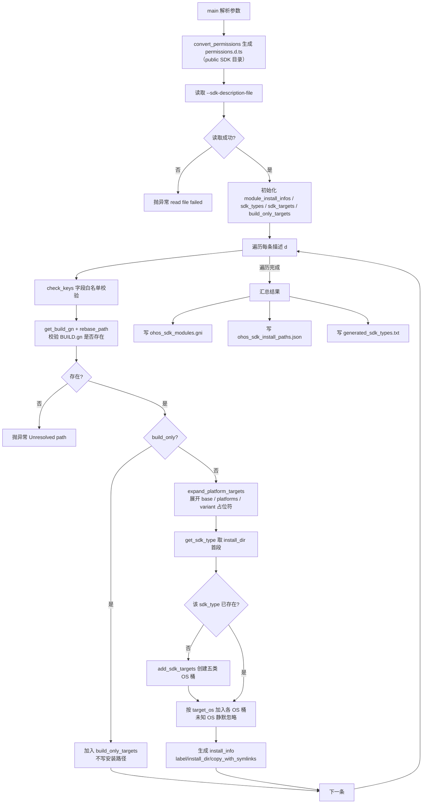

# 01.2 生成模块清单（build/ohos/sdk/parse_sdk_description.py）

> 对应 [01-GN生成期-00总览](./01-GN生成期-00总览.md)「环节 01 · 步骤 01.2」。
> 把扁平 SDK 描述 JSON 展开为「按 SDK 类型 / OS 分组的 GN 变量」，
> 同时生成安装路径表和 SDK 类型列表。

## 1. 脚本定位

| 项       | 内容                                                                                              |
| -------- | ------------------------------------------------------------------------------------------------- |
| 脚本路径 | `build/ohos/sdk/parse_sdk_description.py`                                                     |
| 归属领域 | 编译构建（build 仓）                                                                               |
| 调用位置 | `build/ohos/sdk/BUILD.gn`（变量名 `parse_script`）                                          |
| 调用方式 | GN 生成期 `exec_script`（不是 ninja 的 action）                                                 |
| 触发条件 | `if (!use_current_sdk)` 成立，在 `sdk_build_public`/`sdk_build_arkts` 过滤之后始终执行                                      |
| 一句话   | 展开 `${base}/${platforms}/${variant}` 占位符，把描述 JSON 变为「按 SDK 类型 / OS 分组的 GN 变量」，同时生成安装路径表和 SDK 类型列表 |

流程位置：`parse_description.py`（01.1）→ **本脚本** → `generate_all_types_sdk.py`（01.3）。

`BUILD.gn` 中的调用（节选）：

```gn
parse_args = [
  "--sdk-description-file",
  rebase_path(ohos_sdk_description_file, root_build_dir),
  "--sdk-modules-gni",         rebase_path(generated_sdk_modules_gni, root_build_dir),
  "--sdk-install-info-file",   rebase_path(generated_sdk_module_install_paths, root_build_dir),
  "--sdk-types-file",          rebase_path(generated_sdk_types_file, root_build_dir),
  "--base-platform", "phone",
  "--variant-to-product",      rebase_path("./variant_to_product.json", root_build_dir),
  "--source-root-dir",         rebase_path("//", root_build_dir),
  "--node-js",                 rebase_path(nodejs, root_build_dir),
]
foreach(p, target_platform_list) {
  parse_args += [ "--platforms", p ]
}
exec_script(parse_script, parse_args)
sdk_types = read_file(generated_sdk_types_file, "list lines")
import("${generated_sdk_modules_gni}")
```

## 2. 命令行参数

九个参数均为必填：

| 参数                        | 含义                                          | 实际取值（BUILD.gn）                                   |
| --------------------------- | --------------------------------------------- | ------------------------------------------------------ |
| `--sdk-description-file`  | 输入描述文件（已按 `sdk_build_public`/`sdk_build_arkts` 过滤）           | `out/<产品>/sdk-interface/ohos_sdk_pub_description_std.json` |
| `--sdk-modules-gni`       | 输出 1：SDK 模块 GN 变量文件                  | `out/<产品>/gen/build/ohos/sdk/ohos_sdk_modules.gni`        |
| `--sdk-install-info-file` | 输出 2：安装路径表                            | `out/<产品>/gen/build/ohos/sdk/ohos_sdk_install_paths.json` |
| `--sdk-types-file`        | 输出 3：SDK 类型列表文本                      | `out/<产品>/gen/build/ohos/sdk/generated_sdk_types.txt`     |
| `--base-platform`         | 基础平台，用于 `${base}` 占位符展开         | `phone`                                              |
| `--platforms`             | 目标平台列表，`action='append'`，可重复传入 | `target_platform_list` 中的每一项                    |
| `--source-root-dir`       | 源码根目录，用于校验 `BUILD.gn` 是否存在    | `rebase_path("//", root_build_dir)`                  |
| `--variant-to-product`    | 变体 → 产品名映射文件                        | `build/ohos/sdk/variant_to_product.json`             |
| `--node-js`               | Node.js 可执行文件路径，供权限转换使用        | `nodejs`                                             |

## 3. 输入描述文件格式

输入是 JSON **数组**，每条描述至少包含可解析的 `module_label`。脚本实际读取字段如下：

| 字段                   | 类型     | 是否必填 | 说明                                       |
| ---------------------- | -------- | -------- | ------------------------------------------ |
| `module_label`       | string   | 是       | GN 目标标签，如 `//interface/sdk-js:api` |
| `install_dir`        | string   | 是       | SDK 内安装目录，同时决定 `sdk_type`      |
| `target_os`          | string[] | 是       | 目标 OS 列表，决定模块进入哪些 OS 分组     |
| `build_only`         | bool     | 否       | 为真时只构建、不写安装路径（见第 4 节 ⑤）     |
| `copy_with_symlinks` | bool     | 否       | 拷贝时是否保留软链，默认 `False`         |

`check_keys` 的作用是：**凡是出现的 key 必须命中白名单** `KEYS`，否则抛异常。
（异常文案写的是 `missing`，实际含义是「出现未知字段」，并不强制五个字段都出现。）

```python
KEYS = ['target_os', 'install_dir', 'module_label', 'build_only', 'copy_with_symlinks']
```

输入示例：

```json
[
  {
    "install_dir": "ets/",
    "module_label": "//interface/sdk-js:api",
    "target_os": ["linux", "windows", "darwin", "ohos"]
  },
  {
    "install_dir": "toolchains",
    "module_label": "//developtools/hdc:hdc",
    "target_os": ["linux", "windows"],
    "copy_with_symlinks": true
  }
]
```

**变体映射文件** `variant_to_product.json` 把平台变体映射为产品名，`${platforms}` / `${variant}` 展开时使用：

```json
{
  "ivi": "car",
  "wearable": "wearable",
  "phone": "default",
  "intellitv": "tv"
}
```

`variant_to_product()` 每次调用都重新读取该文件；未命中映射时抛异常。

## 4. 处理逻辑

`main()` 先执行权限文件转换，再调用 `parse_description_file()` 解析，最后写三个产物。



**① `SdkTargets` —— 按 OS 去重收集目标**

```python
class SdkTargets:
    def __init__(self, os_type):
        self.os_type = os_type
        self.targets = []

    def add_target(self, target):
        if target not in self.targets:
            self.targets.append(target)
```

每个 `sdk_type` 内固定创建 `linux`、`windows`、`darwin`、`ohos`、`linux_arm64`
五个 `SdkTargets` 桶；同一桶内相同 label 只保留一次。

**② `get_sdk_type` —— 由安装目录推导 SDK 类型**

取 `install_dir` 的**第一段目录**作为 SDK 类型：

| `install_dir`  | `sdk_type`   |
| ---------------- | -------------- |
| `ets/`         | `ets`        |
| `ets/dynamic/` | `ets`        |
| `toolchains`   | `toolchains` |

注意：这里用的是描述文件里的**原始** `install_dir`，不是占位符展开后的值。

**③ `get_build_gn` + `rebase_path` —— 校验目标存在**

```python
def get_build_gn(label):
    match = re.search(r"(.*?):(.*?)", label)
    gn = '{}/BUILD.gn'.format(match.group(1))
    return gn[2:] if gn.startswith("//") else gn
```

把 `//foo/bar:baz` 变成 `foo/bar/BUILD.gn`，再用
`build_utils.rebase_path(..., current_base=source_root)` 拼成绝对路径。
文件不存在则抛 `Unresolved path: ..., label is ...`，**在 `build_only` 判断之前执行**，
因此 `build_only` 条目同样要求 `BUILD.gn` 存在。

**④ `expand_platform_targets` —— 占位符展开**

按 `label` 中出现的占位符依次判断（顺序不可颠倒）：

| 占位符            | 触发条件               | label 展开                                            | install_dir 展开                                    |
| ----------------- | ---------------------- | ----------------------------------------------------- | ---------------------------------------------------- |
| `${base}`       | label 含 `${base}`   | 替换为 `--base-platform`                              | **不展开**，原样返回                                  |
| `${platforms}` | 否则 label 含 `${platforms}` | 对每个 platform 各生成一个 label                 | `${platforms}` 用 `variant_to_product(platform)` 替换 |
| `${variant}`   | 否则 label 含 `${variant}`   | 对 `platforms - {base}` 中每个变体各生成一个 label | `${variant}` 用 `variant_to_product(variant)` 替换    |
| 无               | 以上都不含               | 原样返回单个 label                                    | 原样返回                                             |

由于是 `if/elif`，一个 label 只会命中一种占位符。展开后的 label 与 install_dir 按 `zip` 一一对应，用于写安装路径表。

**⑤ `build_only` —— 只构建、不安装**

```python
if build_only:
    build_only_targets.append(label)
    continue
```

命中后直接进入下一条：**不做平台展开、不分组、不写安装信息**，只把原始 label 收集到 `build_only_targets`，最终写入 `ohos_sdk_modules.gni` 的 `extras`。

**⑥ 目标分组与安装信息**

```python
module_labels, install_dirs = expand_platform_targets(options, label, install_dir)
target_os = d.get('target_os')
sdk_type = get_sdk_type(install_dir)

if sdk_type not in sdk_types:
    add_sdk_targets(sdk_type, sdk_targets)
    sdk_types.append(sdk_type)

for item in sdk_targets:
    if item['type'] == sdk_type:
        for m in module_labels:
            add_target(item, m, target_os)

for label, install_dir in zip(module_labels, install_dirs):
    module_install_infos.append({
        'label': label,
        'install_dir': install_dir,
        'copy_with_symlinks': copy_with_symlinks,
    })
```

`add_target` 把 label 写进 `target_os` 对应的桶，OS 名大小写不敏感
（`linux`/`Linux`、`windows`/`Windows`、`darwin`/`Darwin`、`ohos`/`Ohos`、`linux_arm64`/`Linux_arm64`）；
**不在列表中的 OS 会被静默忽略**。

**⑦ `convert_permissions` —— 权限声明转换（解析前预处理）**

`main()` 在解析前调用：

```python
convert_permissions(options.source_root_dir,
                    "out/sdk-public/public_interface/sdk-js",
                    "permissions.d.ts", options.node_js)
```

内部步骤（`build/ohos/sdk/convert_permissions.py`，路径相对源码根目录）：

1. `interface/sdk-js` → `out/sdk-public/public_interface/sdk-js`（目标不存在时整目录拷贝）；
2. `.../sdk-js/api` → `.../sdk-js/build-tools/api`；
3. 用 `--node-js` 执行 `interface/sdk-js/build-tools/permissions_converter/convert.js`，
   读取 `base/security/access_token/services/accesstokenmanager/permission_definitions.json`，
   生成 `build-tools/api/permissions.d.ts`；
4. 用生成结果覆盖 `api/permissions.d.ts`。

> 同一个转换工具还有另一处调用：环节 02 的 `ohos_base_split`
> 会对 `out/<产品>/sdk-interface/{dynamic,static}/sdk-js` 各执行一遍。两处共用
> `convert_permissions.py`，只是输出目录不同：本处是 public SDK 目录
> `out/sdk-public/public_interface/sdk-js`，另一处是接口树目录，见 [02-接口源文件拆分-06生成权限声明](./02-接口源文件拆分-06生成权限声明.md)。

## 5. 输出一：`out/<产品>/gen/build/ohos/sdk/ohos_sdk_modules.gni`

由 Jinja2 模板渲染，SDK 类型名中的 `-` 替换为 `_`，固定包含五个 OS 桶，最后附加 `extras`：

```gn
#Generated code, DONOT modify it.
ohos_sdk_modules = {
    ets = {
        linux = [
            "//interface/sdk-js:api",
        ]
        windows = [
            "//interface/sdk-js:api",
        ]
        darwin = [
            "//interface/sdk-js:api",
        ]
        ohos = [
            "//interface/sdk-js:api",
        ]
        linux_arm64 = [
        ]
    }
    toolchains = {
        ...
    }
    extras = [
        "//some/module:build_only_target",
    ]
}
```

- label 在 `add_target` 中已被加上引号和逗号；
- `extras` 即 `build_only_targets`；
- 通过 `file_utils.write_file` 写入，因后缀为 `.gni`，会额外调用 `gn format` 格式化。

## 6. 输出二：`out/<产品>/gen/build/ohos/sdk/ohos_sdk_install_paths.json`

`write_json_file` 写出（`sort_keys=True, indent=2`），元素结构：

```json
[
  {
    "copy_with_symlinks": false,
    "install_dir": "ets/",
    "label": "//interface/sdk-js:api"
  },
  {
    "copy_with_symlinks": true,
    "install_dir": "toolchains",
    "label": "//developtools/hdc:hdc"
  }
]
```

该文件在 `sdk.gni` 中通过 `--sdk-archive-paths-file` 传给
`build/ohos/sdk/copy_sdk_modules.py`，按 `label` 匹配模块产物、按 `install_dir` 计算目标路径并拷贝，
`copy_with_symlinks` 控制 `shutil.copytree` 是否保留软链。

## 7. 输出三：`out/<产品>/gen/build/ohos/sdk/generated_sdk_types.txt`

```python
with open(options.sdk_types_file, 'w') as f:
    f.write('\n'.join(data.get('sdk_types')))
```

每行一个 SDK 类型，**无结尾换行**。`BUILD.gn` 用
`read_file(generated_sdk_types_file, "list lines")` 读取，作为 `--sdk-types` 传给
`generate_all_types_sdk.py`（01.3），并用于 `generated_ohos_sdk` 的依赖汇总。

## 8. 关键细节

1. **字段白名单**：`check_keys` 只拦截未知字段，缺少字段不会在此报错，但缺少
   `module_label` 会在 `get_build_gn` 的 `re.search` 处因 `None` 失败；
2. **先校验后跳过**：`build_only` 判断在校验 `BUILD.gn` 之后，因此 `build_only` 模块的 `BUILD.gn` 也必须存在；
3. **sdk_type 取首段**：`ets/dynamic/` 与 `ets/static/` 都会归入 `ets`，不会因 `dynamic`/`static` 拆分出不同类型；
4. **占位符分支互斥**：`${base}` 优先于 `${platforms}`，`${platforms}` 优先于 `${variant}`；`${base}` 分支不展开 `install_dir`；
5. **未知 OS 静默丢弃**：`add_target` 只识别五种 OS（含大小写变体），其它值不会报错；
6. **去重粒度**：同一 `sdk_type` 的同一 OS 桶内 label 去重；不同 OS 独立；
7. **gni 会被格式化**：`write_file` 对 `.gni` 自动调用 `gn format`，模板缩进不必精确；
8. **类型列表无结尾换行**：`'\n'.join` 直接写盘，下游按行读取。
