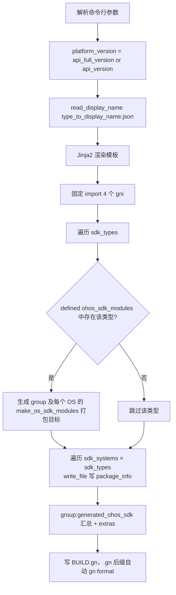

# 01.3 打包 BUILD 渲染（build/ohos/sdk/generate_all_types_sdk.py）

> 对应 [01-GN生成期-00总览](./01-GN生成期-00总览.md)「环节 01 · 步骤 01.3」。
> 用 Jinja2 渲染出「每个 SDK 类型 × 每个 OS」的打包目标 `BUILD.gn`，
> 并顺带为每个类型/OS 写入 `oh-uni-package.json`。

## 1. 脚本定位

| 项       | 内容                                                                                                                       |
| ----- | -------------------------------------------------------------------------------------------------------------------------- |
| 脚本路径 | `build/ohos/sdk/generate_all_types_sdk.py`                                                                             |
| 归属领域 | 编译构建（build 仓）                                                                                                         |
| 调用位置 | `build/ohos/sdk/BUILD.gn`（变量名 `generate_all_types_sdk_script`）                                                 |
| 调用方式 | GN 生成期 `exec_script`                                                                                                  |
| 触发条件 | `if (!use_current_sdk)` 成立，在 `parse_sdk_description.py`（01.2）之后始终执行                                        |
| 一句话   | 用 Jinja2 按「SDK 类型 × OS」渲染打包目标 `BUILD.gn`（供 GN import、ninja 执行拷贝/打包），并为每个类型/OS 写入 `oh-uni-package.json` |

流程位置：`parse_sdk_description.py`（01.2）→ **本脚本** → GN `import` 生成物、ninja 执行拷贝/打包。

`BUILD.gn` 中的调用（节选）：

```gn
generate_all_types_sdk_script = "//build/ohos/sdk/generate_all_types_sdk.py"
generated_build_gn = "$generated_files_dir/BUILD.gn"
generate_args = [
  "--sdk-modules", "ohos_sdk_modules",
  "--output", rebase_path(generated_build_gn, root_build_dir),
  "--current-dir", get_path_info(sdk_base_build_gn, "dir"),
  "--generated-sdk-modules-gni", generated_sdk_modules_gni,
  "--type2displayname", rebase_path("./type_to_display_name.json", root_build_dir),
  "--api-version", api_version,
  "--release-type", release_type,
  "--meta-version", meta_version,
]
if (point_split) {
  generate_args += [ "--api-full-version", api_full_version ]
}
foreach(os, sdk_systems) { generate_args += [ "--sdk-systems", os ] }
foreach(sdk_type, sdk_types) { generate_args += [ "--sdk-types", sdk_type ] }
exec_script(generate_all_types_sdk_script, generate_args)
```

## 2. 命令行参数

| 参数                            | 必填 | 含义                                          | 取值来源                                      |
| ------------------------------- | ---- | --------------------------------------------- | --------------------------------------------- |
| `--output`                    | 是   | 渲染出的 `BUILD.gn` 路径                    | `out/<产品>/gen/build/ohos/sdk/BUILD.gn`    |
| `--sdk-modules`               | 否   | 生成物中引用的 GN 变量名前缀                  | 固定为 `ohos_sdk_modules`                   |
| `--generated-sdk-modules-gni` | 否   | 生成物 import 的 gni 路径（01.2 产物）         | `out/<产品>/gen/build/ohos/sdk/ohos_sdk_modules.gni` |
| `--sdk-systems`               | 否   | 目标 OS，`action='append'`，可多次传入      | `foreach(os, sdk_systems)`                  |
| `--sdk-types`                 | 否   | SDK 类型，`action='append'`，可多次传入     | `generated_sdk_types.txt` 的每一行          |
| `--type2displayname`          | 否   | SDK 类型 → 显示名映射                        | `build/ohos/sdk/type_to_display_name.json`  |
| `--current-dir`               | 否   | 兼容参数，模板中并未使用                      | `get_path_info(sdk_base_build_gn, "dir")`   |
| `--api-version`               | 否   | API 版本                                      | `api_version`                               |
| `--api-full-version`          | 否   | 完整 API 版本，默认 `''`                    | `point_split` 为真时传 `api_full_version` |
| `--release-type`              | 否   | 发布类型，空串表示不输出 `releaseType`      | `release_type`                              |
| `--meta-version`              | 否   | meta 版本，空串表示不输出 `meta`            | `meta_version`                              |
| `--sdk-class`                 | 否   | SDK 类别，仅在 `--use-current-sdk` 分支使用 | `sdk_class`（`current_sdk` 模板）         |
| `--use-current-sdk`           | 否   | `store_true`，切换为 current-sdk 产物布局   | `current_sdk` 模板时传入                    |

注意：`--sdk-systems` / `--sdk-types` 在 argparse 中并非 `required`，缺省时只是渲染出空循环。

## 3. 显示名映射文件 `type_to_display_name.json`

```json
{
  "toolchains": "Toolchains",
  "js": "Js",
  "java": "Java"
}
```

模板渲染时对每个 `sdk_type` 查表；**查不到则用 `sdk_type.capitalize()` 兜底**（如 `ets` → `Ets`）。

## 4. 处理逻辑

脚本本身很薄：解析参数 → 读取显示名 → Jinja2 渲染 → `write_file` 写盘。真正的「处理逻辑」在模板里。



**① `main()` 的少量计算**

```python
platform_version = options.api_full_version if options.api_full_version else options.api_version
```

`platformVersion` 优先取 `--api-full-version`，否则退回 `--api-version`。
显示名通过 `read_json_file(options.type2displayname)` 读入，作为 `display_name` 传入模板。

**② 固定导入段**

模板开头固定生成：

```gn
import("//build/ohos/build_var.gni")
import("//build/ohos/sdk/sdk.gni")
import("${build_configs_path}/platforms_list.gni")
import("<--generated-sdk-modules-gni 的值>")
```

依赖 `sdk.gni` 提供 `make_<os>_sdk_modules`、`copy_and_archive` 等模板。

**③ 每个 SDK 类型的目标**

对 `--sdk-types` 中的每个 `sdk_type`：

1. `_sdk_type = sdk_type.replace('-', '_')`（把 `-` 换成 `_`，保证是合法 GN 标识符）；
2. 用 `if (defined(ohos_sdk_modules.<_sdk_type>))` 做存在性保护；
3. 生成一个类型聚合 group：
   ```gn
   group("<_sdk_type>") {
     public_deps = []
     public_deps += [":<_sdk_type>_<os>"]   # 每个 --sdk-systems
   }
   ```
4. 对每个 OS 生成打包目标：
   ```gn
   make_<os>_sdk_modules("<_sdk_type>_<os>") {
     sdk_type = "<sdk_type>"
     sdk_modules = <_sdk_type>s.<os>
     zipfile_name = "..."
   }
   ```

   其中 `<sdk_type>s` 是模板里对 `ohos_sdk_modules.<_sdk_type>` 的别名，`sdk_modules` 即 01.2 生成的 OS 桶 label 列表。

**④ `zipfile_name` 的构造**

模板按 `release_type` 是否为空输出两种：

```gn
# release_type 为空
zipfile_name = "${sdk_type}-${sdk_system_<os>}-<arch>-${current_sdk_version}.zip"
# release_type 非空时追加 -${release_type}
zipfile_name = "${sdk_type}-${sdk_system_<os>}-<arch>-${current_sdk_version}-${release_type}.zip"
```

- `<os>` 为 `os.replace('-', '_')`，如 `linux_arm64`；
- `<arch>`：`os == 'ohos'` 用 `${target_arch}`，其它用 `${arch}`；
- 这些是 **GN 变量引用**，在 GN 求值期才展开，脚本只负责写模板文本。

**⑤ `oh-uni-package.json` 生成**

模板在顶层 `foreach(os, sdk_systems)` 中，对每个类型/OS 调用 GN 内置
`write_file(package_info_file, package_info, "json")`，即**在 GN 生成期直接落盘**。

目标路径按场景选择：

| 场景                                             | `package_info_file`                                                                     |
| ------------------------------------------------ | ----------------------------------------------------------------------------------------- |
| `ext_ndk_config_file` 非空（NDK）              | `out/<产品>/ohos-sdk/<os>/<sdk_type>/uni-package.json`                                    |
| 普通 SDK                                         | `out/<产品>/ohos-sdk/<os>/<sdk_type>/oh-uni-package.json`                                 |
| `--use-current-sdk`                            | `out/<产品>/<sdk_class>-current-sdk/<os>/<api_version>/<sdk_type>/oh-uni-package.json` |
| `--use-current-sdk` 且 `sdk_class != "base"` | 同上，但文件名为 `uni-package.json`                                                     |

写入内容：

```gn
package_info = {
  path = "<sdk_type>"
  displayName = "<查表值或 capitalize>"
  version = current_sdk_version
  apiVersion = "<api_version>"
  platformVersion = "<platform_version>"
  if (defined(ext_ndk_config_file) && ext_ndk_config_file != "") {
    platformVersion = platform_version
  }
  # release_type != "" 时： releaseType = "<release_type>"
  # meta_version != "" 时： meta = { metaVersion = "<meta_version>" }
}
```

`platformVersion` 细节：普通情况写死字符串 `"<platform_version>"`；NDK 场景改写为 GN 变量 `platform_version`，由 GN 求值。

**⑥ 汇总目标 `generated_ohos_sdk`**

模板末尾：

```gn
group("generated_ohos_sdk") {
  public_deps = []
  # 每个 sdk_type：defined 时依赖 ":<_sdk_type>"
  public_deps += ohos_sdk_modules.extras   # 01.2 的 build_only 目标
}
```

各类型 group 依赖各自的 `:<type>_<os>` 打包目标；`extras` 只参与构建、不打包。

**⑦ 写盘**

`write_file(options.output, contents)`，后缀为 `.gn` / `.gni` 时自动 `gn format`。

## 5. 输出

| 产物                                           | 说明                                                       |
| ---------------------------------------------- | ---------------------------------------------------------- |
| `out/<产品>/gen/build/ohos/sdk/BUILD.gn`               | 由 Jinja2 渲染，`gn format` 格式化                       |
| `out/<产品>/ohos-sdk/<os>/<sdk_type>/oh-uni-package.json` | GN 生成期由 `write_file` 直接写入（每个类型 × OS 一份） |

渲染结果示意（`sdk_types = ["ets"]`、`sdk_systems = ["linux"]`、无 release/meta）：

```gn
#Generated code, DONOT modify it.
import("//build/ohos/build_var.gni")
import("//build/ohos/sdk/sdk.gni")
import("${build_configs_path}/platforms_list.gni")
import("out/<产品>/gen/build/ohos/sdk/ohos_sdk_modules.gni")

  if (defined(ohos_sdk_modules.ets)) {
    etss = ohos_sdk_modules.ets
    group("ets") {
      public_deps = []
        public_deps += [":ets_linux"]
    }
    make_linux_sdk_modules("ets_linux") {
      sdk_type = "ets"
      sdk_modules = etss.linux
      zipfile_name = "${sdk_type}-${sdk_system_linux}-${arch}-${current_sdk_version}.zip"
    }
  }

foreach(os, sdk_systems) {
    package_info_file = "$ohos_sdk_copy_dir/$os/ets/oh-uni-package.json"
    package_info = {
      path = "ets"
      displayName = "Ets"
      version = current_sdk_version
      apiVersion = "12"
      platformVersion = "12"
    }
    write_file(package_info_file, package_info, "json")
}

group("generated_ohos_sdk") {
  public_deps = []
    if (defined(ohos_sdk_modules.ets)) { public_deps += [ ":ets" ] }
  public_deps += ohos_sdk_modules.extras
}
```

**下游消费**：

- 生成物位于 `out/<产品>/gen/build/ohos/sdk/BUILD.gn`，其中 `group("generated_ohos_sdk")`
  作为入口，被 `build/ohos/sdk/BUILD.gn` 的 `group("ohos_sdk_pre")` 通过
  `deps += [ "${generated_files_dir}:generated_ohos_sdk" ]` 依赖；
- `make_<os>_sdk_modules` / `make_sdk_modules` 展开后：解析各模块 label，生成 `sdk_modules.json`，
  通过 `copy_and_archive` 调 `build/ohos/sdk/copy_sdk_modules.py`，按 01.2 的安装路径表拷贝并打包，
  最终产出 `out/<产品>/packages/ohos-sdk/<os>/<zipfile_name>`（`ohos_sdk_out_dir = $product_output_dir/${product_name}`
  即 `out/<产品>/packages/ohos-sdk`）。

## 6. 关键细节

1. **脚本只做渲染**：除 `platform_version` 兜底和读显示名外没有业务计算；
2. **类型名合法化**：`-` → `_` 仅用于 GN 标识符；`sdk_type = "<原值>"` 仍保留原始类型名；
3. **defined 保护**：只有 gni 中存在的类型才生成 group 与打包目标，避免引用未定义变量；
4. **zipfile_name 是 GN 表达式**：脚本写出的是含 `${sdk_type}`、`${sdk_system_os}`、`${current_sdk_version}` 的文本，实际文件名在 GN 求值期生成；
5. **`--current-dir` 未被模板使用**：属于兼容保留；
6. **`--sdk-class` 只在 current-sdk 分支生效**；普通 SDK 忽略；
7. **NDK 包名差异**：`ext_ndk_config_file` 非空时用 `uni-package.json`，否则用 `oh-uni-package.json`；
8. **package_info 在生成期落盘**：不要误以为它是 ninja action 产物，缺失时会在 GN 生成阶段直接报错；
9. **空输入也合法**：不传 `--sdk-systems` / `--sdk-types` 时仍会生成一个只有空 `generated_ohos_sdk` 的文件。
