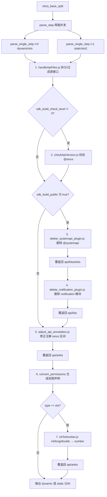

# 02 接口源文件拆分（总览）

> 对应 [00-overview](./00-overview.md)「环节 02」，是整个链路的**地基**。
> 定义在 `interface/sdk-js/BUILD.gn:24`，脚本 `build/ohos/sdk/parse_interface_sdk.py`（build 仓）。
> 本总览只保留环节概览与工具总表，7 个 Node 工具的完整逻辑见 02.1~02.7 分篇。

## 1. 环节职责

| 项      | 内容                                                                                        |
| ------- | ------------------------------------------------------------------------------------------- |
| GN 目标 | `action("ohos_base_split")`，`script = //build/ohos/sdk/parse_interface_sdk.py`         |
| 归属领域 | sdk（`parse_interface_sdk.py` 代码在 build 仓，由 sdk 提供并维护；7 个 Node 工具在 interface/sdk-js 仓） |
| deps    | `host_toolchain` 下挂 `build_ohos_ets_es2panda`（`build_ohos_sdk && !is_arkui_x` 时） |
| 输入    | `interface/sdk-js/{api,arkts,kits,@internal,...}` + 各开关                                |
| 输出    | `out/<产品>/sdk-interface/{dynamic,static}/sdk-js` 两棵接口树                             |
| 一句话  | 由 `parse_interface_sdk.py` 调度 7 个 Node 工具，把源接口清洗、校验、裁剪成 dynamic（ets）/ static（ets2）两套完整接口树，供后续所有环节消费            |

所有下游（目录级过滤、内部目录、装配、清标签、interop…）都直接或间接 `deps = [":ohos_base_split"]`，
因此它一定是链路上最先执行的 action。

`build/ohos/sdk/parse_interface_sdk.py` 本身是调度器，不解析 TypeScript；真正的语法级处理由
`interface/sdk-js/build-tools/` 下的 Node 工具完成。`ohos_base_split` 的 `deps` 会条件带上
es2panda 工具链（按 host 工具链 mac/win/linux 选择），仅 `build_ohos_sdk == true` 且非
`is_arkui_x` 时加入——因为 `delete_systemapi_plugin.js`（02.3）内部要调用 es2panda 做语法级删除。

> 运行构建的 CWD 是 OpenHarmony 源码树根目录，脚本内所有路径都基于 `--root-build-dir`
> （`//` 对应绝对路径）拼接。

## 2. 调用命令与参数

```text
action("ohos_base_split") {
  script = "//build/ohos/sdk/parse_interface_sdk.py"
  outputs = [ "${interface_sdk_path}",
              "${interface_sdk_path_ets1}/api/bundle/bundleStatusCallback.d.ts",
              "${target_out_dir}/${target_name}.timestamp" ]
}
```

| 参数                        | 来源                      | 作用                                       |
| --------------------------- | ------------------------- | ------------------------------------------ |
| `--root-build-dir`        | `rebase_path("//")`     | 源码树根，所有相对路径基准                 |
| `--node-js`               | `nodejs`                | Node 解释器绝对路径                        |
| `--npm-path`              | `npm`                   | 保留参数，Python 中未使用                  |
| `--sdk-build-public`      | `sdk_build_public`      | `"true"` 时删 `@systemapi`（02.3）、删 Notification 模块（02.4） |
| `--sdk-build-arkts`       | `sdk_build_arkts`       | 透传给 `handleApiFiles.js`               |
| `--sdk-build-check-level` | `sdk_build_check_level` | 非 0 执行 `@since` 校验                  |
| `--sdk-api-version`       | `platform_version`      | 版本校验上限                               |
| `--output-interface-sdk`  | `interface_sdk_path`    | 输出根（`out/<产品>/sdk-interface`）     |
| `--build-sdk-path`        | `build_sdk_path`        | es2panda 工具链（`out/<产品>/ohos_ets`） |

相关路径变量：

```gni
interface_sdk_path      = "${root_out_dir}/sdk-interface"
interface_sdk_path_ets1 = "${root_out_dir}/sdk-interface/dynamic/sdk-js"
interface_sdk_path_ets2 = "${root_out_dir}/sdk-interface/static/sdk-js"
build_sdk_path          = "${root_build_dir}/ohos_ets"
```

入口与调用链：

```text
interface/sdk-js/BUILD.gn: action("ohos_base_split")
        └── script = //build/ohos/sdk/parse_interface_sdk.py
                └── parse_step() → ThreadPoolExecutor(2)
                        ├── parse_single_step(options, 0)  → dynamic/sdk-js (ets)
                        └── parse_single_step(options, 1)  → static/sdk-js  (ets2)
```

## 3. 处理流程总图

`parse_step()` 用 `ThreadPoolExecutor(2)` 并发拆出两棵树，每路依次跑 7 个 Node 工具，
中间产物暂存在 `build-tools/` 目录，处理完覆盖回 `api/`、`arkts/`、`kits/`。



`parse_single_step` 伪代码：

```python
sdk_type        = OUT_SDK_TYPE[i]           # ets / ets2
permission_file = OUT_PERMISSION_FILE[i]    # permissions.d.ts / permissions.d.ets
out_path        = output_interface_sdk + OUT_ROOT_LIST[i]

copy_arkts_api_method()          # 02.1 handleApiFiles.js
if sdk_build_check_level != 0:
    check_api_version_method()   # 02.2 checkApiVersion.js
if sdk_build_public == "true":
    remove_system_api_method()   # 02.3 delete_systemapi_plugin.js
    replace api / kits / arkts
    delete_notification_method()          # 02.4 delete_notification_plugin.js
    replace api / kits
adjust_annotation_method()       # 02.5 adjust_api_annotation.js
replace api / arkts
convert_permissions()            # 02.6 permissions_converter/convert.js
if sdk_type == "ets":
    change_int_to_number()       # 02.7 intToNumber.js（10 并发）
    replace api / arkts
```

两路输出互不干扰，分别对应 `OUT_ROOT_LIST = ["dynamic/sdk-js", "static/sdk-js"]`。

## 4. 工具总表

| # | 归属领域 | Node 工具 | 分篇 | 输入 | 输出 | 处理内容 | 并发 |
| ---- | ---- | ---- | ---- | ---- | ---- | ---- | ---- |
| 02.1 | sdk | `interface/sdk-js/build-tools/handleApiFiles.js` | [01 拆分源接口](./02-01split-api.md) | `interface/sdk-js` 全量目录（`api/`、`arkts/`、`kits/` 等） | `out/<产品>/sdk-interface/{dynamic,static}/sdk-js` | 复制源接口，按 `--type` / `@arkts` 标签 / 开关筛选 | 单进程 |
| 02.2 | sdk | `interface/sdk-js/build-tools/checkApiVersion.js` | [02 API 版本校验](./02-02api-version-check.md) | `out/<产品>/sdk-interface/{dynamic,static}/sdk-js/api`、`arkts` + `--versionNumber` | stdout 错误清单 | `@since` 格式与上限校验 | 单进程 |
| 02.3 | sdk | `interface/sdk-js/build-tools/delete_systemapi_plugin.js` | [03 删除系统 API](./02-03delete-system-api.md) | `out/<产品>/sdk-interface/{dynamic,static}/sdk-js/api` + `--build-sdk-path` | `out/<产品>/sdk-interface/{dynamic,static}/sdk-js/build-tools/{api,kits,arkts}` 暂存 | 删除 `@systemapi`，`@publicapi` 转 public | 单进程（内部同步调 es2panda） |
| 02.4 | sdk | `interface/sdk-js/build-tools/delete_notification_plugin.js` | [04 删除 Notification 模块](./02-04delete-notification.md) | `out/<产品>/sdk-interface/{dynamic,static}/sdk-js/api`（同级 kits） | `out/<产品>/sdk-interface/{dynamic,static}/sdk-js/build-tools/{api,kits}` 暂存 | public 时删除 notification 模块文件并清理引用 | 单进程 |
| 02.5 | sdk | `interface/sdk-js/build-tools/adjust_api_annotation.js` | [05 修正 API 注解](./02-05api-annotation-fix.md) | `out/<产品>/sdk-interface/{dynamic,static}/sdk-js/api`（含同级 arkts） | `out/<产品>/sdk-interface/{dynamic,static}/sdk-js/build-tools/{api,arkts}` 暂存 | 修正 `[since x-y]` 区间与接口 `@since` 一致 | 单进程 |
| 02.6 | 安全领域 | `interface/sdk-js/build-tools/permissions_converter/convert.js` | [06 生成权限声明](./02-06permission-declaration.md) | `base/security/access_token/services/accesstokenmanager/permission_definitions.json` | `out/<产品>/sdk-interface/{dynamic,static}/sdk-js/api/permissions.d.ts` / `.d.ets` | 生成权限联合类型 | 单进程 |
| 02.7 | sdk | `interface/sdk-js/build-tools/intToNumber.js` | [07 数值类型转换](./02-07numeric-conversion.md) | `out/<产品>/sdk-interface/dynamic/sdk-js`（仅 dynamic） | `out/<产品>/sdk-interface/dynamic/sdk-js/build-tools/type-change/{api,arkts}` | 仅 dynamic：`int/long/double` → `number` | 10 进程并发（Python 按 `--index` 分片启动） |

## 5. 并发、容错与约束

- **并发**：
  - **调度层**：`parse_step` 用 `ThreadPoolExecutor(max_workers=2)` 同时处理
    dynamic / static 两路，7 个工具在两路内各自依次执行；
  - **环节内**：除 02.7 外均为单进程（Python 侧单个 `Popen`，工具内部不再开
    线程/进程）；02.7 `intToNumber.js` 由 Python 按 `--index` 分片一次启动
    10 个 Node 进程并发，各进程处理不同文件片。
- **容错**：Node 工具多以 `try/catch` 打印后继续；Python 侧主要依靠：
  - `checkApiVersion.js` stdout 非空 → `ValueError`；
  - 其它子进程用 `Popen + wait`，未显式检查返回码，以产物是否完整为准。
- **前置清理**：02.1 与 02.6 写输出前会 `rmtree` 目标目录，保证幂等。
- **不手改生成物**：`out/<产品>/sdk-interface/**` 均为构建产物，修改应在源仓
  `interface/sdk-js` 进行。

`replace_sdk_dir(source, dest)`：先删除 `dest`，再把 `source` 整目录复制为 `dest`（源目录保留）。

## 6. 开关对照

| 开关                      | 取值              | 行为                                                          |
| ------------------------- | ----------------- | ------------------------------------------------------------- |
| `sdk_build_public`      | `"false"`（默认） | `sdk_build_public != "true"` 保留 `@systemapi`（完整 SDK） |
|                           | `"true"`          | `sdk_build_public == "true"` 执行 02.3 删除系统 API、02.4 删除 Notification 模块 |
| `sdk_build_arkts`       | `"true"` / `"false"` | `sdk_build_arkts == "true"` 保留 ArkTS static 内容          |
| `sdk_build_check_level` | `"0"`（默认）     | 跳过 02.2 版本校验                                            |
|                           | 非 `"0"`           | 执行 `@since` 上限校验，超限构建失败                        |
| `sdk_type`              | `ets`           | dynamic 全流程含 02.6；static 不做类型转换，权限为 `.d.ets` |
|                           | `ets2`          | static 全流程，不做数值类型转换，权限文件为 `.d.ets`        |

## 7. 输出与下游消费

| 产物                                                                         | 消费方                                                                                           |
| ---------------------------------------------------------------------------- | ------------------------------------------------------------------------------------------------ |
| `out/<产品>/sdk-interface/dynamic/sdk-js`                                  | 目录级过滤（环节 03）、内部目录（环节 04）、装配（环节 05）、interop（环节 06）、清标签（环节 08）… |
| `out/<产品>/sdk-interface/static/sdk-js`                                   | 同上，static（ets2）分支                                                                         |
| `out/<产品>/sdk-interface/{dynamic,static}/sdk-js/build-tools`             | 各 Node 工具中转暂存（非最终产物）                                                               |
| `out/<产品>/sdk-interface/{dynamic,static}/sdk-js/build-tools/type-change` | `intToNumber.js` 的中转目录                                                                    |
| `out/<产品>/ohos_ets`                                                      | `--build-sdk-path`，es2panda 解析依赖                                                          |

`ohos_base_split` 完成后，`interface/sdk-js/BUILD.gn` 继续消费两套接口树：

- `ohos_declaration_template` / `interface/sdk-js/remove_internal.py`：目录级过滤产出常规声明目录；
- `ohos_copy_internal` / `interface/sdk-js/process_internal.py`：处理 `@internal` 等内部目录；
- `ohos_handle_declaration_template` / `interface/sdk-js/delete_arkui_label.py`：处理 ArkUI noninterop 标签；
- `interface/sdk-js/copy_runtimeapi.py` / `interface/sdk-js/build-tools/delete_unpublished_plugin.js`：处理 `@unpublished`；
- 最终由 SDK 打包目标汇总为对外的 `ets` / `ets2` API 包。

本阶段只负责最前面的"一份源码 → 两套基础接口树"，后续均以这两棵接口树为输入。

## 8. 相关文件

| 文件                                                                                    | 作用                                                           |
| --------------------------------------------------------------------------------------- | -------------------------------------------------------------- |
| `build/ohos/sdk/parse_interface_sdk.py`                                               | 调度脚本（条件判断、构造命令、`rmtree`/`replace_sdk_dir`） |
| `interface/sdk-js/build-tools/handleApiFiles.js`                                      | 拆分/过滤                                                      |
| `interface/sdk-js/build-tools/handle_api_dynamic_delete.json`                         | dynamic 专用删除清单                                           |
| `interface/sdk-js/build-tools/handleDynamicApiFiles.js` / `handleStaticApiFiles.js` | 拆分出的 dynamic/static 实现（当前主流程未直接引用）           |
| `interface/sdk-js/build-tools/checkApiVersion.js`                                     | 版本校验                                                       |
| `interface/sdk-js/build-tools/delete_systemapi_plugin.js`                             | 删系统 API                                                     |
| `interface/sdk-js/build-tools/delete_systemapi_plugin_dynamic.js` / `_static.js`    | 拆分版本实现（当前 Python 调用的是主文件）                     |
| `interface/sdk-js/build-tools/delete_notification_plugin.js`                          | public 删 notification 模块并清理引用                          |
| `interface/sdk-js/build-tools/package_tools/src/deleteTool/entry.js`                  | es2panda 语法级删除入口                                        |
| `interface/sdk-js/build-tools/adjust_api_annotation.js`                               | 注解修正                                                       |
| `interface/sdk-js/build-tools/permissions_converter/convert.js`                       | 权限声明                                                       |
| `interface/sdk-js/build-tools/intToNumber.js`                                         | 数值类型转换                                                   |
| `base/security/access_token/services/accesstokenmanager/permission_definitions.json`  | 权限定义输入                                                   |

> 维护建议：7 个工具都是「暂存目录 → 覆盖回正式目录」模式，改动任一工具后
> 只需验证 `out/<产品>/sdk-interface/{dynamic,static}/sdk-js` 两棵树的完整性与
> 开关组合；新增过滤规则时优先落在 02.1 的 `handle_api_dynamic_delete.json`。
