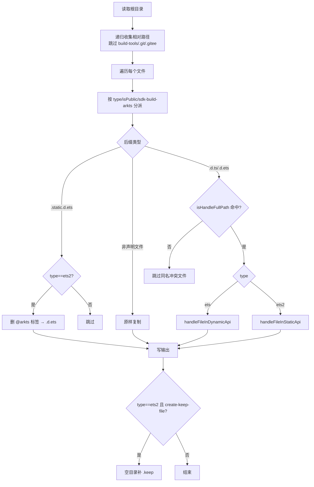

# 02.1 拆分源接口（interface/sdk-js/build-tools/handleApiFiles.js）

> 对应 [02-00interface-split-overview](./02-00interface-split-overview.md)「环节 02 · 步骤 02.1」。
> 递归扫描 `interface/sdk-js`，按 `--type` 与 `@arkts` 标签产出
> `dynamic/sdk-js` 或 `static/sdk-js` 基础接口树。

## 1. 脚本定位

| 项          | 内容                                                                                          |
| ----------- | --------------------------------------------------------------------------------------------- |
| Python 函数 | `copy_arkts_api_method`（`build/ohos/sdk/parse_interface_sdk.py:66`）                     |
| Node 工具   | `interface/sdk-js/build-tools/handleApiFiles.js`                                           |
| 归属领域    | sdk（Node 工具在 interface/sdk-js 仓）                                                       |
| 触发条件    | 始终执行，dynamic / static 两路并发各执行一次                                                 |
| 作用        | 递归扫描 `interface/sdk-js`，按 `--type` 与 `@arkts` 标签产出 `dynamic/sdk-js` 或 `static/sdk-js` 基础接口树 |

> 函数名叫 `copy_arkts_api_method`，但实际是**主拆分/过滤步骤**，决定后续所有步骤的输入。

## 2. 调用命令

```text
node interface/sdk-js/build-tools/handleApiFiles.js \
    --path          interface/sdk-js \
    --output        out/<产品>/sdk-interface/{dynamic|static}/sdk-js \
    --type          {ets|ets2} \
    --isPublic      {true|false} \
    --create-keep-file true \
    --sdk-build-arkts {true|false}
```

Python 在启动 Node 前会先 `rmtree(output)`，保证输出目录干净（幂等）。

## 3. 输入与输出

| 类别 | 内容                                                                                                                     |
| ---- | ------------------------------------------------------------------------------------------------------------------------ |
| 输入 | `interface/sdk-js` 全量目录（递归，跳过 `build-tools`、`.git`、`.gitee`）                                        |
| 输入 | `interface/sdk-js/build-tools/handle_api_dynamic_delete.json`（仅 dynamic 使用的删除清单）                        |
| 参数 | `--type`：`ets`（dynamic）或 `ets2`（static）；`--sdk-build-arkts` 决定是否保留仅 static 内容                    |
| 输出 | `out/<产品>/sdk-interface/dynamic/sdk-js` 或 `out/<产品>/sdk-interface/static/sdk-js`，包含 `api/`、`arkts/`、`kits/` 等 |
| 输出 | static 场景下为空目录补 `.keep`（`api`、`api/@internal/ets`、`api/arkui/component`、`arkts`、`kits`）        |

## 4. 处理流程



## 5. dynamic（ets）处理规则

入口 `handleFileInDynamicApi`：

1. **条件块展开** `handleArktsDefinition`：处理 `/*** if arkts dynamic|static|dynamic&static */ ... /*** endif */`，只保留 dynamic 分支。
2. **仅 dynamic 删除清单**：`--sdk-build-arkts != true` 时，
   `handleApiFileByType` 先按 `deleteFilesOnlydynamicList` 整文件跳过；
   文件内接口按 `deleteApisOnlydynamicMap`（文件 → 需删除的声明文本）由 `deleteApi` 删除。
3. **`@since` 归一**：
   - `@since arkts {'1.1':x,'1.2':y}` → `@since x dynamic`（`handleSinceInFirstType`）；
   - 去掉 `@since` 后缀的 `dynamic`、`static`、`dynamic&static`、`dynamiconly`、`staticonly` 修饰；
   - 删除 JSDoc 中的 `[dynamiconly]` / `[staticonly]` 标记。
4. **删除失效 export/import**：`deleteApi` 删除 API 后，用 `transformExportApi`
   清理指向已删 API 的 `export`/`import`，避免悬空引用。
5. **保留 `index-full.d.ts`**：该文件不参与接口删除，原样输出。
6. **`.static.d.ets` 在 dynamic 下直接跳过**（仅 static 需要）。

输出文件后缀保持源文件后缀；`.static.d.ets` 目标在 static 场景才转 `.d.ets`。

## 6. static（ets2）处理规则

入口 `handleFileInStaticApi`：

1. **`.static.d.ets` 特判**：`--type ets2` 时删除 `@arkts` 标签与不支持标签，
   输出路径把 `.static.d.ets` 改为 `.d.ets`。
2. **条件块展开**：只保留 static / dynamic&static 分支。
3. **补 `'use static'`**：`addStaticString` 保证文件首行存在 `'use static'`，
   若已存在且不在首行则先去掉再补。
4. **删除 1.2 不支持标签**：`deleteUnsportedTag` 删除
   `@crossplatform`、`@form`、`@atomicservice`（含可选 `[since ...]`）。
5. **`@since` 归一**：`@since arkts {'1.1':x,'1.2':y}` → `@since y static`；
   去掉相关 dynamic/static 修饰与 `[dynamiconly]/[staticonly]`。
6. **输出后缀**：`writeFile` 中当 `dirType != dynamicApi` 且文件是 `.d.ts` 时，
   写盘路径改为 `.d.ets`。
7. **`.keep` 补齐**：`--create-keep-file true` 时，对
   `api`、`api/@internal/ets`、`api/arkui/component`、`arkts`、`kits`
   中不存在或为空的目录写入 `.keep`。

## 7. 同名文件筛选（isHandleFullPath）

同一路径可能同时存在 `.d.ts`、`.d.ets`、`.static.d.ets`，按场景二选一：

| 当前文件          | dynamic（ets）                                                           | static（ets2）                                                   |
| ----------------- | ------------------------------------------------------------------------ | ---------------------------------------------------------------- |
| `.d.ts`         | 总是处理                                                                 | 无 `.d.ets`/`.static.d.ets` 时处理                           |
| `.d.ets`        | 无 `.d.ts`/`.static.d.ets` 时处理；或仅存在 `.static.d.ets` 时处理 | 无 `.d.ts`/`.static.d.ets` 时处理；或仅存在 `.d.ts` 时处理 |
| `.static.d.ets` | 跳过                                                                     | 总是处理                                                         |

`StateManagement.d.ts` 有白名单特判（避免 Linux 大小写重名）。

## 8. 关键细节

- **逐文件容错**：`handleApiFiles` 对每个文件 `try/catch`，单文件失败打印后继续。
- **非声明文件**：`.json`、`.md` 等原样复制。
- **全局状态**：`dirType`、`sdkBuildArkts`、`defaultIsDynamic` 等在单进程内共享，
  处理顺序会影响"无标签默认 dynamic/static"的判断。
- **`.d.ts` → `.d.ets`**：只在非 dynamic 场景的 `writeFile` 中发生。
- **删除清单格式**：`interface/sdk-js/build-tools/handle_api_dynamic_delete.json` 含
  `deleteFilesOnlydynamicList`（整文件）与 `deleteApisOnlydynamicMap`（文件内声明文本）。
