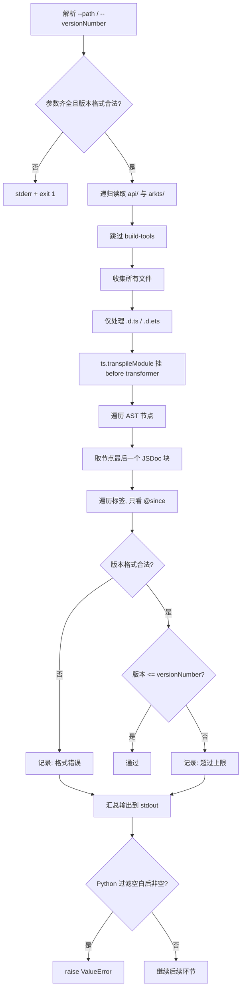

# 02.2 API 版本校验（interface/sdk-js/build-tools/checkApiVersion.js）

> 对应 [02-00interface-split-overview](./02-00interface-split-overview.md)「环节 02 · 步骤 02.2」。
> 校验接口 `@since` 版本号格式合法，且不超过 `--sdk-api-version`。

## 1. 脚本定位

| 项       | 内容                                                                          |
| -------- | ----------------------------------------------------------------------------- |
| Python 函数 | `check_api_version_method`（`build/ohos/sdk/parse_interface_sdk.py:87`） |
| Node 工具   | `interface/sdk-js/build-tools/checkApiVersion.js`                         |
| 归属领域    | sdk（Node 工具在 interface/sdk-js 仓）                                       |
| 触发条件 | `--sdk-build-check-level` 解析为整数且 `!= 0`                                 |
| 作用     | 校验接口 `@since` 版本号格式合法，且不超过 `--sdk-api-version`                  |
| 失败处理 | stdout 去掉空白后非空 → Python 抛 `ValueError`，构建失败                     |

> 代码注释写"仅在编译 dynamic 时校验"，但实现上两路 `parse_single_step` 都会判断，
> 实际由构建侧传入的 `sdk_build_check_level` 决定是否执行。

## 2. 调用命令

```text
node interface/sdk-js/build-tools/checkApiVersion.js \
    --path          out/<产品>/sdk-interface/{dynamic|static}/sdk-js \
    --versionNumber <platform_version>
```

## 3. 输入与输出

| 类别 | 内容 |
| ---- | ---- |
| 输入 | `out/<产品>/sdk-interface/{dynamic,static}/sdk-js/api`、`arkts`（递归，跳过 `build-tools`） |
| 输入 | `--versionNumber`：当前平台版本，如 `12` / `12.0.0` |
| 输出 | 不写文件；合规时 stdout 为空，不合规时 stdout 输出错误清单 |
| 输出 | 参数非法（缺参或 `--versionNumber` 格式错）时写 stderr 并 `process.exit(1)` |

## 4. 处理流程



## 5. 校验规则

### 5.1 版本号格式

```text
^[1-9][0-9]?((\.(0|[1-9][0-9]?)){2})?$
```

允许两种形式：

- 单数字：`1` ~ `99`，如 `26`；
- 三段式：`major.minor.patch`，每段 `0` ~ `99`，如 `26.0.0`。

`--versionNumber` 本身和每个 `@since` 值都用该规则校验。

### 5.2 版本比较

`compareVersions` 把版本解析为 `[major, minor, patch]`：

- 含 `.` 的三段式逐段补 0；
- 单数字视为 `[n, 0, 0]`；
- 依次比较 major → minor → patch。

`@since` 版本 > `--versionNumber` 时记录错误。

### 5.3 JSDoc 遍历

- 只处理声明文件（`.d.ts` / `.d.ets`）；
- 取每个 TS 节点 **最后一个** JSDoc 块（`jsDoc[jsDoc.length - 1]`）；
- 只检查 `tagName === 'since'` 的标签；
- 版本值优先取 `tag.comment`，否则从 `getFullText()` 去标签名得到。

### 5.4 错误信息

每条错误由 `recursionParentNode` 自底向上拼接节点名，格式形如：

```text
<相对路径>#<外层接口>#<内层成员>
```

脚本会在前面追加统一说明：

```text
The current API version must not exceed<versionNumber>, The following interface version numbers are not compliant. Please check！
Example of correct format: 26 or 26.0.0 version number range: ...
```

> `appendLineNumber` 函数存在但当前未被调用，错误信息默认不带行号。

## 6. 关键细节

- **格式错误与超限分开记录**：格式非法会附加
  `error since version: "..." is not a valid API version number`。
- **stdout 是唯一失败信号**：Python 用 `translate` 去掉空格、换行、制表符后判断是否为空；
  因此脚本即使非 0 退出，只要 stdout 为空，Python 不会主动报错。
- **不修改文件**：`ts.transpileModule` 仅用于触发 transformer，输出结果被丢弃。
- **跳过 `build-tools`**：递归读取时遇到名为 `build-tools` 的目录直接返回。
