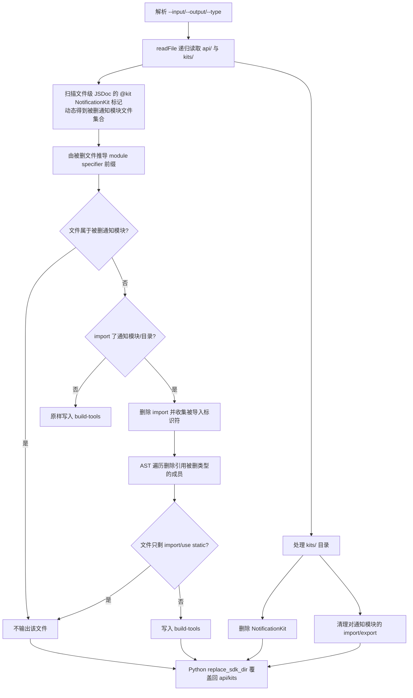

# 02.4 删除 Notification 模块（interface/sdk-js/build-tools/delete_notification_plugin.js）

> 对应 [02-00interface-split-overview](./02-00interface-split-overview.md)「环节 02 · 步骤 02.4」。
> public SDK（`sdk_build_public == "true"`）不对外提供 notification（通知）能力，
> 删除整个通知模块文件，并清理其它模块对通知类型 / 模块的引用。

## 1. 脚本定位

| 项          | 内容                                                                                      |
| ----------- | ----------------------------------------------------------------------------------------- |
| Python 函数 | `delete_notification_method`（`build/ohos/sdk/parse_interface_sdk.py`）                 |
| Node 工具   | `interface/sdk-js/build-tools/delete_notification_plugin.js`                            |
| 归属领域    | sdk（interface/sdk-js 仓，基于 TypeScript AST 处理）                                      |
| 触发条件    | `sdk_build_public == "true"`                                                           |
| 作用        | 动态识别并删除 notification 模块（目录 + 顶级文件 + kit），并清理跨模块文件对通知类型的引用 |

执行完本环节后，Python 会把暂存目录覆盖回正式目录：

```python
replace_sdk_dir(build-tools/api  → api)
replace_sdk_dir(build-tools/kits → kits)
```

## 2. 调用命令

```text
node interface/sdk-js/build-tools/delete_notification_plugin.js \
    --input  out/<产品>/sdk-interface/{dynamic|static}/sdk-js/api \
    --output out/<产品>/sdk-interface/{dynamic|static}/sdk-js/build-tools \
    --type   {ets|ets2}
```

## 3. 输入与输出

| 类别 | 内容                                                                                                   |
| ---- | ------------------------------------------------------------------------------------------------------ |
| 输入 | `out/<产品>/sdk-interface/{dynamic,static}/sdk-js/api`（已删 `@systemapi`） |
| 输入 | 同级 `kits/`（读取并清理 NotificationKit 及对通知模块的引用）                                        |
| 输出 | 暂存目录 `build-tools/api`、`build-tools/kits`（结构镜像源目录）                                      |
| 输出 | 被删除的模块文件不输出；被清理引用后的跨模块文件输出处理结果                                          |

## 4. 被整体删除的文件（动态识别）

脚本**不写死文件路径**，通过通知模块文件自带的 `@kit NotificationKit` 标记
（文件级 JSDoc）扫描 `api/`、`kits/` 动态判定归属。以下清单仅为当前仓库
（`sdk_build_public == "true"`）的实际匹配结果，作为参考而非硬编码依据：

### 4.1 api 目录（7 个顶级文件）

| 文件                                                        | 说明                     |
| ----------------------------------------------------------- | ------------------------ |
| `@ohos.notification.d.ts`                                   | 通知（已 deprecated）    |
| `@ohos.notificationManager.d.ts`                            | 通知管理                 |
| `@ohos.notificationSubscribe.d.ts`                          | 通知订阅（文件级 systemapi） |
| `@ohos.notificationExtensionSubscription.d.ts`              | 通知扩展订阅             |
| `@ohos.application.NotificationSubscriberExtensionAbility.d.ts` | 订阅扩展能力           |
| `@ohos.application.NotificationSubscriberExtensionContext.d.ts`  | 订阅扩展上下文         |
| `@system.notification.d.ts`                                 | 旧版通知（已 deprecated） |

### 4.2 api 目录（整个 `notification/` 子目录）

`notificationActionButton.d.ts`、`notificationContent.d.ts`、`notificationRequest.d.ts`、
`notificationSlot.d.ts`、`notificationSubscriber.d.ts` 等 15 个类型声明文件整体删除。

### 4.3 kits 目录

`@kit.NotificationKit.d.ts` 整体删除（聚合入口，纯通知能力）。

## 5. 跨模块引用清理

删除通知模块后，以下文件 import 了通知模块 / 目录，且其公开成员使用了被删类型
（`NotificationRequest`、`NotificationSlot`、`notification.SlotType` 等），需要同步处理：

| 文件                                              | 受影响内容                                      |
| ------------------------------------------------- | ----------------------------------------------- |
| `@ohos.geoLocationManager.d.ts`                   | `notifications?: Array<NotificationRequest>` 字段 |
| `@ohos.ability.particleAbility.d.ts`              | `startBackgroundRunning(...)` ×2                |
| `@ohos.reminderAgent.d.ts`                        | `addNotificationSlot(...)` ×2、`removeNotificationSlot(...)` ×2、`slotType?` 字段 |
| `@ohos.reminderAgentManager.d.ts`                 | `addNotificationSlot(...)` ×2、`removeNotificationSlot(...)` ×2、`slotType?` / `snoozeSlotType?` 字段 |
| `@ohos.resourceschedule.backgroundTaskManager.d.ts` | `ContinuousTaskNotification` 接口（`slotType` / `contentType` 类型来自 notificationManager） |

处理方式：

1. 删除指向通知模块 / 目录的 `import` 语句，并记录其导入的标识符集合；
2. 用 TypeScript AST 遍历接口 / 类 / 模块 / 枚举成员，删除类型引用了被删标识符的成员；
3. 删除 `kits` 中对通知模块的 `import` / `export`，整体移除 `@kit.NotificationKit.d.ts`；
4. 清理后文件若只剩 import / `'use static'`，则不再输出。

## 6. 处理流程



## 7. 关键细节

- **动态识别，不写死路径**：通知模块文件以文件级 JSDoc 中的 `@kit NotificationKit`
  标记自证身份，脚本据此扫描 `api/`、`kits/` 判定删除集合；`import/export` 的
  module specifier 前缀由被删文件动态推导，不维护文件清单；
- **AST 判定**：成员是否引用被删类型，通过递归扫描成员节点的 Identifier 是否落入
  「被删模块导入的标识符集合」判断，命中即删除整个成员（含其 JSDoc）；
- **仅清理 import 者**：未 import 通知模块的文件原样保留，避免对大量无关文件做无谓改写；
- **与 02.3 顺序**：本环节在 `delete_systemapi_plugin.js`（02.3）之后执行，
  二者输出暂存到同一 `build-tools`，各自从已覆盖的正式目录读取、写暂存；
  本环节执行完由 Python 立即把 `build-tools/api`、`build-tools/kits` 覆盖回正式目录；
- **不依赖 es2panda**：工具基于 TypeScript 编译器 API（`typescript` 依赖已随 build-tools 安装）。

## 8. 相关文件

| 文件                                    | 作用                              |
| --------------------------------------- | --------------------------------- |
| `interface/sdk-js/build-tools/delete_notification_plugin.js` | public 删 notification 模块并清理引用 |
| `build/ohos/sdk/parse_interface_sdk.py` | `delete_notification_method` 调度 |
