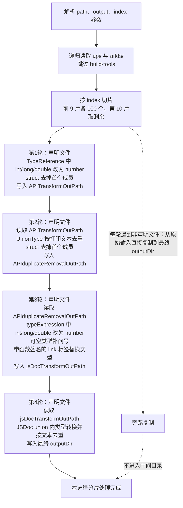

# 02.7 数值类型转换（interface/sdk-js/build-tools/intToNumber.js）

> 对应 [02-00interface-split-overview](./02-00interface-split-overview.md)「环节 02 · 步骤 02.7」。
> 把动态 SDK 中的 `int` / `long` / `double` 改为 JS 兼容的 `number`。

## 1. 脚本定位

| 项       | 内容                                                                                     |
| -------- | ---------------------------------------------------------------------------------------- |
| Python 函数 | `change_int_to_number`（`build/ohos/sdk/parse_interface_sdk.py:142`）              |
| Node 工具   | `interface/sdk-js/build-tools/intToNumber.js`                                         |
| 归属领域    | sdk（Node 工具在 interface/sdk-js 仓）                                                |
| 触发条件 | `sdk_type == "ets"`（仅 dynamic；ArkTS 1.2 支持 `int/long/double`，不转换）              |
| 作用     | 把动态 SDK 中的 `int` / `long` / `double` 改为 JS 兼容的 `number`                      |

执行完后 Python 覆盖回正式目录（`kits` 不参与本步）：

```python
replace_sdk_dir(build-tools/type-change/api   → api)
replace_sdk_dir(build-tools/type-change/arkts → arkts)
```

## 2. 调用命令

Python 启动 **10 个并发进程**，按 100 文件/片切片：

```text
node interface/sdk-js/build-tools/intToNumber.js \
    --path   out/<产品>/sdk-interface/{dynamic|static}/sdk-js \
    --output out/<产品>/sdk-interface/{dynamic|static}/sdk-js/build-tools/type-change \
    --index  {0..9}
```

- `--index < 9`：处理 `index * 100` 起的 100 个文件；
- `--index == 9`：处理剩余全部文件；
- 每个进程都重新读取 `api/`、`arkts/` 全量列表后再切片。

## 3. 输入与输出

| 类别 | 内容 |
| ---- | ---- |
| 输入 | 02.6 后的 dynamic SDK 目录：`out/<产品>/sdk-interface/dynamic/sdk-js`，递归读取 `api/`、`arkts/` |
| 输入 | 非 `.d.ts` / `.d.ets` 文件：每一轮都从原始输入直接复制到最终 `outputDir` |
| 中间目录 | `out/<产品>/sdk-interface/dynamic/sdk-js/build-tools/` 下的 `APITransformOutPath`、`APIduplicateRemovalOutPath`、`jsDocTransformOutPath` |
| 输出 | `out/<产品>/sdk-interface/dynamic/sdk-js/build-tools/type-change/api`、`build-tools/type-change/arkts` |
| 输出 | 声明文件按分片写入 `build-tools/type-change/api`、`build-tools/type-change/arkts`；非声明文件由每个进程重复复制（内容相同） |

## 4. 处理流程：四轮转换



说明：

- 四轮处理的是同一个已切片文件列表；只有声明文件进入中间目录，
  非声明文件在每一轮都会从原始输入直接复制到最终 `outputDir`，不参与中间链路。
- 第 3、4 轮虽然遍历 AST 读取 JSDoc，但写盘内容来自 `jsDocContent` 文本，
  不是 printer 输出，因此能保留原始空格与换行。
- 第 3 轮的 `typeExpression` 处理只在 JSDoc 文本含 `int/long/double` 时触发；
  `{@link}` 也只处理带函数签名括号的写法。
- 第 4 轮对所有 JSDoc `typeExpression` 的 union 成员做类型转换与按文本去重，
  最终写入 `build-tools/type-change`。

| 轮次 | 输入目录 | 输出目录 | 回调 | 主要动作 |
| ---- | -------- | -------- | ---- | -------- |
| 1 | `sdk-js` | `APITransformOutPath` | `recursionAstCallback` → `processVisitEachChild1` | `TypeReference` 中 `int/long/double` 换成 `number`；去除 struct 自动生成的首个 constructor 成员 |
| 2 | `APITransformOutPath` | `APIduplicateRemovalOutPath` | `recursionAstCallback2` → `processVisitEachChild2` | union 类型成员按文本去重；同样处理 struct 首成员 |
| 3 | `APIduplicateRemovalOutPath` | `jsDocTransformOutPath` | `parseJSDocCallback` → `parseJSDocVisitEachChild1` | 仅当 JSDoc 文本含 `int/long/double` 时处理 `typeExpression`；可空类型补 `?`/`?(...)`；处理带 `()` 的 `{@link}` 签名；直接写回 `jsDocContent` 文本 |
| 4 | `jsDocTransformOutPath` | `--output` | `parseJSDocCallback2` → `parseJSDocVisitEachChild2` | JSDoc union 内的 `int/long/double` 转为 `number` 并按文本去重；最终写回 `jsDocContent` |

## 5. 转换规则

`typeArray = ['long', 'double', 'int']`。

### 5.1 类型引用

`TypeReferenceNode` 且 `typeName` 是上述关键字时，替换为
`ts.SyntaxKind.NumberKeyword`（即 `number`）。

### 5.2 union 去重

- 第 2 轮：`UnionType` 的成员按打印文本去重；
- 第 4 轮：JSDoc 中的 union 先转换 `int/long/double`，再按文本去重，避免出现
  `number | number`。

### 5.3 JSDoc 类型

- 第 3 轮：仅当 JSDoc 文本含 `int/long/double` 时，处理 `@param` / `@returns`
  等 `typeExpression`；可空类型会补 `?`，union 可空类型输出 `?(...)`；
- 第 4 轮：对所有 `typeExpression` 的 union 成员做类型转换与文本去重，
  此轮 `isChange=false`，不再补问号；
- 两轮都通过 `tagDataList` 记录 `pos/end`，`changeContent` 从后往前替换，
  以保留原始空格、换行与缩进。

### 5.4 `{@link}` 签名

只处理带函数签名 `()` 的 `{@link ...}`，例如：

```text
{@link foo(int): long}  →  {@link foo(number): number}
```

参数列表按 `,` 拆分，类型中的 union 会合并重复的 `number`；不带括号的普通
`{@link Foo}` 不处理。

## 6. 关键细节

- **仅 dynamic**：`change_int_to_number` 只在 `sdk_type == "ets"` 时调用。
- **不处理 `kits`**：读写只覆盖 `api/`、`arkts/`，Python 覆盖范围也仅这两个目录。
- **100 文件分片**：`SPLIT_LENGTH = 100`；声明文件按分片写入同一输出目录，
  非声明文件则每个进程都会复制一次；Python 等 10 个 `Popen` 全部 `wait()` 后再覆盖。
- **非声明文件走旁路**：每一轮遇到非 `.d.ts` / `.d.ets` 文件时，
  都从原始输入直接复制到最终 `outputDir`，不写入中间目录；重复执行结果一致。
- **struct 首成员**：TypeScript 会为 struct 自动生成 constructor，处理时始终跳过
  第 0 个成员（`index >= 1` 才保留）。
- **幂等**：输出目录由 Python 后续 `replace_sdk_dir` 整体覆盖。
