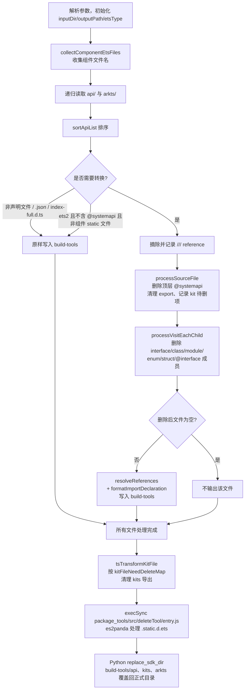

# 02.3 删除系统 API（interface/sdk-js/build-tools/delete_systemapi_plugin.js）

> 对应 [02-接口源文件拆分-00总览](./02-接口源文件拆分-00总览.md)「环节 02 · 步骤 02.3」。
> 删除 `@systemapi` 声明；带 `@publicapi [since x]` 的接口转为 public 并重算 `@since`。

## 1. 脚本定位

| 项          | 内容                                                                                      |
| ----------- | ----------------------------------------------------------------------------------------- |
| Python 函数 | `remove_system_api_method`（`build/ohos/sdk/parse_interface_sdk.py:110`）            |
| Node 工具   | `interface/sdk-js/build-tools/delete_systemapi_plugin.js`                           |
| 归属领域    | sdk（Node 工具在 interface/sdk-js 仓，内部调用 es2panda 语法级删除）                    |
| 触发条件    | `sdk_build_public == "true"`（即 `--sdk-build-public == "true"`）                                        |
| 作用        | 删除 `@systemapi` 声明；带 `@publicapi [since x]` 的接口转为 public 并重算 `@since` |

执行完本环节后，Python 会把暂存目录覆盖回正式目录：

```python
replace_sdk_dir(build-tools/api   → api)
replace_sdk_dir(build-tools/kits  → kits)
replace_sdk_dir(build-tools/arkts → arkts)
```

## 2. 调用命令

```text
node interface/sdk-js/build-tools/delete_systemapi_plugin.js \
    --input          out/<产品>/sdk-interface/{dynamic|static}/sdk-js/api \
    --output         out/<产品>/sdk-interface/{dynamic|static}/sdk-js/build-tools \
    --type           {ets|ets2} \
    --build-sdk-path out/<产品>/ohos_ets
```

## 3. 输入与输出

| 类别 | 内容                                                                                        |
| ---- | ------------------------------------------------------------------------------------------- |
| 输入 | `out/<产品>/sdk-interface/{dynamic,static}/sdk-js/api`，以及同级 `arkts/`、`kits/` |
| 输入 | `--build-sdk-path`：es2panda 工具链，`out/<产品>/ohos_ets`，`interface/sdk-js/build-tools/package_tools/src/deleteTool/entry.js` 使用 |
| 输出 | 暂存目录 `out/<产品>/sdk-interface/{dynamic,static}/sdk-js/build-tools/api`、`build-tools/arkts`、`build-tools/kits`（结构镜像源目录） |
| 输出 | 被删空的文件不再输出；组件类被删空时记录文件名供后续清理引用                                |

## 4. 处理流程



说明：

- 不是所有文件都走删除逻辑；`tsTransform` 会先判定 `isTransformer`，
  非声明文件、`.json`、`index-full.d.ts`，以及 `ets2` 下不含 `@systemapi`
  且非 `@ohos.arkui.component.static.d.ets` 的文件直接原样写入。
- `export` 清理发生在 `processSourceFile`（顶层处理）阶段，
  `import` 清理与写盘由 `formatImportDeclaration` 完成，`/// reference`
  由 `resolveReferences` 处理。
- `tsTransformKitFile` 只在全部 api/arkts 文件处理完后执行一次，
  依赖处理过程中收集的 `kitFileNeedDeleteMap`。
- es2panda 的入口 `interface/sdk-js/build-tools/package_tools/src/deleteTool/entry.js`
  实际只处理 `.static.d.ets` 文件，其余文件在 `traverseProgram` 中被直接跳过。

## 5. 判定规则

### 5.1 是否删除

`isSystemapi(node)` 取节点 JSDoc 文本：

- 不含 `@systemapi` → 保留；
- 含 `@systemapi` 且 **没有** `@publicapi [since x]` → 删除（声明 + JSDoc）；
- 含 `@systemapi` 且 **有** `@publicapi [since x]` → 转为 public API，不删除。

`isAbsoluteSystemApi` 即"有 `@systemapi` 但 `getPublicApiVersion` 返回空"。

### 5.2 systemapi → publicapi 转换

`convertSystemApiVersion` 对 JSDoc：

1. 删除 `@publicapi [...]` 行；
2. `@since` 改为 `max(原 @since, @publicapi 的 since)`；
3. 删除 `@systemapi` 行。

版本比较支持开源格式（`26`、`26.0.0`）与闭源格式（`x.y.z(n)`）。

## 6. 各类声明处理

| 节点类型       | 处理方式                                                                                |
| -------------- | --------------------------------------------------------------------------------------- |
| 顶层语句       | `processSourceFile` 用 `addNewStatements` 判断，删除 systemapi 顶层声明             |
| `interface`  | `processInterfaceDeclaration` 过滤成员                                                |
| `class`      | `processClassDeclaration` 过滤成员                                                    |
| `module`     | 过滤 `ModuleBlock` 内的语句                                                           |
| `enum`       | `processEnumDeclaration` 过滤成员                                                     |
| `struct`     | `processStructDeclaration` 保留第 0 个成员（TS 自动生成的 constructor），过滤其余成员 |
| `@interface` | `processAnnotationDeclaration` 过滤成员                                               |

删除后还会：

- 清理指向被删 API 的 `export`/`import`；
- 对 `./arkui/component/*` 的导出，按组件文件是否被删空做额外剪枝；
- `resolveReferences` 清理 `/// <reference>`；
- `tsTransformKitFile` 清理 `kits` 中对应导出（`kitFileNeedDeleteMap`）。

## 7. 文件级处理

`deleteSystemApi` 对每个文件：

1. 提取文件头版权、`@file`、`@kit` 注释；
2. `processSourceFile` 处理顶层节点；
3. `processVisitEachChild` 递归处理子成员；
4. `isEmptyFile` 判断是否只剩 `import` / `'use static'`，是则整文件不输出；
5. 用 TypeScript printer 输出，再经 `formatImportDeclaration` 重新格式化 import；
6. 写入 `--output` 对应相对路径。

组件文件被删空时会记录到 `componentEtsDeleteFiles`，供其它文件导出剪枝使用。

## 8. 语法级删除（es2panda）

`collectDeclaration` 最后执行：

```text
node interface/sdk-js/build-tools/package_tools/src/deleteTool/entry.js \
    --input <api 目录> \
    --output <build-tools 目录> \
    --build_sdk_path <ohos_ets>
```

- `--input` 虽然传的是 `api` 目录，但 `package_tools/src/deleteTool/entry.js`
  会去掉最后一段路径，实际以 `sdk-js` 根目录作为扫描输入。
- `traverseProgram` 只处理 `.static.d.ets` 文件；其它文件直接跳过。
- `entry.js` 通过 `--build_sdk_path` 动态加载 es2panda，对静态声明文件做
  TypeScript AST 无法覆盖的语法级解析与删除，结果按相对路径写入 `build-tools`。

## 9. 关键细节

- **整体 try/catch**：`collectDeclaration` 捕获异常后仅打印，不主动退出。
- **输出是暂存目录**：`build-tools` 是中间产物，最终由 Python `replace_sdk_dir` 覆盖。
- **struct 首成员保留**：避免把编译器自动生成的 constructor 当作可删成员。
- **`--type` 影响部分 static 处理**：脚本按 `ets` / `ets2` 区分处理分支。
