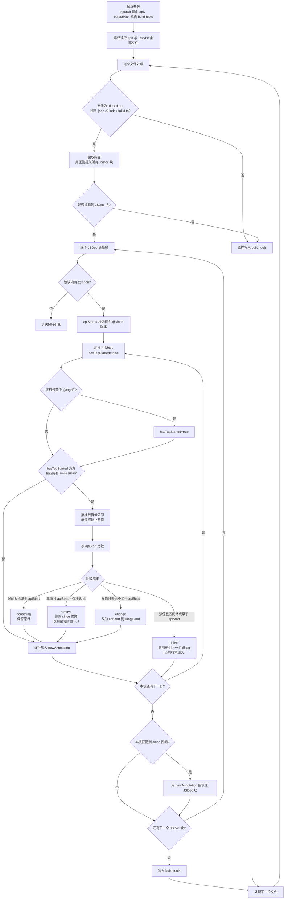

# 02.5 修正 API 注解（interface/sdk-js/build-tools/adjust_api_annotation.js）

> 对应 [02-接口源文件拆分-00总览](./02-接口源文件拆分-00总览.md)「环节 02 · 步骤 02.5」。
> 修正 `@syscap`/`@permission`/`@supportDeviceType` 等注解里的 `[since x-y]`
> 区间，使其与接口自身 `@since` 起始版本一致。

## 1. 脚本定位

| 项          | 内容                                                                                                                            |
| ----------- | ------------------------------------------------------------------------------------------------------------------------------- |
| Python 函数 | `adjust_annotation_method`（`build/ohos/sdk/parse_interface_sdk.py:127`）                                                |
| Node 工具   | `interface/sdk-js/build-tools/adjust_api_annotation.js`                                                                    |
| 归属领域    | sdk（Node 工具在 interface/sdk-js 仓）                                                                                        |
| 触发条件    | 始终执行                                                                                                                        |
| 作用        | 修正 `@syscap`/`@permission`/`@supportDeviceType` 等注解里的 `[since x-y]` 区间，使其与接口自身 `@since` 起始版本一致 |

执行完后 Python 覆盖回正式目录：

```python
replace_sdk_dir(build-tools/api   → api)
replace_sdk_dir(build-tools/arkts → arkts)
```

## 2. 调用命令

```text
node interface/sdk-js/build-tools/adjust_api_annotation.js \
    --input  out/<产品>/sdk-interface/{dynamic|static}/sdk-js/api \
    --output out/<产品>/sdk-interface/{dynamic|static}/sdk-js/build-tools
```

## 3. 输入与输出

| 类别 | 内容                                                                  |
| ---- | --------------------------------------------------------------------- |
| 输入 | `out/<产品>/sdk-interface/{dynamic,static}/sdk-js/api`，以及同级 `arkts/` |
| 输入 | `index-full.d.ts`、`.json` 不参与注解修改（仍原样输出）           |
| 输出 | 暂存目录 `out/<产品>/sdk-interface/{dynamic,static}/sdk-js/build-tools/api`、`build-tools/arkts`，相对路径与源一致 |
| 输出 | 内容为空时删除对应输出文件                                            |

## 4. 处理流程



说明：

- `getFileAnnotations` 只按 JSDoc 块提取；某个块没有 `@since` 时只跳过该块，
  不会提前结束整个文件，后续块仍会继续处理。
- `hasTagStarted` 用于跳过描述文本里的 `[since ...]`；只有遇到第一个 `@tag`
  行之后出现的区间才会被处理。
- 每匹配到一个区间都会置 `isNeedChange = true`，最后用 `newAnnotation`
  回填整个 JSDoc 块；`remove` 产生的 `null` 行会被过滤。
- `delete` 若发生在标签行本身，只丢弃当前行；若发生在续行，则会连同前面的
  `@tag` 行一起删除。

## 5. 核心比较规则

设接口自身起始版本为 `apiStart`（取 JSDoc 中第一个 `@since`）：

| 条件                                                       | 操作          | 含义                                                     |
| ---------------------------------------------------------- | ------------- | -------------------------------------------------------- |
| `apiStart < range.start`                                 | `donothing` | 接口早于区间开始，注解保持原样                           |
| `apiStart >= range.start` 且区间只有一个值 `[since x]` | `remove`    | 删除 `[since x]` 修饰                                  |
| 区间两个值且 `apiStart > range.end`                      | `delete`    | 整个注解早于接口引入，删除该注解                         |
| 区间两个值且 `apiStart <= range.end`                     | `change`    | 起点改为 `apiStart`，即 `[since apiStart - range.end]` |

示例：

```text
@xxx [since 17-20]   + 接口 @since 16  → donothing（起点 17 晚于 16）
@xxx [since 16-20]   + 接口 @since 16  → change（输出 [since 16 - 20]）
@xxx [since 13]      + 接口 @since 14  → remove（删掉 [since 13]）
@xxx [since 12-13]   + 接口 @since 15  → delete（删掉整条注解）
@xxx [since 12-19]   + 接口 @since 15  → change（输出 [since 15 - 19]）
```

## 6. 实现细节

### 6.1 注解与版本提取

- `ANNOTATION_REGEX = /\/\*\*[\s\S]*?\*\//g`：按 JSDoc 块切分；
- `SINCE_REGEX`：匹配块内第一个 `@since`，版本取空格前的第一个 token；
- `ANNOTATION_SINCE_REGEX = /\[since (.*?)\]/`：匹配注解里的区间修饰；
- `ANNOTATION_KEYWORD = /[^\S\n]*\*\s*@(\w+)/`：识别标签行。

只有 `hasTagStarted`（遇到第一个 `@tag`）之后出现的 `[since ...]` 才会被处理，
避免误改 JSDoc 描述文本。

### 6.2 四种操作

- **donothing**：区间起点晚于 `apiStart`，原样保留该行。
- **delete**：`deleteAnnotations` 删除当前行；若当前行是续行，还会从
  `newAnnotation` 末尾向前删除，直到遇到并包含最近的一个 `@tag` 行。
  若 `[since ...]` 本身就在标签行上，`deleteAnnotations` 直接返回，只丢弃当前行。
- **change**：把区间文本替换为 `apiStart + " - " + range.end`。
- **remove**：删除 `[since ...]` 文本；若该行只剩 `*`，返回 `null` 由调用方过滤。

### 6.3 版本比较

`compareVersions` 同时支持：

- 闭源格式 `x.y.z(n)`；
- 开源三段式 `x.y.z`；
- 单数字/浮点（如 `15`），按 `n * 10000` 归一。

## 7. 关键细节

- **输入是两个目录**：`--input` 指向 `api/`，脚本会自动处理同级 `../arkts/`。
- **输出目录按相对路径镜像**：以 `--input` 的父目录（`sdk-js`）为基准，
  得到 `build-tools/api/...`、`build-tools/arkts/...`。
- **非声明文件原样复制**：保证暂存目录结构完整，供后续覆盖回正式目录。
- **写文件为异步 mkdir**：`fs.mkdir` 回调中再写文件；空内容会 `rmSync` 删除。
- **异常仅打印**：`collectDeclaration` 用 `try/catch` 捕获，构建不因单文件失败中断。
