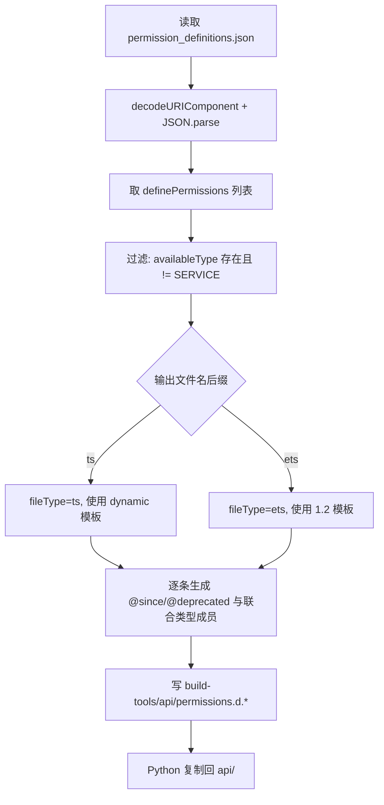

# 02.6 生成权限声明（interface/sdk-js/build-tools/permissions_converter/convert.js）

> 对应 [02-接口源文件拆分-00总览](./02-接口源文件拆分-00总览.md)「环节 02 · 步骤 02.6」。
> 把系统权限定义 `permission_definitions.json` 转成 SDK 的
> `export type Permissions = ...`。

## 1. 脚本定位

| 项       | 内容                                                                          |
| -------- | ----------------------------------------------------------------------------- |
| Python 函数 | `convert_permissions`（来自 `build/ohos/sdk/convert_permissions.py`）     |
| Node 工具   | `interface/sdk-js/build-tools/permissions_converter/convert.js`            |
| 归属领域    | 安全领域（负责人：陈念；Python 驱动 `convert_permissions` 在 build 仓，Node 工具 `convert.js` 在 interface/sdk-js 仓）                                       |
| 触发条件 | 始终执行，dynamic / static 各生成一个权限文件                                |
| 作用     | 把系统权限定义 `permission_definitions.json` 转成 SDK 的 `export type Permissions = ...` |

## 2. 调用链

```text
build/ohos/sdk/parse_interface_sdk.py: convert_permissions(root_build_dir, out_path, permission_file, node_js)
        └── build/ohos/sdk/convert_permissions.py: parse_step()
                ├── copy_sdk_interface()    # out_path 不存在时整目录拷贝 interface/sdk-js
                ├── copy_api()              # build-tools/api 不存在时复制 api
                ├── convert_permission_method()
                │       └── node interface/sdk-js/build-tools/permissions_converter/convert.js \
                │               base/security/access_token/services/accesstokenmanager/permission_definitions.json \
                │               out/<产品>/sdk-interface/{dynamic|static}/sdk-js/build-tools/api/{permissions.d.ts|permissions.d.ets}
                └── replace_sdk_api_dir()   # 生成文件复制回 api/
```

| 路数 | `out_path` | `permission_file` |
| ---- | ---------- | ----------------- |
| dynamic（ets） | `out/<产品>/sdk-interface/dynamic/sdk-js` | `permissions.d.ts` |
| static（ets2） | `out/<产品>/sdk-interface/static/sdk-js` | `permissions.d.ets` |

> 同一个转换工具还有一处独立调用：环节 01 的 `parse_sdk_description.py` 在解析
> SDK 描述文件前，会以 public SDK 目录 `out/sdk-public/public_interface/sdk-js` 为输出
> 执行同样流程，见 [01-GN生成期-02生成模块清单](./01-GN生成期-02生成模块清单.md)。两处只是输出目录不同，
> 转换工具本身一致。

## 3. 输入与输出

| 类别 | 内容 |
| ---- | ---- |
| 输入 | `base/security/access_token/services/accesstokenmanager/permission_definitions.json` |
| 输入 | `--node-js` 指定的 Node 可执行文件 |
| 输出（中间） | `out/<产品>/sdk-interface/{dynamic,static}/sdk-js/build-tools/api/permissions.d.ts` 或 `.d.ets` |
| 输出（最终） | `out/<产品>/sdk-interface/{dynamic,static}/sdk-js/api/permissions.d.ts` 或 `.d.ets` |

## 4. 处理流程



## 5. 权限过滤规则

```js
configMap.definePermissions.filter(permission => {
  if (permission.availableType) {
    return permission.availableType !== 'SERVICE';
  }
});
```

只有 `availableType` 存在且不等于 `SERVICE` 的权限会被保留。
（`availableType` 缺失时回调返回 `undefined`，同样会被过滤掉。）

## 6. 版本计算规则

`getArkTsVersion(permission, fileType)`：

| 场景 | 结果 |
| ---- | ---- |
| `fileType == 'ts'`（dynamic） | 直接使用 `permission.since` |
| `fileType == 'ets'` 且 `since <= 20` | 若 `deprecated` 版本 `<= 20` → 丢弃该权限；否则统一输出 `20` |
| `fileType == 'ets'` 且 `since > 20` | 使用 `permission.since` |

即 static（ArkTS 1.2）对 `<= 20` 的权限统一归到 20，已废弃的则不再输出。

## 7. 输出文件结构

```ts
/* 版权头 */

/**
 * @file Defines all permissions.
 * @kit AbilityKit
 */

 /**
  * Indicates permissions.
  *
  * @typedef Permissions
  * @syscap SystemCapability.Security.AccessToken
  * @since 9
  */
 ...
export type Permissions =
  /**
   * @since 9
   */
  'ohos.permission.XXX'
  | 'ohos.permission.YYY';
```

- dynamic（`.ts`）使用 `@since 9` + `@since 11 @atomicservice` 双段标签模板；
- static（`.ets`）使用 `@since 20 @atomicservice` 模板；
- 每条权限输出 `@since`，有 `deprecated` 时追加 `@deprecated`；
- 成员以单引号包裹，`|` 连接，最后以 `;` 结束。

## 8. 关键细节

- **输出类型由后缀决定**：取输出路径最后一个 `.` 后的扩展名判断 `ts` / `ets`。
- **先删后写**：目标文件存在时先 `unlinkSync`，再追加写入，保证幂等。
- **JSON 解码**：读取后先 `decodeURIComponent` 再 `JSON.parse`，兼容被转义的配置。
- **前置目录处理**：`copy_sdk_interface`、`copy_api` 只为兼容独立调用；
  在 `ohos_base_split` 流程中 02.1 已创建目录，通常不会重复拷贝。
- **失败不中断**：JSON 解析失败打印 `Convert json file to object failed`；
  `convert.js` 最外层 `try/catch` 打印错误。
