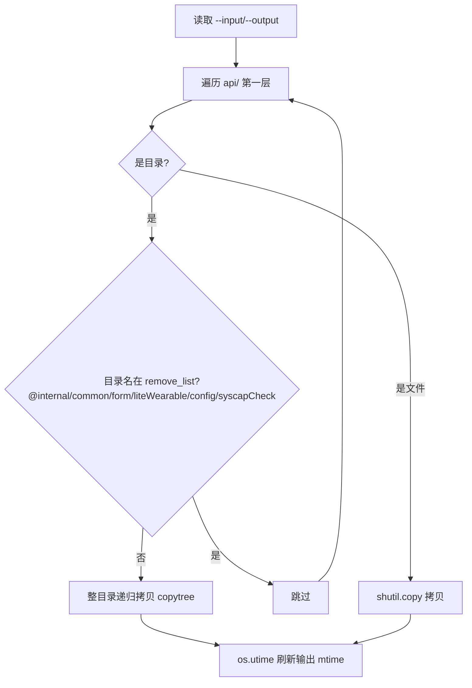

# 03 目录级过滤（`ohos_declaration_ets` / `ohos_declaration_ets2` / `ohos_declaration_common`）

> 对应 [00-总览](./00-总览.md)「环节 03」。
> 脚本 `interface/sdk-js/remove_internal.py`，模板 `ohos_declaration_template`（`BUILD.gn:136`）。
> 本环节做**目录级过滤**：从接口树 `api/` 拷贝出常规声明目录，
> 排除内置 `remove_list` 中的 6 个特殊目录（见下）。

## 1. 环节职责

| 项      | 内容                                                                                      |
| ------- | ----------------------------------------------------------------------------------------- |
| GN 模板 | `ohos_declaration_template`，三个实例：`ohos_declaration_ets` / `ets2` / `common` |
| 脚本    | `interface/sdk-js/remove_internal.py`                                                   |
| 归属领域 | sdk（interface/sdk-js 仓）                                                                 |
| 输入    | `out/<产品>/sdk-interface/{dynamic,static}/sdk-js/api`                             |
| 输出    | `out/<产品>/ohos_declaration/ohos_declaration_{ets,ets2,common}` + `.timestamp`       |
| 一句话  | 按 `remove_internal.py` 排除 `remove_list` 的 6 个特殊目录后，目录级全量拷贝出 ets / ets2 / common 三份常规 API 声明目录（`ohos_declaration_*`）                 |

实例一览：

| 目标                        | `input_project_dir`                 | 输出                        | 用途                                    | 装配合并（最终 SDK 目录）                                                      |
| --------------------------- | ------------------------------------ | --------------------------- | --------------------------------------- | ------------------------------------------------------------------------------ |
| `ohos_declaration_ets`    | `out/<产品>/sdk-interface/dynamic/sdk-js` | `ohos_declaration_ets`    | dynamic 打包（→ `out/<产品>/ohos_dynamic/api`） | 05 装配 → `out/<产品>/ohos_dynamic/api` → 08 清标签 → 10 安装 → `ets/dynamic/api` |
| `ohos_declaration_ets2`   | `out/<产品>/sdk-interface/static/sdk-js`  | `ohos_declaration_ets2`   | static 打包（→ `out/<产品>/ohos_static/api`）   | 05 装配 → `out/<产品>/ohos_static/api` → 07 runtimeapi → 08 清标签 → 10 安装 → `ets/static/api`   |
| `ohos_declaration_common` | `out/<产品>/sdk-interface/dynamic/sdk-js` | `ohos_declaration_common` | 直接作为 `js/api` 安装                | 10 直接安装 → `js/api`                                                      |

## 2. 调用命令

```text
python interface/sdk-js/remove_internal.py \
    --input  <input_project_dir>/api \
    --output out/<产品>/ohos_declaration/<target_name>
```

只解析 `--input`、`--output` 两个参数。

## 3. 处理逻辑

```python
remove_list = ["@internal", "common", "form", "liteWearable", "config", "syscapCheck"]

for file in os.listdir(input_path):
    src = input_path / file
    if isdir(src) and file not in remove_list:
        copytree(src, output_path / file, dirs_exist_ok=True)
    elif isfile(src):
        shutil.copy(src, output_path / file)
```



规则要点：

1. 只遍历 `api/` 第一层；
2. 顶层文件全部拷贝；顶层子目录只有不在 `remove_list` 中才整体递归拷贝；
3. 输出目录存在时直接覆盖写入，不先清理；
4. 退出前 `os.utime` 刷新 mtime，适配增量构建。

内置 `remove_list` 共 **6 个目录**（写死在 `remove_internal.py`）：

| 目录          | 含义                                   | 处理去向 |
| ------------- | -------------------------------------- | -------- |
| `@internal` | 内部 API（`@ohos` 隐藏声明等）       | 见下方第 4 节 |
| `common`     | 公共/通用声明（full / lite）          | 见下方第 4 节 |
| `form`       | 服务卡片表单声明                      | 见下方第 4 节 |
| `liteWearable` | 轻量穿戴设备声明                    | 见下方第 4 节 |
| `config`     | 配置类声明                            | 见下方第 4 节 |
| `syscapCheck` | syscap 校验专用声明                   | 见下方第 4 节 |

> 这些目录不属于「常规 API 声明」，由环节 04 以独立目标专门处理或由其他目标消费；
> 改动排除清单 = 改这里的 `remove_list` 列表。

## 4. 被排除目录的处理去向

| 被排除目录       | 后续处理目标                                                                                             |
| ---------------- | -------------------------------------------------------------------------------------------------------- |
| `@internal`    | `ets_internal_api` / `ets_internal_api_static`、`ets_component`、`ohos_ets_dynamic_api_internal` |
| `common`       | `internal_full`、`internal_lite`                                                                     |
| `form`         | `form_declaration`                                                                                     |
| `liteWearable` | 当前 `BUILD.gn` 无单独目标                                                                             |
| `config`       | `config`                                                                                               |
| `syscapCheck`  | `syscap_check`                                                                                         |

## 5. 输出与下游

| 输出                        | 下游                                                         | 最终 SDK 目录       |
| --------------------------- | ------------------------------------------------------------ | ------------------- |
| `ohos_declaration_ets`    | `ohos_ets_dynamic_api_declaration` → `out/<产品>/ohos_dynamic/api` | `ets/dynamic/api` |
| `ohos_declaration_ets2`   | `ohos_ets_static_api_declaration` → `out/<产品>/ohos_static/api`   | `ets/static/api`  |
| `ohos_declaration_common` | 直接作为 `js/api` 安装                                     | `js/api`          |

> `ohos_declaration_ets_api`（`BUILD.gn:257`）也以 `ohos_declaration_ets` 为输入，
> 输出到 `out/<产品>/obj/interface/api`，通过 `sdk:ohos_declaration_ets_api` 被
> `developtools_ace_ets2bundle` 读取（跨部件契约，见 [11-部件化对外接口](./11-部件化对外接口.md)）。

## 6. 常加的改动

- **新增要排除的目录** → 改这里的 `remove_list`；
- **改写 API 内容（替换 / 改相对导入）** → 改这里的处理函数。

## 7. 相关文件

| 文件                                      | 作用                                        |
| ----------------------------------------- | ------------------------------------------- |
| `interface/sdk-js/remove_internal.py`   | 目录级过滤拷贝（排除内置 6 个目录）                            |
| `interface/sdk-js/BUILD.gn`             | `ohos_declaration_template` 与实例定义    |
| `interface/sdk-js/interface_config.gni` | `ohos_dynamic` / `ohos_static` 路径变量 |
