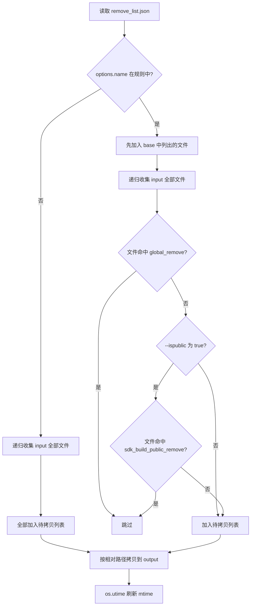

# 04 内部目录 / 独立模块（`ohos_copy_internal` ×9）

> 对应 [00-总览](./00-总览.md)「环节 04」。
> 脚本 `interface/sdk-js/process_internal.py`，规则文件 `interface/sdk-js/remove_list.json`，
> 模板 `ohos_copy_internal`（`BUILD.gn:86`）。

## 1. 环节职责

| 项 | 内容 |
| -- | ---- |
| GN 模板 | `ohos_copy_internal`，共 9 个实例，多实例并行 |
| 脚本 | `interface/sdk-js/process_internal.py` |
| 归属领域 | sdk（interface/sdk-js 仓） |
| 输入 | 各实例源目录（接口树子目录）+ `remove_list.json` 规则 + `--ispublic` |
| 输出 | `out/<产品>/obj/interface/sdk-js/<target_name>` |
| 一句话 | 按 `remove_list.json` 做文件级过滤/挑选，经 9 个 `ohos_copy_internal` 实例并行拷贝到 `out/<产品>/obj/interface/sdk-js`，处理内部目录与独立模块 |

## 2. 调用命令

```text
python interface/sdk-js/process_internal.py \
    --input <iv_input> \
    --project-dir <input_project_dir> \
    --base-dir //interface/sdk-js \
    --remove //interface/sdk-js/remove_list.json \
    --ispublic <sdk_build_public> \
    --name <target_name> \
    --output out/<产品>/obj/interface/sdk-js/<target_name>
```

每个实例同时生成 `<target_name>_info` 的 `generate_module_info`，登记模块信息。

## 3. 处理逻辑



规则要点：

1. **`base` 是额外拷贝项，不是白名单**；基于 `project_dir` 拼接，不要求位于 `input` 下，
   不在 `input` 下时直接扁平拷贝到输出根；
2. 未在 `remove_list.json` 登记的 `target_name` = 不过滤，全量拷贝；
3. `global_remove` 所有构建都删；`sdk_build_public_remove` 仅 `--ispublic == "true"` 时删；
4. 输出保留 `input` 的相对目录结构；最后 `os.utime` 刷新 mtime。

## 4. `remove_list.json` 规则表

| 目标 | `base` | `global_remove` | `sdk_build_public_remove` |
| ---- | ------ | --------------- | ------------------------- |
| `ets_internal_api` | `api/common/full/canvaspattern.d.ts`、`api/common/full/featureability.d.ts` | 无 | 无 |
| `bundle_arkts` | 空 | `builtin/dynamic/lib*.d.ts`（70 个） | 无 |
| `ets_component` | 无 | 无 | 13 个系统组件声明（`ability_component.d.ts` 等） |
| `internal_lite` | 无 | 无 | `featureability.d.ts` |

其余目标（`bundle_kits`、`internal_full`、`ets_internal_api_static`、
`bundle_arkts_static`、`bundle_kits_static` 等）无规则条目 → 全量拷贝。

## 5. 9 个实例输入输出

| 实例（target_name） | 输入目录（`iv_input`） | 处理要点 | 输出 | 装配合并（最终 SDK 目录） |
| ------------------- | ---------------------- | -------- | ---- | -------------------------- |
| `ets_internal_api` | `out/<产品>/sdk-interface/dynamic/sdk-js/api/@internal/ets` | `base` 额外带入 `common/full` 下 2 个文件 | `out/<产品>/obj/interface/sdk-js/ets_internal_api` | 05 装配 → `out/<产品>/ohos_dynamic/api/@internal/full` → 10 安装 → `ets/dynamic/api/@internal/full` |
| `bundle_arkts` | `out/<产品>/sdk-interface/dynamic/sdk-js/arkts` | 删 `lib*.d.ts` 约 70 个（全版本） | `out/<产品>/obj/interface/sdk-js/bundle_arkts` | 05 装配 → `out/<产品>/ohos_dynamic/arkts` → 10 安装 → `ets/dynamic/arkts` |
| `ets_component` | `out/<产品>/sdk-interface/dynamic/sdk-js/api/@internal/component/ets` | `sdk_build_public == "true"` 时删 13 个系统组件 | `out/<产品>/obj/interface/sdk-js/ets_component` | 05 装配 → `out/<产品>/ohos_dynamic/component` → 10 安装 → `ets/dynamic/component` |
| `bundle_kits` | `out/<产品>/sdk-interface/dynamic/sdk-js/kits` | 无删除，全量拷贝 | `out/<产品>/obj/interface/sdk-js/bundle_kits` | 05 装配 → `out/<产品>/ohos_dynamic/kits` → 10 安装 → `ets/dynamic/kits` |
| `internal_full` | `out/<产品>/sdk-interface/dynamic/sdk-js/api/common/full` | 无删除，全量拷贝 | `out/<产品>/obj/interface/sdk-js/internal_full` | 10 直接安装 → `js/api/@internal/full` |
| `internal_lite` | `out/<产品>/sdk-interface/dynamic/sdk-js/api/common/lite` | `sdk_build_public == "true"` 时删 `featureability.d.ts` | `out/<产品>/obj/interface/sdk-js/internal_lite` | 10 直接安装 → `js/api/@internal/lite` |
| `ets_internal_api_static` | `out/<产品>/sdk-interface/static/sdk-js/api/@internal/ets` | 全量拷贝 | `out/<产品>/obj/interface/sdk-js/ets_internal_api_static` | 05 装配 → `out/<产品>/ohos_static/api/@internal/full` → 10 安装 → `ets/static/api/@internal/full` |
| `bundle_arkts_static` | `out/<产品>/sdk-interface/static/sdk-js/arkts` | 全量拷贝 | `out/<产品>/obj/interface/sdk-js/bundle_arkts_static` | 05 装配 → `out/<产品>/ohos_static/arkts` → 10 安装 → `ets/static/arkts` |
| `bundle_kits_static` | `out/<产品>/sdk-interface/static/sdk-js/kits` | 全量拷贝 | `out/<产品>/obj/interface/sdk-js/bundle_kits_static` | 05 装配 → `out/<产品>/ohos_static/kits` → 10 安装 → `ets/static/kits` |

## 6. 常加的改动

- **新增独立安装模块**（单独成目录、不进 api）→
  加一个 `ohos_copy_internal` 实例（BUILD.gn）+ 环节 01 描述文件登记
  `install_dir` / `module_label`。
- **新增文件级过滤规则** → 改 `remove_list.json`（三类规则）。

## 7. 相关文件

| 文件 | 作用 |
| ---- | ---- |
| `interface/sdk-js/process_internal.py` | 文件级过滤/拷贝 |
| `interface/sdk-js/remove_list.json` | 过滤规则数据 |
| `interface/sdk-js/BUILD.gn` | `ohos_copy_internal` 模板与 9 个实例 |
