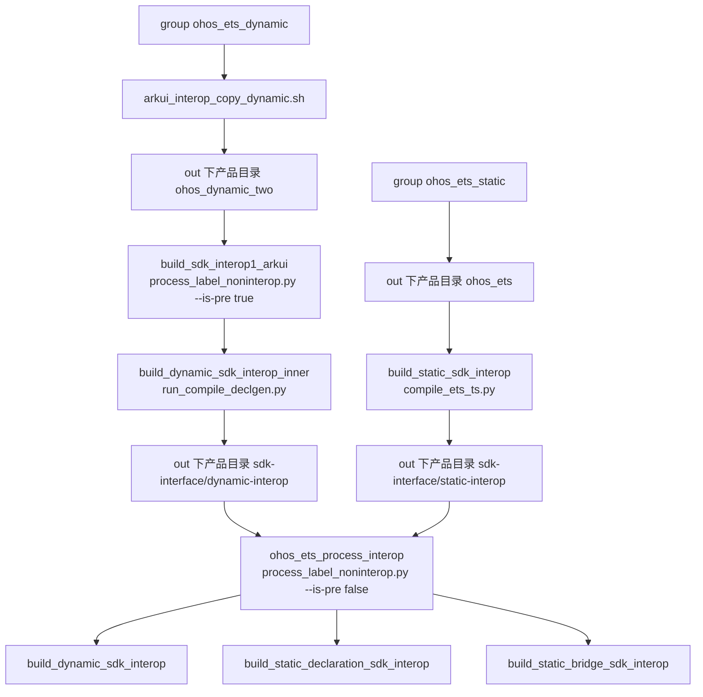
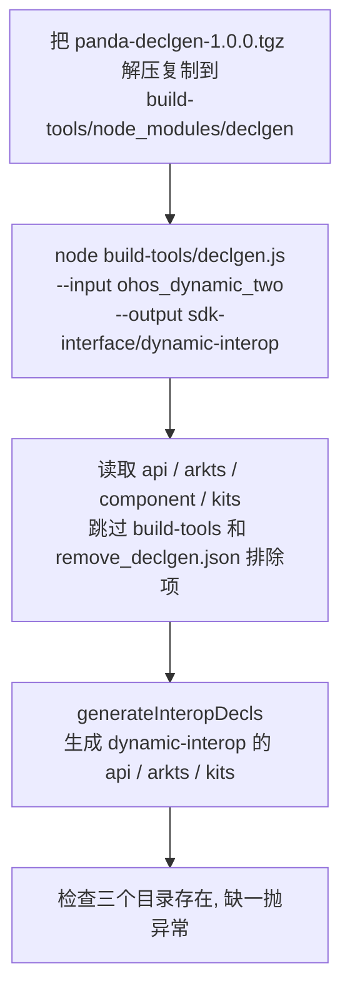
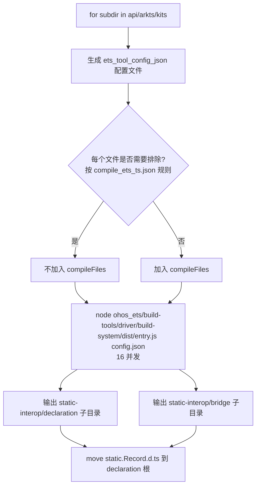
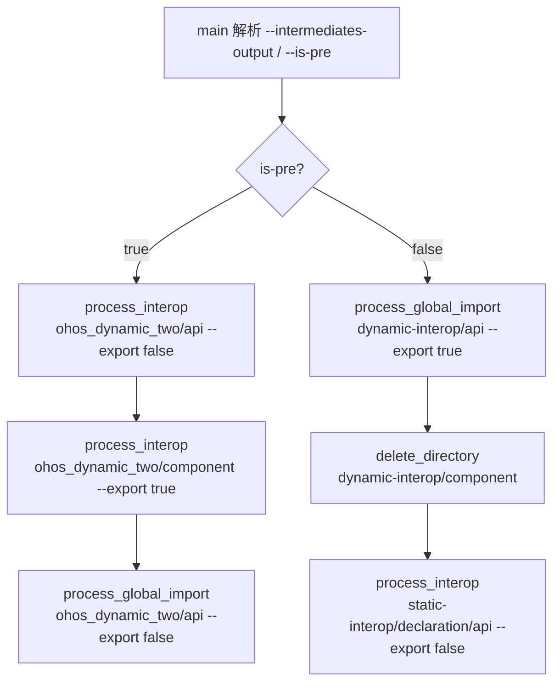
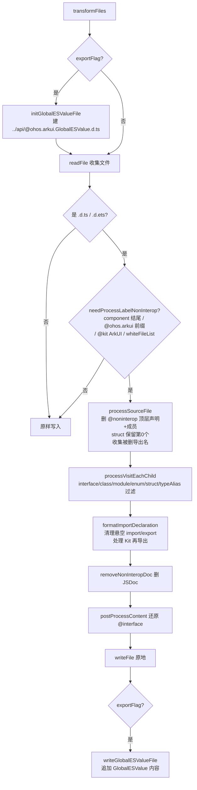

# 06 interop（互操作声明 / 胶水代码）

> 对应 [00-overview](./00-overview.md)「环节 06」。
> 涉及脚本：`interface/sdk-js/arkui_interop_copy_dynamic.sh`、`interface/sdk-js/process_label_noninterop.py`（+ js 工具）、
> `interface/sdk-js/run_compile_declgen.py` → `interface/sdk-js/build-tools/declgen.js`、`interface/sdk-js/compile_ets_ts.py`。
> 输入来自 [05-assembly](./05-assembly.md)，与 [08-label-cleanup](./08-label-cleanup.md) 的 `@noninterop` 清理同源；
> static 支线是 [07-runtimeapi](./07-runtimeapi.md) 的上游（runtimeapi 的 `copy_runtimeapi` order-only 依赖本环节 `build_static_sdk_interop`）。

## 1. 环节职责

| 项 | 内容 |
| -- | ---- |
| 作用 | 为 dynamic / static 两套 SDK 生成互操作声明与桥接代码，供 ArkTS 1.1 / 1.2 互相调用 |
| 归属领域 | sdk（interface/sdk-js 仓全部脚本） |
| 工具差异 | dynamic 用 declgen（`runtime_core` 仓工具包）；static 用 ets2panda driver |
| 安装 | `ets/{dynamic,static}/build-tools/interop/**` |

## 2. 总览图



## 3. dynamic interop 链路

### 3.1 拷贝加工副本 `interface/sdk-js/arkui_interop_copy_dynamic.sh`

```bash
cp -r out/<产品>/ohos_dynamic/* out/<产品>/ohos_dynamic_two/
```

只做目录复制，不修改内容；目的：保留 `ohos_dynamic` 原件，在副本上做 interop 预处理。

### 3.2 预处理 `build_sdk_interop1_arkui`（`--is-pre true`）

`interface/sdk-js/process_label_noninterop.py --is-pre true` 依次执行：

| 调用 | 输入 / 输出（原地） | `--export` |
| ---- | ------------------- | ---------- |
| `process_interop` | `out/<产品>/ohos_dynamic_two/api` | `false` |
| `process_interop` | `out/<产品>/ohos_dynamic_two/component` | `true` |
| `process_global_import` | `out/<产品>/ohos_dynamic_two/api` | `false` |

- `--export true` 会初始化并写入 `out/<产品>/ohos_dynamic_two/api/@ohos.arkui.GlobalESValue.d.ts`；
- `outputs = [ "out/<产品>/sdk-interface/arkui_dummy_interop_pre" ]` 只是 GN 目标标记。

### 3.3 declgen `build_dynamic_sdk_interop_inner`

`interface/sdk-js/run_compile_declgen.py`：



### 3.4 收尾 `ohos_ets_process_interop`（`--is-pre false`）

| 调用 | 输入 / 输出（原地） | `--export` |
| ---- | ------------------- | ---------- |
| `process_global_import` | `out/<产品>/sdk-interface/dynamic-interop/api` | `true` |
| `delete_directory` | 删除 `out/<产品>/sdk-interface/dynamic-interop/component` | — |
| `process_interop` | `out/<产品>/sdk-interface/static-interop/declaration/api` | `false` |

`outputs = [ "out/<产品>/sdk-interface/arkui_dummy_interop" ]` 同样是标记，脚本不创建。

## 4. static interop 链路 `build_static_sdk_interop`

`interface/sdk-js/compile_ets_ts.py` 对 `INTEROP_ETS_LIST = ["api", "arkts", "kits"]` 依次处理：



配置关键字段：

| 字段 | 值 |
| ---- | -- |
| `compileFiles` | `out/<产品>/ohos_ets/<subdir>` 下排除后的文件 |
| `moduleRootPath` | `out/<产品>/ohos_ets/<subdir>` |
| `loaderOutPath` | `out/<产品>/sdk-interface/static-interop` |
| `buildSdkPath` | `out/<产品>/ohos_ets` |
| `declgenV1OutPath` | `out/<产品>/sdk-interface/static-interop/declaration/<subdir>` |
| `declgenBridgeCodePath` | `out/<产品>/sdk-interface/static-interop/bridge/<subdir>` |
| `maxWorkers` | 16 |
| `enableDeclgenEts2Ts` | true |

## 5. `process_label_noninterop` 处理细节

脚本链：`process_label_noninterop.py`（Python 调度）→ `process_label_noninterop.js`（删 `@noninterop` 成员）
+ `process_global_import.js`（全局 import 处理）。输入输出**同目录（原地处理）**。

### 5.1 调度分两阶段（`process_label_noninterop.py`）

`process_label_noninterop.py` 本身不处理文件，按 `--is-pre` 分两阶段调用 Node 工具：



各阶段输入输出：

| 阶段 | 输入（原地） | 输出 | 处理 |
| ---- | ------------ | ---- | ---- |
| `--is-pre true` | `out/<产品>/ohos_dynamic_two/api` | 同目录 | 删 `@noninterop` 成员，`--export false` |
| `--is-pre true` | `out/<产品>/ohos_dynamic_two/component` | 同目录 | 删 `@noninterop` 成员 + 补 `export`（`--export true`） |
| `--is-pre true` | `out/<产品>/ohos_dynamic_two/api`（全局 import） | 同目录 | `process_global_import.js` 清理全局 / 动态 import |
| `--is-pre false` | `out/<产品>/sdk-interface/dynamic-interop/api` | 同目录 | 补 `GlobalESValue`、补 `export`（`--export true`） |
| `--is-pre false` | `out/<产品>/sdk-interface/dynamic-interop/component` | 删除 | 目录级删除，只留 `api` / `arkts` / `kits` |
| `--is-pre false` | `out/<产品>/sdk-interface/static-interop/declaration/api` | 同目录 | 删 `@noninterop` 成员（`--export false`） |

> `process_interop` → `process_label_noninterop.js`；`process_global_import` → `process_global_import.js`。
> `outputs` 中的 `arkui_dummy_interop_pre` / `arkui_dummy_interop` 只是 GN 目标标记，脚本不创建。

### 5.2 `process_label_noninterop.js` 处理流程



- 仅处理 `.d.ts` / `.d.ets`，是否改写由 `needProcessLabelNonInterop` 判定（任一成立）：
  1. 输入目录以 `component` 结尾；
  2. 文件名以 `@ohos.arkui` 开头；
  3. `@kit` 值为 `ArkUI`（小写比较）；
  4. 文件名在 `whiteFileList` 中（当前只有 `web`）。
- 递归删除带 `@noninterop` 的顶层声明和成员；struct 保留第 0 个成员；
- `--export true` 时给被保留声明补 `export`，并创建/追加 `GlobalESValue.d.ts`（去掉 `'use static'`、`../api` 替换为 `.`）；
- 清理悬空 import/export，按 `kitFileNeedDeleteMap` 清理 Kit 再导出；
- 特殊文件：`alert_dialog` 的 `TextStyle` → `AlertDialogTextStyle`、`common` 的 `LinearGradient` → `CommonLinearGradient`、`FrameNode.d.ts` 补 `typeNode.XComponent = Any`。

## 6. 最终产物

| 目标 | 源 | 安装目录 | 构建条件 |
| ---- | -- | -------- | -------- |
| `build_dynamic_sdk_interop` | `out/<产品>/sdk-interface/dynamic-interop` | `ets/dynamic/build-tools/interop` | 依赖收尾 |
| `build_static_declaration_sdk_interop` | `out/<产品>/sdk-interface/static-interop/declaration` | `ets/static/build-tools/interop/declaration` | 依赖收尾 |
| `build_static_bridge_sdk_interop` | `out/<产品>/sdk-interface/static-interop/bridge` | `ets/static/build-tools/interop/bridge` | 依赖收尾 |
| `build_dynamic_sdk_predefined_interop` | `interface/sdk-js/build-tools/interop/dynamic/api/@ohos.lang.interop.d.ets` | `ets/dynamic/build-tools/interop/api` | 零脚本 |
| `build_static_predefined_declaration_sdk_interop` | `interface/sdk-js/build-tools/interop/static/declaration/api/*` | `ets/static/build-tools/interop/declaration/api` | 零脚本 |
| `build_static_predefined_bridge_sdk_interop` | `interface/sdk-js/build-tools/interop/static/bridge/api/@ohos.lang.interop.ts` | `ets/static/build-tools/interop/bridge/api` | 零脚本 |

## 7. 关键细节

- dynamic 用 declgen，static 用 ets2panda driver，两条链路工具完全不同；
- 这路在**副本**（`ohos_dynamic_two`）上加工，`ohos_dynamic` 原件不受影响；
- `arkui_dummy_interop*` 不是真实产物，仅作 GN `outputs` 标记；
- component 目录在收尾时被删除，interop 只保留 `api` / `arkts` / `kits`。

## 8. 与 [07-runtimeapi](./07-runtimeapi.md)、[08-label-cleanup](./08-label-cleanup.md) 的关系

三个环节数据上都从 [05-assembly](./05-assembly.md) 出发，但**处理对象不同**：

| 环节 | 处理对象 | `@noninterop` 处理 | 消费方 |
| ---- | -------- | ----------------- | ------ |
| 06 interop | 副本 `ohos_dynamic_two` / `ohos_ets` | **删成员**（`process_label_noninterop.js`，declaration 级） | `ets/{dynamic,static}/build-tools/interop/**` |
| 07 runtimeapi | `ohos_static`（static 专属） | `@unpublished` 标签+API 删除 | `ets/static/*` 输入（供 08）、ets-loader runtimeapi |
| 08 清标签 | 安装副本 `ohos_dynamic` / `copy_runtimeapi` | **只删标签行**（`delete_label_noninterop.js`，声明保留） | `ets/{dynamic,static}/{api,arkts,component,kits}` |

> static 支线是串行链 **06 interop(static) → 07 runtimeapi → 08 清标签(static)**：
> ninja 中 07 的 `copy_runtimeapi` 对 06 的 `build_static_sdk_interop` 有 order-only 依赖
> （保证 static 工具链先就绪，数据上不消费 interop 产物）；
> dynamic 支线互不依赖：06 interop(dynamic) 与 08 清标签(dynamic) 都从 05 出发，
> 08 的 dynamic 输入直取 05、static 输入取 07 的 `copy_runtimeapi`。

## 9. 相关文件

| 文件 | 作用 |
| ---- | ---- |
| `interface/sdk-js/compile_ets_ts.py` | static interop 生成 |
| `interface/sdk-js/compile_ets_ts.json` | static interop 文件排除规则 |
| `interface/sdk-js/run_compile_declgen.py` | dynamic declgen 调度 |
| `interface/sdk-js/build-tools/declgen.js` | dynamic interop 声明生成 |
| `interface/sdk-js/process_label_noninterop.py` | interop 前后处理调度 |
| `interface/sdk-js/build-tools/process_label_noninterop.js` | `@noninterop` 成员清理与导出处理 |
| `interface/sdk-js/build-tools/process_global_import.js` | 全局 import / 动态 import 处理 |
| `interface/sdk-js/arkui_interop_copy_dynamic.sh` | dynamic 副本拷贝 |
