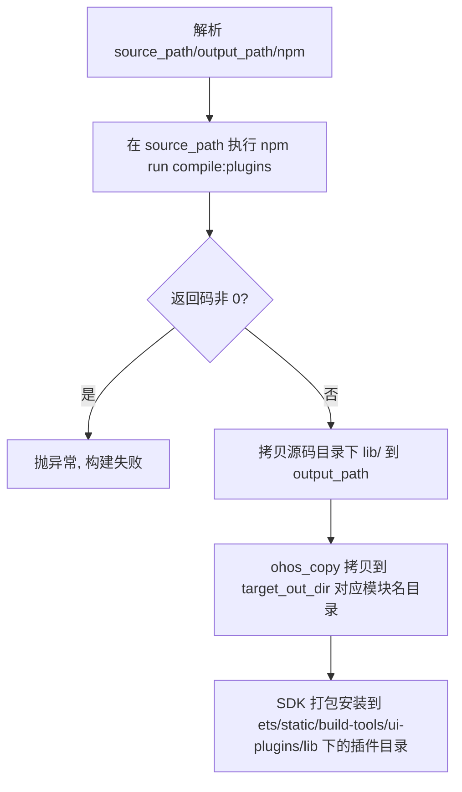

# 09 插件（ui-plugins，独立环节）

> 对应 [00-overview](./00-overview.md)「环节 09」。
> 脚本 `interface/sdk-js/build_api_check_plugin.py`，**独立环节**：与接口源文件处理无关。
> 本环节产物由 [10-sdk-packaging-install](./10-sdk-packaging-install.md) 安装。

## 1. 环节职责

| 项 | 内容 |
| -- | ---- |
| 独立性 | **独立环节**：不依赖接口源文件处理，不需要 `ohos_base_split` 等拆分动作 |
| 目标 | `gen_api_check_plugin`、`gen_api_transform` → `api_check_plugin`、`api-transform-plugin` |
| 脚本 | `interface/sdk-js/build_api_check_plugin.py` |
| 归属领域 | sdk（interface/sdk-js 仓） |
| 输入 | `interface/sdk-js/build-tools/compile-plugins/{api-check-plugin-static,api-transform-static}` + npm |
| 输出 | `out/<产品>/gen/interface/sdk-js/gen_api_check_plugin`、`gen_api_transform` |
| 一句话 | 用 npm 构建 api-check / api-transform 两个静态插件工程，再把各工程 `lib/` 拷到最终输出目录 |

## 2. 调用命令

```text
python interface/sdk-js/build_api_check_plugin.py \
    --source_path <plugin 源码目录> \
    --output_path out/<产品>/gen/interface/sdk-js/<target_name> \
    --npm         //prebuilts/build-tools/common/nodejs/current/bin/npm
```

## 3. 处理流程



脚本逻辑只有两步：

1. 在 `source_path` 下执行 `npm run compile:plugins`；
2. 把源码目录下的 `lib/` 拷贝到 `output_path`。

`run_cmd` 会检查返回码，非 0 时抛异常（构建失败）。

## 4. 两个插件实例

### 4.1 `api_check_plugin`

| 项 | 内容 |
| -- | ---- |
| 源码 | `interface/sdk-js/build-tools/compile-plugins/api-check-plugin-static` |
| 中间产物 | `out/<产品>/gen/interface/sdk-js/gen_api_check_plugin`（`target_gen_dir`） |
| 最终输出 | `out/<产品>/obj/interface/sdk-js/api-check-plugin` |
| 安装目录 | `ets/static/build-tools/ui-plugins/lib/api-check-plugin` |

```gn
action("gen_api_check_plugin") {
  external_deps = [ "ace_ets2bundle:ohos_ets_ui_plugins" ]
  script = "build_api_check_plugin.py"
  args = [ "--source_path", "build-tools/compile-plugins/api-check-plugin-static",
           "--output_path", "${target_gen_dir}/${target_name}", "--npm", npm_path ]
  outputs = [ "${target_gen_dir}/${target_name}" ]
}
ohos_copy("api_check_plugin") {
  deps = [ ":gen_api_check_plugin" ]
  sources = [ "${target_gen_dir}/gen_api_check_plugin" ]
  outputs = [ target_out_dir + "/api-check-plugin" ]
}
```

### 4.2 `api-transform-plugin`

| 项 | 内容 |
| -- | ---- |
| 源码 | `interface/sdk-js/build-tools/compile-plugins/api-transform-static` |
| 中间产物 | `out/<产品>/gen/interface/sdk-js/gen_api_transform` |
| 最终输出 | `out/<产品>/obj/interface/sdk-js/api-transform-plugin` |
| 安装目录 | `ets/static/build-tools/ui-plugins/lib/api-transform-plugin` |

两个插件共用同一个 Python 脚本，`external_deps` 均为 `ace_ets2bundle:ohos_ets_ui_plugins`，
npm 路径固定在 prebuilts 中。

## 5. 关键细节

- 插件构建是**独立环节**，与接口源文件处理无关，不需要先跑 `ohos_base_split` 等拆分脚本；
- 可以在任意时刻构建，产物只依赖插件源码与 npm 工具链；
- 先在 `target_gen_dir` 下构建，再由 `ohos_copy` 拷到 `target_out_dir` 对应模块名目录；
- 只有 `sdk_build_arkts == true` 时 `ets/static/*` 条目才保留（否则环节 01 已过滤）。

## 6. 相关文件

| 文件 | 作用 |
| ---- | ---- |
| `interface/sdk-js/build_api_check_plugin.py` | 插件 npm 构建与输出拷贝 |
| `interface/sdk-js/build-tools/compile-plugins/api-check-plugin-static` | api-check 插件源码 |
| `interface/sdk-js/build-tools/compile-plugins/api-transform-static` | api-transform 插件源码 |
| `interface/sdk-js/BUILD.gn` | `gen_*` / `ohos_copy` 目标定义 |
