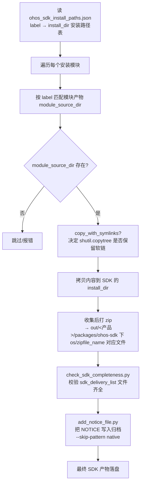

# 10 SDK 打包安装（build 仓，`copy_and_archive` 模板）

> 对应 [00-总览](./00-总览.md)「环节 10」。
> 脚本均在 build 仓：`build/ohos/sdk/copy_sdk_modules.py`、`build/ohos/sdk/check_sdk_completeness.py`、`build/ohos/sdk/add_notice_file.py`。
> 上游模块产物来自 [01-GN生成期](./01-GN生成期-00总览.md) 至 [08-清标签](./08-清标签.md)，
> 以及独立环节 [09-插件](./09-插件.md)。

## 1. 环节职责

| 项 | 内容 |
| -- | ---- |
| 模板 | `build/ohos/sdk/sdk.gni` 的 `copy_and_archive`（`make_<os>_sdk_modules`） |
| 输入 | ①环节 01.2 的 `ohos_sdk_install_paths.json`（label→install_dir）②各模块产物（`module_source_dir`） |
| 输出 | `out/<产品>/packages/ohos-sdk/<os>/<sdk_type>-<os>-<arch>-<version>.zip` |
| 一句话 | 按 `ohos_sdk_install_paths.json` 把每个模块 `module_source_dir` 内容拷到 `install_dir` 再打 zip，并做完整性校验与 NOTICE 补写 |

`make_<os>_sdk_modules`（环节 01.3 渲染）解析各模块 label → 生成 `sdk_modules.json` →
`copy_and_archive` 调 `copy_sdk_modules.py`，最终产出
`out/<产品>/packages/ohos-sdk/<os>/<zipfile_name>`（`ohos_sdk_out_dir = $product_output_dir/${product_name}`
即 `out/<产品>/packages/ohos-sdk`）。

## 2. 处理流程

## 3. 脚本逐个说明

### 3.1 `build/ohos/sdk/copy_sdk_modules.py`（拷贝 + 打 zip）

| 项 | 内容 |
| -- | ---- |
| 归属领域 | 编译构建（build 仓） |
| 输入 | ①`ohos_sdk_install_paths.json`（经 `sdk.gni` 的 `--sdk-archive-paths-file` 传入）②各模块 `module_source_dir` |
| 输出 | `out/<产品>/packages/ohos-sdk/<os>/<sdk_type>-<os>-<arch>-<version>.zip` |
| 处理 | 按 `label` 匹配模块产物、按 `install_dir` 计算目标路径并拷贝；`copy_with_symlinks` 控制 `shutil.copytree` 是否保留软链 |

- `install_dir` 由环节 01.1 改写（`ets/dynamic/` → `ets/`）或环节 01.2 占位符展开而来；
- 各模块在描述文件中的登记顺序决定安装路径表；
- **最终产物目录由这一步落盘**。

### 3.2 `build/ohos/sdk/check_sdk_completeness.py`（完整性校验）

| 项 | 内容 |
| -- | ---- |
| 归属领域 | 编译构建（build 仓） |
| 输入 | `sdk_delivery_list`（交付清单）+ 打包产物目录 |
| 输出 | `check_sdk_completeness.txt` |
| 处理 | 校验交付清单要求的文件是否齐全，输出校验结果 |

### 3.3 `build/ohos/sdk/add_notice_file.py`（加 NOTICE）

| 项 | 内容 |
| -- | ---- |
| 归属领域 | 编译构建（build 仓） |
| 输入 | `sdk_notice_txt` + 打包产物目录 |
| 输出 | stamp |
| 处理 | 把 NOTICE 文件写入 SDK 归档（`--skip-pattern native` 跳过 native 目录） |

## 4. 安装路径与模块来源

`ohos_sdk_install_paths.json` 中本仓（`//interface/sdk-js:`）共 **23 条**登记，逐一列出如下
（分组、开关联动、5 种流程等完整视角见 [12-入口清单与流程视角](./12-入口清单与流程视角.md)）：

| install_dir | module_label | 目标类型 | 来源 |
| ----------- | ------------ | -------- | ---- |
| `js/api` | `//interface/sdk-js:ohos_declaration_common` | `ohos_declaration_template` | 环节 03 目录级过滤 |
| `js/api/config` | `//interface/sdk-js:config` | `ohos_copy` | 环节 03 被排除目录，源码直拷 |
| `js/form` | `//interface/sdk-js:form_declaration` | `ohos_copy` | 环节 03 被排除目录，源码直拷 |
| `js/api/@internal/full` | `//interface/sdk-js:internal_full` | `ohos_copy_internal` | 环节 04 |
| `js/api/@internal/lite` | `//interface/sdk-js:internal_lite` | `ohos_copy_internal` | 环节 04 |
| `toolchains/syscapcheck` | `//interface/sdk-js:syscap_check` | `ohos_copy` | 源码直拷 |
| `ets/dynamic/api` | `//interface/sdk-js:ohos_build_dynamic_sdk_api` | `ohos_handle_declaration_template` | 环节 08 清标签 |
| `ets/dynamic/arkts` | `//interface/sdk-js:ohos_build_dynamic_sdk_arkts` | `ohos_handle_declaration_template` | 环节 08 清标签 |
| `ets/dynamic/component` | `//interface/sdk-js:ohos_build_dynamic_sdk_component` | `ohos_handle_declaration_template` | 环节 08 清标签 |
| `ets/dynamic/kits` | `//interface/sdk-js:ohos_build_dynamic_sdk_kits` | `ohos_handle_declaration_template` | 环节 08 清标签 |
| `ets/dynamic/build-tools/ets-loader/declarations` | `//interface/sdk-js:bundle_api` | `ohos_copy` | `ohos_build_dynamic_sdk_api` 的单个文件 |
| `ets/dynamic/build-tools/interop` | `//interface/sdk-js:build_dynamic_sdk_interop` | `ohos_copy` | 环节 06 interop |
| `ets/dynamic/build-tools/interop/api` | `//interface/sdk-js:build_dynamic_sdk_predefined_interop` | `ohos_copy` | 环节 06 interop |
| `ets/static/api` | `//interface/sdk-js:ohos_build_static_sdk_api` | `ohos_handle_declaration_template` | 环节 08（输入 `out/<产品>/obj/interface/sdk-js/copy_runtimeapi`） |
| `ets/static/arkts` | `//interface/sdk-js:ohos_build_static_sdk_arkts` | `ohos_handle_declaration_template` | 环节 08（输入 `out/<产品>/obj/interface/sdk-js/copy_runtimeapi`） |
| `ets/static/kits` | `//interface/sdk-js:ohos_build_static_sdk_kits` | `ohos_handle_declaration_template` | 环节 08（输入 `out/<产品>/obj/interface/sdk-js/copy_runtimeapi`） |
| `ets/static/build-tools/ets-loader/runtimeapi` | `//interface/sdk-js:ohos_ets_runtimeapi` | `ohos_copy` | 环节 07 runtimeapi |
| `ets/static/build-tools/interop/declaration` | `//interface/sdk-js:build_static_declaration_sdk_interop` | `ohos_copy` | 环节 06 interop |
| `ets/static/build-tools/interop/bridge` | `//interface/sdk-js:build_static_bridge_sdk_interop` | `ohos_copy` | 环节 06 interop |
| `ets/static/build-tools/interop/declaration/api` | `//interface/sdk-js:build_static_predefined_declaration_sdk_interop` | `ohos_copy` | 环节 06 interop |
| `ets/static/build-tools/interop/bridge/api` | `//interface/sdk-js:build_static_predefined_bridge_sdk_interop` | `ohos_copy` | 环节 06 interop |
| `ets/static/build-tools/ui-plugins/lib/api-check-plugin` | `//interface/sdk-js:api_check_plugin` | `action` + `ohos_copy` | 环节 09 插件 |
| `ets/static/build-tools/ui-plugins/lib/api-transform-plugin` | `//interface/sdk-js:api-transform-plugin` | `action` + `ohos_copy` | 环节 09 插件 |

## 5. 关键细节

- **安装到哪，由环节 01 的 install_paths 决定**：修改安装位置一律在
  `ohos_sdk_description_std.json` 的 `install_dir` / `module_label` 登记；
- `target_os` 决定模块进入哪些 OS 分组（本仓多数含 `ohos`，纯工具类只进 host 构建包）；
- `build_only` 条目只构建不安装（进 `extras`）；
- 非 ArkTS 构建（`sdk_build_arkts != true`）时，环节 01.1 已把 `ets/dynamic/` 改写为 `ets/`，
  static / interop / 插件条目被删除，这里只打包一套 dynamic 接口。

## 6. 常加的改动

- **修改最终打包 zip / 交付** → `copy_sdk_modules.py`、`check_sdk_completeness.py`；
- **修改 SDK 安装路径** → 环节 01 描述文件（下游 parse 链自动生效）。

## 7. 相关文件

| 文件 | 作用 |
| ---- | ---- |
| `build/ohos/sdk/copy_sdk_modules.py` | 按安装路径表拷贝并打包 |
| `build/ohos/sdk/check_sdk_completeness.py` | 完整性校验 |
| `build/ohos/sdk/add_notice_file.py` | 写入 NOTICE |
| `build/ohos/sdk/sdk.gni` | `make_<os>_sdk_modules` / `copy_and_archive` 模板 |
| `build/ohos/sdk/ohos_sdk_description_std.json` | 安装清单（`module_label` / `install_dir`） |
| `build/ohos/sdk/ohos_sdk_install_paths.json` | 环节 01.2 生成的安装路径表（`out/<产品>/gen/` 下） |
