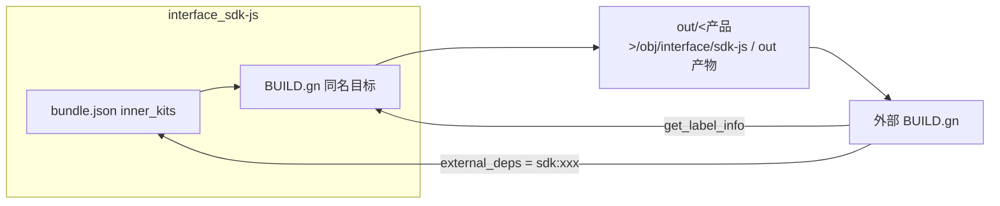

# 11 跨部件对外接口（`sdk:` 标签 / `inner_kits` 契约）

> 对应 [00-总览](./00-总览.md)「环节 11」。
> 与环节 01~10 的**内部处理链**不同，本文是**跨部件依赖契约**：
> 其他部件如何依赖 `interface_sdk-js` 暴露的 GN 目标。
> 内容依据 `interface/sdk-js/bundle.json` 的 `component.build.inner_kits`。

## 1. 环节职责

| 项 | 内容 |
| -- | ---- |
| 契约载体 | `interface/sdk-js/bundle.json` 的 `component.build.inner_kits` |
| 对外目标 | 共 **13 个** inner_kit |
| 实际消费 | 外部用 `sdk:` 引用 **9 个**；`is_arkui_x` 分支用 `//interface/sdk-js:` 直引 4 个 |
| 一句话 | 定义「别的部件能不能依赖、怎么依赖」，**不是** SDK 安装清单 |

> `inner_kits` 与 SDK 安装清单（`build/ohos/sdk/ohos_sdk_description_std.json`
> 的 `module_label` / `install_dir`）是**两回事**：前者管跨部件依赖，后者管打包落盘。

## 2. `sdk:` 标签的解析

`bundle.json` 声明子系统/组件名与可依赖目标：

```json
"component": {
  "name": "sdk",
  "subsystem": "sdk",
  "build": {
    "inner_kits": [
      { "name": "//interface/sdk-js:ets_component" }
    ]
  }
}
```

外部用法：

```gn
external_deps = [ "sdk:ets_component" ]
```

等价于 `//interface/sdk-js:ets_component`：

- `sdk:` 指向 `subsystem = "sdk"` 的组件；
- 目标名必须已登记在 `inner_kits`，否则 `sdk:` 无法解析；
- `get_label_info("sdk:ets_component", "target_out_dir")` 解析到
  `out/<产品>/obj/interface/sdk-js`，外部常用它推导该目录。



> `sdk:` 与 `//interface/sdk-js:` 指向同一 GN 目标；
> 区别在跨部件依赖检查、`part_name` / `subsystem_name` 校验和路径可见性。

## 3. `inner_kits` 清单（13 个目标）

| 目标 | 类型 | 外部引用 |
| ---- | ---- | -------- |
| `ets_internal_api` | `ohos_copy_internal` | 直接标签（`is_arkui_x`） |
| `bundle_arkts` | `ohos_copy_internal` | 直接标签（`is_arkui_x`） |
| `ets_component` | `ohos_copy_internal` | `sdk:ets_component`（仅 `get_label_info`） |
| `bundle_kits` | `ohos_copy_internal` | 直接标签（`is_arkui_x`） |
| `ohos_declaration_ets` | `ohos_declaration_template` | 直接标签（`is_arkui_x`） |
| `ohos_declaration_ets_api` | `ohos_copy` | `sdk:ohos_declaration_ets_api` |
| `ets_internal_api_etc` | `ohos_prebuilt_etc` | `sdk:ets_internal_api_etc` |
| `bundle_arkts_etc` | `ohos_prebuilt_etc` | `sdk:bundle_arkts_etc` |
| `ets_component_etc` | `ohos_prebuilt_etc` | `sdk:ets_component_etc` |
| `bundle_kits_etc` | `ohos_prebuilt_etc` | `sdk:bundle_kits_etc` |
| `ohos_ets_api` | `ohos_copy` | `sdk:ohos_ets_api` |
| `ohos_ets_arkts` | `ohos_copy` | `sdk:ohos_ets_arkts` |
| `ohos_ets_kits` | `ohos_copy` | `sdk:ohos_ets_kits` |

要点：

- `*_etc` 目标的输出文件本身常不被外部读取，它们是带
  `part_name = "sdk"` / `subsystem_name = "sdk"` 的**依赖载体**，
  用来建立跨部件依赖并触发上游 producer；
- `ohos_declaration_ets_api` 是例外：被外部**当作数据源**读取的拷贝目标，
  输出到 `out/<产品>/obj/interface/api`；
- `ets_component_etc` 的 `output` 直接复用
  `out/<产品>/obj/interface/sdk-js/ohos_build_dynamic_sdk_component`。

## 4. 外部引用明细

### 4.1 `developtools_ace_ets2bundle/BUILD.gn`（6 个）

非 `is_arkui_x` 分支用 `sdk:`：

```gn
ets_component_dep = "sdk:ets_component"
external_deps = [
  "sdk:bundle_arkts_etc",
  "sdk:bundle_kits_etc",
  "sdk:ets_component_etc",
  "sdk:ets_internal_api_etc",
  "sdk:ohos_declaration_ets_api",
]
```

`build_ets_loader_library` 实际读取：

| 外部读取路径 | 数据来源目标 | 依赖入口 |
| ------------ | ------------ | -------- |
| `out/<产品>/obj/interface/sdk-js/ohos_build_dynamic_sdk_component` | `ohos_build_dynamic_sdk_component` | `sdk:ets_component_etc` |
| `out/<产品>/obj/interface/sdk-js/bundle_kits` | `bundle_kits` | `sdk:bundle_kits_etc` |
| `out/<产品>/obj/interface/sdk-js/bundle_arkts` | `bundle_arkts` | `sdk:bundle_arkts_etc` |
| `out/<产品>/ohos_declaration/ohos_declaration_ets` | `ohos_declaration_ets` | `sdk:ohos_declaration_ets_api`（间接） |
| `out/<产品>/obj/interface/api` | `ohos_declaration_ets_api` | `sdk:ohos_declaration_ets_api` |

`is_arkui_x` 分支不走 `sdk:`，直接依赖：

```gn
deps += [
  "//interface/sdk-js:bundle_arkts",
  "//interface/sdk-js:bundle_kits",
  "//interface/sdk-js:ohos_build_dynamic_sdk_component",
  "//interface/sdk-js:ets_internal_api",
  "//interface/sdk-js:ohos_declaration_ets",
]
```

`ohos_declaration_ets_ark` 在 `is_arkui_x` 时也直依赖 `ohos_declaration_ets`。

### 4.2 `build/config/components/ets_frontend/ets2abc_config.gni`（3 个）

```gn
ohos_ets_kits_deps = "sdk:ohos_ets_kits"
ohos_ets_api_deps = "sdk:ohos_ets_api"
ohos_ets_arkts_deps = "sdk:ohos_ets_arkts"
```

- `ui_enable == "True"` 时，ets2abc 模板把 3 个 `sdk:ohos_ets_*` 加入
  `external_deps`，并把 `out/<产品>/ohos_ets/{api,arkts,kits}` 作为
  `--scan-path` 传给 ArkTS 1.2 工具链；
- 只有 `base_url` 时，加入 `ohos_ets_api` / `ohos_ets_arkts`；
- 即 `ohos_ets_{api,arkts,kits}` 是 static SDK 面向 ets2panda 的**输入出口**。

## 5. 与内部链路的对应

| inner_kit | 内部下游（05 环节） | 说明 |
| --------- | ------------------- | ---- |
| `ohos_declaration_ets` | 环节 03 → [05-装配](./05-装配.md) | 装配 dynamic `api` |
| `ets_internal_api` | 环节 04 → 05 装配 | 装配 `api/@internal/full` |
| `bundle_arkts` | 环节 04 → 05 装配 | 装配 dynamic `arkts` |
| `ets_component` | 环节 04 → 05 装配 | 装配 dynamic `component` |
| `bundle_kits` | 环节 04 → 05 装配 | 装配 dynamic `kits` |
| `ets_component_etc` | 环节 08 | 外部读取最终组件声明目录 |
| `ohos_ets_api/arkts/kits` | 环节 05（`build_ohos_ets`） | static SDK 工具链输入 |
| `ohos_declaration_ets_api` | 环节 05 装配（`out/<产品>/obj/interface/api`） | 被 ace_ets2bundle 当数据源读取 |

## 6. 常加的改动

1. **新增外部可依赖目标** → 同时在 `BUILD.gn` 定义、`bundle.json` 的
   `inner_kits` 登记、外部用 `sdk:<target>`；
2. **重命名 / 删除 inner_kit** → 搜索 `sdk:<target>` 与
   `//interface/sdk-js:<target>`（`is_arkui_x` 分支）两处引用；
3. **只用于 SDK 安装、没有跨部件消费者的目标** → 不必登记到 `inner_kits`。

## 7. 相关文件

| 文件 | 作用 |
| ---- | ---- |
| `interface/sdk-js/bundle.json` | `subsystem/component = sdk`，定义 13 个 `inner_kits` |
| `interface/sdk-js/BUILD.gn` | 13 个目标的定义与 producer |
| `build/config/components/ets_frontend/ets2abc_config.gni` | `sdk:ohos_ets_{api,arkts,kits}` 引用与扫描路径 |
| `developtools_ace_ets2bundle/BUILD.gn` | ets-loader 构建时引用 `sdk:` 目标并读取产物目录 |
| `build/ohos/sdk/ohos_sdk_description_std.json` | SDK 安装模块清单（与 `inner_kits` 不同） |
