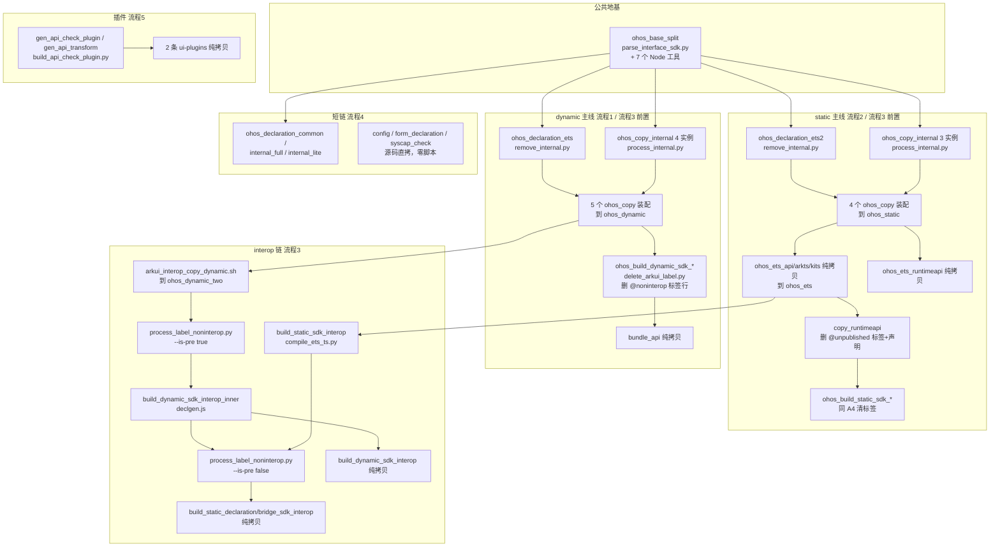

# 12 入口清单与流程视角（SDK 描述文件 23 条入口）

> 环节 01~11 是**流水线视角**（按 GN/ninja 执行顺序）；本文是**入口视角**：
> 从 `build/ohos/sdk/ohos_sdk_description_std.json` 中 `module_label` 属于
> `//interface/sdk-js` 的 **23 条**条目出发，看每条入口：
> ①装到什么 `install_dir`、②被 public / arkts 开关如何联动、③执行时先后跑哪些脚本。
> 与 [10-sdk-packaging-install](./10-sdk-packaging-install.md) §4 的登记表同源，本文补充分组、联动、流程。

> 入口语义：**「构建该 GN 目标，产物安装到 SDK 的 install_dir」**。
> 条目本身仍是 GN 依赖图的顶层节点，其 `deps` 决定中间产物如何生成。

## 1. 23 条入口分组总表

### 1.1 js/（类 Web 范式，5 条）

| install_dir | module_label | 目标类型 | 来源内容 | 上游依赖 |
| ----------- | ------------ | -------- | -------- | -------- |
| `js/api` | `ohos_declaration_common` | `ohos_declaration_template` | `out/<产品>/sdk-interface/dynamic/sdk-js/api` 经 [03-directory-filter](./03-directory-filter.md) 排除 `@internal`/`common`/`form`/`config` 等 6 个目录后的声明集 | [02](./02-00interface-split-overview.md) |
| `js/api/config` | `config` | `ohos_copy` | 源仓 `api/config/{css,hml}`（直接读源码目录，不依赖接口树） | — |
| `js/form` | `form_declaration` | `ohos_copy` | 源仓 `api/form/{action,css,hml}`（直接读源码目录） | — |
| `js/api/@internal/full` | `internal_full` | `ohos_copy_internal` | `out/<产品>/sdk-interface/dynamic/sdk-js/api/common/full` 经 [04-internal-dirs-modules](./04-internal-dirs-modules.md) | [02](./02-00interface-split-overview.md) |
| `js/api/@internal/lite` | `internal_lite` | `ohos_copy_internal` | `out/<产品>/sdk-interface/dynamic/sdk-js/api/common/lite`（public 删 `featureability.d.ts`） | [02](./02-00interface-split-overview.md) |

> `js/api` 的输入同时会产出 `js/api/config`、`js/form` 的内容，但
> [03-directory-filter](./03-directory-filter.md) 把 `config`、`form` 目录排除了，所以这两个目录
> 需要由 `config` / `form_declaration` 两条入口单独从源码目录拷贝安装。

### 1.2 ets/dynamic/*（ArkTS 1.1 动态 SDK，7 条）

| install_dir | module_label | 目标类型 | 来源内容 |
| ----------- | ------------ | -------- | -------- |
| `ets/dynamic/api` | `ohos_build_dynamic_sdk_api` | `ohos_handle_declaration_template` | `out/<产品>/ohos_dynamic/api`（声明集 + `@internal/full`，经 [08-label-cleanup](./08-label-cleanup.md)） |
| `ets/dynamic/arkts` | `ohos_build_dynamic_sdk_arkts` | `ohos_handle_declaration_template` | `out/<产品>/ohos_dynamic/arkts` |
| `ets/dynamic/component` | `ohos_build_dynamic_sdk_component` | `ohos_handle_declaration_template` | `out/<产品>/ohos_dynamic/component`（组件声明，public 删 13 个系统组件） |
| `ets/dynamic/kits` | `ohos_build_dynamic_sdk_kits` | `ohos_handle_declaration_template` | `out/<产品>/ohos_dynamic/kits` |
| `ets/dynamic/build-tools/ets-loader/declarations` | `bundle_api` | `ohos_copy` | `out/<产品>/obj/interface/sdk-js/ohos_build_dynamic_sdk_api/bundle/bundleStatusCallback.d.ts` |
| `ets/dynamic/build-tools/interop` | `build_dynamic_sdk_interop` | `ohos_copy` | `out/<产品>/sdk-interface/dynamic-interop`（[06-interop](./06-interop.md) declgen 产出） |
| `ets/dynamic/build-tools/interop/api` | `build_dynamic_sdk_predefined_interop` | `ohos_copy` | 源仓 `build-tools/interop/dynamic/api/@ohos.lang.interop.d.ets` |

### 1.3 ets/static/*（ArkTS 1.2 静态 SDK，10 条）

| install_dir | module_label | 目标类型 | 来源内容 |
| ----------- | ------------ | -------- | -------- |
| `ets/static/api` | `ohos_build_static_sdk_api` | `ohos_handle_declaration_template` | `out/<产品>/obj/interface/sdk-js/copy_runtimeapi/api`（经 [07-runtimeapi](./07-runtimeapi.md) 删 `@unpublished`） |
| `ets/static/arkts` | `ohos_build_static_sdk_arkts` | `ohos_handle_declaration_template` | `out/<产品>/obj/interface/sdk-js/copy_runtimeapi/arkts` |
| `ets/static/kits` | `ohos_build_static_sdk_kits` | `ohos_handle_declaration_template` | `out/<产品>/obj/interface/sdk-js/copy_runtimeapi/kits` |
| `ets/static/build-tools/ets-loader/runtimeapi` | `ohos_ets_runtimeapi` | `ohos_copy` | `out/<产品>/obj/interface/sdk-js/copy_runtimeapi_runtimeapi`（仅删 `@unpublished` 标签，API 保留） |
| `ets/static/build-tools/interop/declaration` | `build_static_declaration_sdk_interop` | `ohos_copy` | `out/<产品>/sdk-interface/static-interop/declaration`（[06-interop](./06-interop.md) 产出） |
| `ets/static/build-tools/interop/bridge` | `build_static_bridge_sdk_interop` | `ohos_copy` | `out/<产品>/sdk-interface/static-interop/bridge` |
| `ets/static/build-tools/interop/declaration/api` | `build_static_predefined_declaration_sdk_interop` | `ohos_copy` | 源仓 `build-tools/interop/static/declaration/api/` 下 2 个预定义声明 |
| `ets/static/build-tools/interop/bridge/api` | `build_static_predefined_bridge_sdk_interop` | `ohos_copy` | 源仓 `build-tools/interop/static/bridge/api/@ohos.lang.interop.ts` |
| `ets/static/build-tools/ui-plugins/lib/api-check-plugin` | `api_check_plugin` | `action` + `ohos_copy` | [09-plugins](./09-plugins.md) npm 构建产物 |
| `ets/static/build-tools/ui-plugins/lib/api-transform-plugin` | `api-transform-plugin` | `action` + `ohos_copy` | [09-plugins](./09-plugins.md) npm 构建产物 |

### 1.4 toolchains/（1 条）

| install_dir | module_label | 目标类型 | 来源内容 |
| ----------- | ------------ | -------- | -------- |
| `toolchains/syscapcheck` | `syscap_check` | `ohos_copy` | 源仓 `api/syscapCheck/sysCapSchema.json` |

三条 ui-plugins 条目（上表 1.3 最后两行）与 `syscap_check` 是仅工具类条目，
不携带接口声明。

## 2. 与 01-01 过滤规则的联动

`build/ohos/sdk/parse_description.py`（[01-01file-trim](./01-01file-trim.md)）
对这 23 条的效果：

### 2.1 `sdk_build_public == "true"`

| 效果 | 条目 |
| ---- | ---- |
| 删除 | `bundle_api`（`DEL_TARGET` 唯一成员；public SDK 不带 ets-loader declarations） |
| [04-internal-dirs-modules](./04-internal-dirs-modules.md) 内部再过滤 | `internal_lite`（删 `featureability.d.ts`）、`ets_component`（删 13 个系统组件，ets/dynamic/component 入口的上游） |
| 替代删除 | [02-03delete-system-api](./02-03delete-system-api.md) 阶段删 `@systemapi`（依赖链内，非描述文件过滤） |

### 2.2 `sdk_build_arkts == "false"`（不构建静态 SDK）

| 规则 | 命中的条目 | 结果 |
| ---- | ---------- | ---- |
| `install_dir` 以 `ets/static/` 开头 → 删除 | `ohos_build_static_sdk_*` 3 条、`ohos_ets_runtimeapi`、`build_static_*_interop` 4 条、`api_check_plugin`、`api-transform-plugin`（共 10 条） | 整条删除 |
| `install_dir` 以 `ets/dynamic/build-tools/interop` 开头 → 删除 | `build_dynamic_sdk_interop`、`build_dynamic_sdk_predefined_interop`（2 条） | 整条删除 |
| `install_dir` 以 `ets/dynamic/` 开头（其余）→ 前缀改写为 `ets/` | `ohos_build_dynamic_sdk_api/arkts/component/kits`、`bundle_api`（5 条） | 安装目录变成 `ets/api`、`ets/arkts`、`ets/component`、`ets/kits`、`ets/build-tools/ets-loader/declarations` |
| 不含 `ets/static`/`ets/dynamic` 前缀 → 不变 | `js/*` 5 条、`toolchains/syscapcheck` | 原样保留 |

### 2.3 `sdk_build_arkts == "true"`

全部 23 条原样保留，仅 `bundle_api` 在 public 组合下会被删；
dynamic 与 static 目录并存。

## 3. target_os 字段

描述文件所有本仓条目的 `target_os` 为
`["windows","linux","darwin","ohos","linux_arm64"]`，仅两类例外：

| 条目 | target_os | 说明 |
| ---- | --------- | ---- |
| `syscap_check`、2 条 ui-plugins | `["linux","windows","darwin","linux_arm64"]` | 纯工具，**不进 ohos 设备 SDK**，只进各 host 构建工具包 |
| 其余 20 条 | 含 `ohos` | 设备 SDK 与 host SDK 都安装 |

## 4. 口径外目标说明

描述文件只收录 **可直接安装的最终目标**；本仓 `BUILD.gn` 中其余目标属于
中间产物或对外部件接口，不在此表：

- **中间链路**：[02-00interface-split-overview](./02-00interface-split-overview.md)（`ohos_base_split`）、
  [03-directory-filter](./03-directory-filter.md)（`ohos_declaration_ets`）、
  [04-internal-dirs-modules](./04-internal-dirs-modules.md)（`ohos_copy_internal` 全部实例）、
  [05-assembly](./05-assembly.md)（`ohos_ets_dynamic*` / `ohos_ets_static*` 装配目标）、
  [07-runtimeapi](./07-runtimeapi.md)（`copy_runtimeapi`）、[06-interop](./06-interop.md) 各 action——
  它们作为上述 23 条目标的 `deps` 被 ninja 间接构建；
- **多设备/部件直接消费**：`ohos_declaration_ets_api`、`bundle_arkts_etc`、
  `bundle_kits_etc` 等通过部件 `deps` 直接被外部子系统依赖
  （见 [11-cross-part-interfaces](./11-cross-part-interfaces.md)），不参与 SDK 打包。

## 5. 23 条入口只有 5 种流程

把每条入口理解为「点菜」——描述文件登记的 `module_label` 是一份菜单，
ninja 按菜单把后厨（各脚本流水线）依次跑完，出餐到 SDK 的 `install_dir`。
23 条菜只会命中下面 **5 种制作流程**：

| 流程 | 一句话 | 覆盖的入口 |
| ---- | ------ | ---------- |
| ① 声明安装主线 | 拆分 → 筛选拷贝 → 装配 → 清标签 | dynamic api / arkts / component / kits 共 4 条，外加 `bundle_api`（只装 1 个文件）= **5 条** |
| ② 声明安装主线（静态版） | 同 ①，多一步「删 @unpublished」 | static api / arkts / kits、`ohos_ets_runtimeapi` = **4 条** |
| ③ interop 生成 | 工具生成互操作声明/胶水代码 | dynamic 1 条、static 2 条、预定义 3 条（其中 3 条预定义**零脚本**）= **6 条** |
| ④ 短链 / 纯拷贝 | 跳过装配与清标签，部分零脚本 | js/api 家族 3 条（前缀步骤 1~2）、config / form / syscapCheck 3 条（**零脚本**）= **6 条** |
| ⑤ 插件 npm 构建 | 只跑一个 npm 构建脚本 | ui-plugins 2 条 |

> 数量核对：5 + 4 + 6 + 6 + 2 = 23。

## 6. 链路总览图



## 7. 流程详解

### 7.1 流程 ①：声明安装主线（以 `ets/dynamic/api` 为例）

执行顺序固定为 5 步，前 4 步的内容对 dynamic 的 4 条入口是共用的，第 5 步只换「处理哪个目录」：

| 步骤 | 脚本 / 动作 | 干什么 |
| ---- | ----------- | ------ |
| 1 | [02-00interface-split-overview](./02-00interface-split-overview.md)（`parse_interface_sdk.py` + 7 个 Node 工具） | 把源接口「清洗」成 `out/<产品>/sdk-interface/{dynamic,static}/sdk-js` 两套接口树 |
| 2 | [03-directory-filter](./03-directory-filter.md)（`remove_internal.py`） | 生成声明集，跳过 6 个特殊目录 |
| 3 | [04-internal-dirs-modules](./04-internal-dirs-modules.md)（`process_internal.py` ×4 并行） | 处理 `@internal/ets`、`arkts`、`component/ets`、`kits` |
| 4 | [05-assembly](./05-assembly.md)（`ohos_copy` 纯拷贝） | 合成待打包目录 `out/<产品>/ohos_dynamic/{api,@internal/full,arkts,component,kits}` |
| 5 | [08-label-cleanup](./08-label-cleanup.md)（`delete_arkui_label.py`） | 逐文件删 `@noninterop` 标签行，输出最终目录 |

- `arkts`、`kits` 与 api 相同规则；`component` 因输入目录名就叫 component，会命中整个目录；
- `bundle_api` 也属于本流程：步骤 1 完成后纯拷贝安装那 1 个额外文件
  `bundle/bundleStatusCallback.d.ts`（公开版不带）。

### 7.2 流程 ②：静态主线（+ 一步删 @unpublished）

static 的 3 条安装项（api / arkts / kits）把流程 ① 的 5 步换成 static 版本：

- 步骤 1 还是一样的 `parse_interface_sdk.py`（同时产出 static 树；static 树不做数值类型转换）；
- 步骤 2~4 换成 `ohos_declaration_ets2`、`_static` 三件套，装配为 `out/<产品>/ohos_static`；
- **多出**步骤 4.5：[07-runtimeapi](./07-runtimeapi.md)（`copy_runtimeapi.py`）→
  静态树先拷两份，对其中一份删 `@unpublished` 标签+声明；另一份保留原始内容（内部版本）；
- 步骤 5 同样用 [08-label-cleanup](./08-label-cleanup.md) 清标签后安装到 `ets/static/*`；
- 产物 `ohos_ets_runtimeapi`：不跑步骤 5，直接把「保留 `@unpublished` 的那份副本」
  安装到 `ets/static/build-tools/ets-loader/runtimeapi`（给 ets-loader 用；
  public / 非静态构建下会随 `ets/static/*` 一起被过滤掉）。

### 7.3 流程 ③：interop 链（6 条，其中 3 条零脚本）

互操作声明（ArkTS 1.1/1.2 互相调用用的额外声明与胶水代码）分三路：

- **预定义 3 条（零脚本）**：`build_dynamic_sdk_predefined_interop`、
  `build_static_predefined_declaration_sdk_interop`、
  `build_static_predefined_bridge_sdk_interop`——文件手工写好放在本仓
  `build-tools/interop/**`，纯拷贝安装，不处理；
- **dynamic 1 条**（`build_dynamic_sdk_interop`）：复制 `ohos_dynamic` → `ohos_dynamic_two`
  → 原地删 `@noninterop` 成员 + 清理全局 import（`process_label_noninterop.py --is-pre true`）
  → declgen 生成互操作声明 → 收尾删 component、补 GlobalESValue（`--is-pre false`）
  → 纯拷贝安装（详见 [06-interop](./06-interop.md)）。这路在**副本上加工**，原件不受影响；
- **static 2 条**（`build_static_declaration/bridge_sdk_interop`）：编译静态树
  （ets2panda driver，16 并发，按 `compile_ets_ts.json` 排除清单选文件）产出
  `static-interop/{declaration,bridge}` → 收尾处理 → 纯拷贝安装。

### 7.4 流程 ④：短链 / 纯拷贝（6 条）

| 入口 | 跑法 |
| ---- | ---- |
| `ohos_declaration_common`（js/api） | 流程 ① 的步骤 1 + 步骤 2 就直接安装（**无步骤 4、5**：不装配、不清标签） |
| `internal_full`（js/api/@internal/full） | 步骤 1 + [04](./04-internal-dirs-modules.md) 全量拷贝（不装配、不清标签） |
| `internal_lite`（js/api/@internal/lite） | 同上，公开版多删 `featureability.d.ts` |
| `config` / `form_declaration` / `syscap_check` | **零脚本**源码直拷（`parse_interface_sdk.py` 根本不碰，从源仓直接安装） |

> 「跑步骤 1~2」的老三条属于折中：内容来自接口树（所以要先拆分），
> 但不走装配与清标签（所以比流程 ① 短）。

### 7.5 流程 ⑤：插件 npm 构建（2 条）

`api_check_plugin`、`api-transform-plugin`：
`build_api_check_plugin.py` 用 npm 把两个静态插件工程（`build-tools/compile-plugins/*`）
构建出来再拷贝安装，与接口树无关，不需要先跑任何拆分脚本（详见 [09-plugins](./09-plugins.md)）。

## 8. 23 条入口 → 流程归属总表

| # | module_label | 流程 | 前置依赖 |
| -- | ------------ | ---- | -------- |
| 1 | `ohos_build_dynamic_sdk_api` | ① | 需先构建整条主线（步骤 1~4） |
| 2 | `ohos_build_dynamic_sdk_arkts` | ① | 同上 |
| 3 | `ohos_build_dynamic_sdk_component` | ① | 同上 |
| 4 | `ohos_build_dynamic_sdk_kits` | ① | 同上 |
| 5 | `bundle_api` | ① + 一次纯拷贝 | 依赖 #1 完成 |
| 6 | `ohos_build_static_sdk_api` | ② | 需先构建静态主线 |
| 7 | `ohos_build_static_sdk_arkts` | ② | 同上 |
| 8 | `ohos_build_static_sdk_kits` | ② | 同上 |
| 9 | `ohos_ets_runtimeapi` | ②（少一步 5） | 需 `copy_runtimeapi` 产出 |
| 10 | `build_dynamic_sdk_interop` | ③ dynamic 路 | 需 #1~#4 的装配结果 + 收尾 |
| 11 | `build_static_declaration_sdk_interop` | ③ static 路 | 需静态编译链 |
| 12 | `build_static_bridge_sdk_interop` | ③ static 路 | 同 #11 |
| 13 | `build_dynamic_sdk_predefined_interop` | ③ 预定义路（零脚本） | 无 |
| 14 | `build_static_predefined_declaration_sdk_interop` | ③ 预定义路（零脚本） | 无 |
| 15 | `build_static_predefined_bridge_sdk_interop` | ③ 预定义路（零脚本） | 无 |
| 16 | `ohos_declaration_common` | ④（跑步骤 1~2） | 需接口树 |
| 17 | `internal_full` | ④（跑步骤 1~3） | 需接口树 |
| 18 | `internal_lite` | ④ | 需接口树 |
| 19 | `config` | ④ | 无 |
| 20 | `form_declaration` | ④ | 无 |
| 21 | `syscap_check` | ④ | 无 |
| 22 | `api_check_plugin` | ⑤ | npm 链路 |
| 23 | `api-transform-plugin` | ⑤ | npm 链路 |

## 9. 单条菜单的时间线（以 `ohos_build_dynamic_sdk_api` 为例）

单独点一条菜单时，ninja 实际执行顺序：

```text
[1] parse_interface_sdk.py（+ 7 个 Node 工具）          → 两套接口树
[2] remove_internal.py                                  → 声明集
[3] process_internal.py ×4（并行）                      → @internal/arkts/component/kits
[4] ohos_copy ×5（纯拷贝）                              → ohos_dynamic 装配目录
[5] delete_arkui_label.py → delete_label_noninterop.js  → 删 @noninterop，出最终目录
[6] ohos_copy ×1（纯拷贝，由描述文件决定）              → 安装到 ets/dynamic/api
```

`ohos_build_static_sdk_api` 时是把 2~4 换成 static 版本、
在 4 和 5 之间插入 `copy_runtimeapi.py`，其余相同。

## 10. 相关文件

| 文件 | 作用 |
| ---- | ---- |
| `build/ohos/sdk/ohos_sdk_description_std.json` | 本文梳理的描述文件（205 条，本仓 23 条） |
| `build/ohos/sdk/parse_description.py` | 环节 01.1：public / arkts 过滤与 `ets/dynamic/` 改写 |
| `build/ohos/sdk/parse_sdk_description.py` | 环节 01.2：展开为模块清单 |
| `build/ohos/sdk/generate_all_types_sdk.py` | 环节 01.3：渲染各类型打包 `BUILD.gn` |
| `interface/sdk-js/BUILD.gn` | 23 条 `module_label` 对应目标的定义 |
