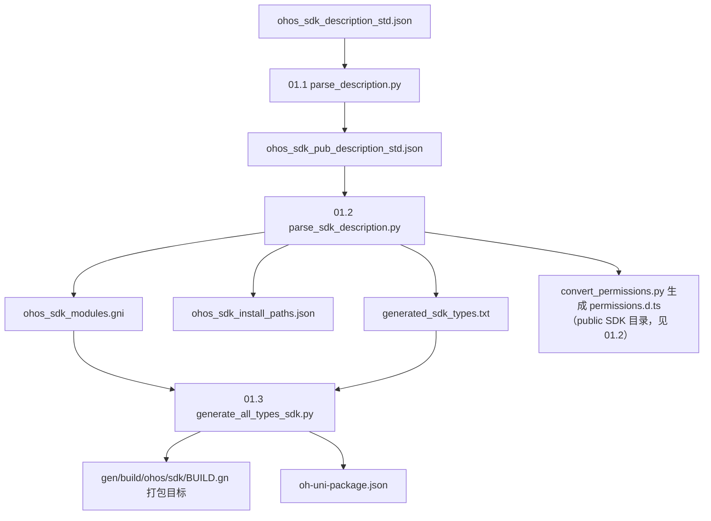

# 01 GN 生成期（总览）

> 对应 [00-总览](./00-总览.md)「环节 01」，发生于
> `build/ohos/sdk/BUILD.gn` 的 `exec_script`，**ninja 之前**执行。
> 产出「菜单」（模块清单、安装路径表、打包 BUILD.gn），不碰任何接口产物。
> 本总览只保留环节概览与脚本索引，各脚本的详细说明见 01.1~01.4 分篇。

## 1. 环节职责

| 项       | 内容                                                                                                                                                     |
| -------- | -------------------------------------------------------------------------------------------------------------------------------------------------------- |
| 执行时机 | GN 生成期（`exec_script`），不是 ninja action                                                                                                          |
| 主要脚本 | `build/ohos/sdk/parse_description.py`、`build/ohos/sdk/parse_sdk_description.py`、`build/ohos/sdk/generate_all_types_sdk.py`、`build/ohos/sdk/convert_permissions.py` |
| 触发条件 | `if (!use_current_sdk)`，依次执行                                                                                                                      |
| 一句话   | 把 SDK 描述 JSON 裁剪、展开为 GN 变量与安装路径，再渲染出打包目标                                                                                        |

## 2. 整体数据流

```text
ohos_sdk_description_std.json
        │
        ▼
[01.1] parse_description.py          按 sdk_build_public/sdk_build_arkts 过滤、改写 install_dir
        ▼
ohos_sdk_pub_description_std.json
        │
        ▼
[01.2] parse_sdk_description.py      展开 ${base}/${platforms}/${variant}，按类型/OS 分组
        ├──► ohos_sdk_modules.gni
        ├──► ohos_sdk_install_paths.json（label → install_dir）
        └──► generated_sdk_types.txt
        ▼
[01.3] generate_all_types_sdk.py     Jinja2 渲染
        ├──► out/<产品>/gen/build/ohos/sdk/BUILD.gn（make_<os>_sdk_modules / copy_and_archive）
        └──► out/<产品>/ohos-sdk/<os>/<type>/oh-uni-package.json（GN 生成期写盘）
```

流程总图：



## 3. 脚本索引

| 步骤 | 归属领域 | 分篇                                                  | 脚本                                                 | 一句话                                                                          |
| ---- | -------- | ----------------------------------------------------- | ---------------------------------------------------- | ------------------------------------------------------------------------------- |
| 01.1 | 编译构建 | [01 文件裁剪](./01-GN生成期-01文件裁剪.md)             | `build/ohos/sdk/parse_description.py`              | 按 `sdk_build_public`/`sdk_build_arkts` 裁剪描述 JSON、改写 `install_dir` |
| 01.2 | 编译构建 | [02 生成模块清单](./01-GN生成期-02生成模块清单.md)     | `build/ohos/sdk/parse_sdk_description.py`          | 展开 `${base}/${platforms}/${variant}`，按 SDK 类型 / OS 分组                 |
| 01.3 | 编译构建 | [03 打包 BUILD 渲染](./01-GN生成期-03打包BUILD渲染.md) | `build/ohos/sdk/generate_all_types_sdk.py`         | Jinja2 渲染「类型 × OS」打包目标与 `oh-uni-package.json`                     |
| 01.4 | 编译构建 / sdk | [04 权限转换](./01-GN生成期-04权限转换.md)             | `build/ohos/sdk/convert_permissions.py`            | 权限定义 JSON → `permissions.d.ts`                                           |

## 4. 输出与下游消费

| 产物                            | 消费方                                                                                 |
| ------------------------------- | -------------------------------------------------------------------------------------- |
| `out/<产品>/gen/build/ohos/sdk/ohos_sdk_modules.gni`        | `generate_all_types_sdk.py`（01.3）渲染 `BUILD.gn` 的 `sdk_modules` / `extras` |
| `out/<产品>/gen/build/ohos/sdk/ohos_sdk_install_paths.json` | `copy_sdk_modules.py`（环节 10）按 `install_dir` 拷贝                              |
| `out/<产品>/gen/build/ohos/sdk/generated_sdk_types.txt`     | `BUILD.gn` `read_file("list lines")` 传给 01.3                                     |
| `out/<产品>/gen/build/ohos/sdk/BUILD.gn`                | `group("generated_ohos_sdk")` 作为 SDK 打包入口                                      |
| `permissions.d.ts`            | public SDK 接口目录（01.2 前置生成）                                                   |

## 5. 相关文件

| 文件                                                                                   | 作用                                                                          |
| -------------------------------------------------------------------------------------- | ----------------------------------------------------------------------------- |
| `build/ohos/sdk/ohos_sdk_description_std.json`                                       | SDK 描述文件（205 条，本仓 23 条）                                            |
| `build/ohos/sdk/parse_description.py`                                                | 01.1 描述裁剪                                                                 |
| `build/ohos/sdk/parse_sdk_description.py`                                            | 01.2 生成模块清单                                                             |
| `build/ohos/sdk/generate_all_types_sdk.py`                                           | 01.3 渲染打包 BUILD.gn                                                        |
| `build/ohos/sdk/convert_permissions.py`                                              | 01.4 权限转换                                                                 |
| `build/ohos/sdk/variant_to_product.json` / `type_to_display_name.json`             | 占位符映射 / 类型显示名                                                       |
| `build/ohos/sdk/sdk.gni`                                                             | `make_<os>_sdk_modules`、`copy_and_archive` 模板                          |
| `build/ohos/build_var.gni`                                                           | `current_sdk_version`、`api_version`、`release_type` 等变量             |
| `build/scripts/util/file_utils.py`                                                   | `read_json_file` / `write_json_file` / `write_file`（含 `gn format`） |
| `build/scripts/util/build_utils.py`                                                  | `rebase_path`                                                               |
| `base/security/access_token/services/accesstokenmanager/permission_definitions.json` | 权限定义输入                                                                  |

> 维护建议：工具侧调整过滤规则/新字段时只改 01.1；改动 01.1 输出字段前先确认
> 01.2 的字段白名单，避免下游 `check_keys` 报错。
