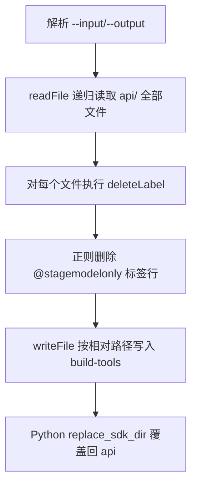

# 02.4 删除 StageModelOnly 标签（interface/sdk-js/build-tools/delete_stagemodelonly_label.js）

> 对应 [02-接口源文件拆分-00总览](./02-接口源文件拆分-00总览.md)「环节 02 · 步骤 02.4」。
> public SDK（`sdk_build_public == "true"`）不对外暴露 Stage 模型专属标记，
> 删除所有 `@stagemodelonly` 标签行，**声明本身保留**。

## 1. 脚本定位

| 项          | 内容                                                                                      |
| ----------- | ----------------------------------------------------------------------------------------- |
| Python 函数 | `delete_stagemodelonly_label_method`（`build/ohos/sdk/parse_interface_sdk.py`）        |
| Node 工具   | `interface/sdk-js/build-tools/delete_stagemodelonly_label.js`                          |
| 归属领域    | sdk（interface/sdk-js 仓）                                                                |
| 触发条件    | `sdk_build_public == "true"`                                                           |
| 作用        | 删除 API 声明 JSDoc 中的 `@stagemodelonly` 标签行，保留接口 / 函数 / 属性声明             |

执行完本环节后，Python 会把暂存目录覆盖回正式目录：

```python
replace_sdk_dir(build-tools/api → api)
```

## 2. 调用命令

```text
node interface/sdk-js/build-tools/delete_stagemodelonly_label.js \
    --input  out/<产品>/sdk-interface/{dynamic|static}/sdk-js/api \
    --output out/<产品>/sdk-interface/{dynamic|static}/sdk-js/build-tools
```

## 3. 输入与输出

| 类别 | 内容                                                                                 |
| ---- | ------------------------------------------------------------------------------------ |
| 输入 | `out/<产品>/sdk-interface/{dynamic,static}/sdk-js/api`（已删 `@systemapi` 后的目录） |
| 输出 | 暂存目录 `out/<产品>/sdk-interface/{dynamic,static}/sdk-js/build-tools/api`（结构镜像源目录） |
| 输出 | 被删空的文件不再输出                                                                  |

## 4. 处理流程



## 5. 判定规则

### 5.1 匹配正则

```js
const STAGE_MODEL_ONLY_TAG_REGX = /^\s*\*\s*\@stagemodelonly[^\r\n]*[\r\n]/mgi;
```

- 大小写不敏感（`i`）：同时命中规范写法 `@stagemodelonly` 与历史写法 `@StageModelOnly`；
- 匹配以 `* @stagemodelonly` 开头的**整行**（可带 `[since x]`、`[staticonly]` 等后缀）；
- 仅删除标签行本身，声明与同一 JSDoc 块中的其它标签不受影响。

### 5.2 保留的内容

- 接口 / 函数 / 属性声明本身保留；
- 同一 JSDoc 块中的 `@syscap`、`@since`、`@atomicservice` 等其它标签保留；
- 仅作为普通文字出现的 `stagemodelonly`（无 `@` 前缀，如文档引用、Markdown）不删除。

## 6. 关键细节

- **无依赖声明**：工具是纯文本正则处理，不依赖 es2panda / libarkts；
- **输出是暂存目录**：`build-tools/api` 是中间产物，执行完立即由 Python `replace_sdk_dir` 覆盖回正式目录；
- **与 02.3 顺序**：本环节在 `delete_systemapi_plugin.js`（02.3）之后执行，
  两者输出暂存到同一 `build-tools` 目录；覆盖回正式目录后，下一个工具再从正式目录读取。

## 7. 相关文件

| 文件                                    | 作用                              |
| --------------------------------------- | --------------------------------- |
| `interface/sdk-js/build-tools/delete_stagemodelonly_label.js` | public 删 `@stagemodelonly` 标签行 |
| `build/ohos/sdk/parse_interface_sdk.py` | `delete_stagemodelonly_label_method` 调度 |
