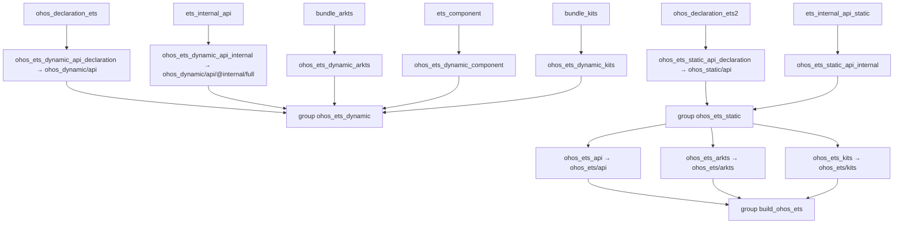

# 05 装配（`ohos_copy` 纯拷贝，无脚本）

> 对应 [00-总览](./00-总览.md)「环节 05」。
> 使用 `build/templates/common/copy.gni` 的 `ohos_copy` 模板，**没有任何脚本参与**。

## 1. 环节职责

| 项 | 内容 |
| -- | ---- |
| 模板 | `build/templates/common/copy.gni` 的 `ohos_copy` |
| 输入 | 环节 03 常规声明目录 + 环节 04 内部目录产物 |
| 输出 | `out/<产品>/ohos_dynamic`、`ohos_static`、`ohos_ets`、`obj/interface/api`、js 各目录 |
| 一句话 | 纯拷贝合成「待打包目录」，作为最终打包和 interop 的统一输入 |

## 2. dynamic 装配（group `ohos_ets_dynamic`）

| `ohos_copy` 目标 | sources | outputs |
| ---------------- | ------- | ------- |
| `ohos_ets_dynamic_api_declaration` | `out/<产品>/ohos_declaration/ohos_declaration_ets` | `out/<产品>/ohos_dynamic/api` |
| `ohos_ets_dynamic_api_internal` | `out/<产品>/obj/interface/sdk-js/ets_internal_api` | `out/<产品>/ohos_dynamic/api/@internal/full` |
| `ohos_ets_dynamic_arkts` | `out/<产品>/obj/interface/sdk-js/bundle_arkts` | `out/<产品>/ohos_dynamic/arkts` |
| `ohos_ets_dynamic_component` | `out/<产品>/obj/interface/sdk-js/ets_component` | `out/<产品>/ohos_dynamic/component` |
| `ohos_ets_dynamic_kits` | `out/<产品>/obj/interface/sdk-js/bundle_kits` | `out/<产品>/ohos_dynamic/kits` |

`group("ohos_ets_dynamic")`（`BUILD.gn:681`）聚合这 5 个目标 ——
是 `ohos_build_dynamic_sdk_*` 的直接依赖。

## 3. static 装配（group `ohos_ets_static`）

| `ohos_copy` 目标 | sources | outputs |
| ---------------- | ------- | ------- |
| `ohos_ets_static_api_declaration` | `out/<产品>/ohos_declaration/ohos_declaration_ets2` | `out/<产品>/ohos_static/api` |
| `ohos_ets_static_api_internal` | `out/<产品>/obj/interface/sdk-js/ets_internal_api_static` | `out/<产品>/ohos_static/api/@internal/full` |
| `ohos_ets_static_arkts` | `out/<产品>/obj/interface/sdk-js/bundle_arkts_static` | `out/<产品>/ohos_static/arkts` |
| `ohos_ets_static_kits` | `out/<产品>/obj/interface/sdk-js/bundle_kits_static` | `out/<产品>/ohos_static/kits` |

`group("ohos_ets_static")` 聚合这 4 个目标。

## 4. static interop 工具输入（group `build_ohos_ets`）

| 目标 | 输入 | 输出 |
| ---- | ---- | ---- |
| `ohos_ets_api` | `out/<产品>/ohos_static/api` | `out/<产品>/ohos_ets/api` |
| `ohos_ets_arkts` | `out/<产品>/ohos_static/arkts` | `out/<产品>/ohos_ets/arkts` |
| `ohos_ets_kits` | `out/<产品>/ohos_static/kits` | `out/<产品>/ohos_ets/kits` |

`group("build_ohos_ets")` 依赖这 3 个目标，并携带 es2panda / ets_frontend 外部依赖。

## 5. 装配结果一览

## 6. 关键点

- 装配阶段只做纯拷贝，内容完整（含 `@noninterop` 标签），只差后续标签清理；
- `internal_full` / `internal_lite` / `ohos_declaration_common` 不属于 `group ohos_ets_dynamic`，
  直接作为 `js/api/@internal/*`、`js/api` 安装；
- `ohos_ets_{api,arkts,kits}` 是 static SDK 面向 ets2panda 工具链的输入出口
  （被 `ets2abc_config.gni` 以 `sdk:ohos_ets_*` 引用，见
  [11-部件化对外接口](./11-部件化对外接口.md)）；
- 新建目标通常不需要动这里的装配关系。

## 7. 相关文件

| 文件 | 作用 |
| ---- | ---- |
| `build/templates/common/copy.gni` | `ohos_copy` 模板定义 |
| `interface/sdk-js/BUILD.gn` | 各 `ohos_copy` / group 目标 |
| `interface/sdk-js/interface_config.gni` | `ohos_dynamic` / `ohos_static` / `ohos_ets` 路径变量 |
