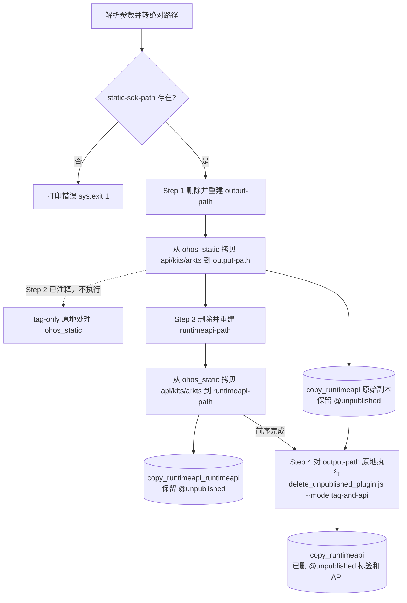
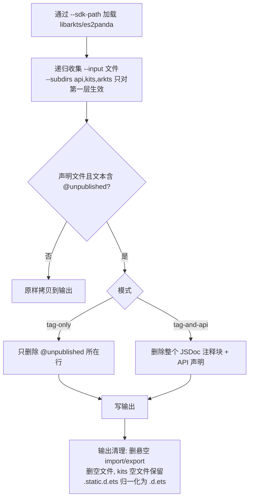
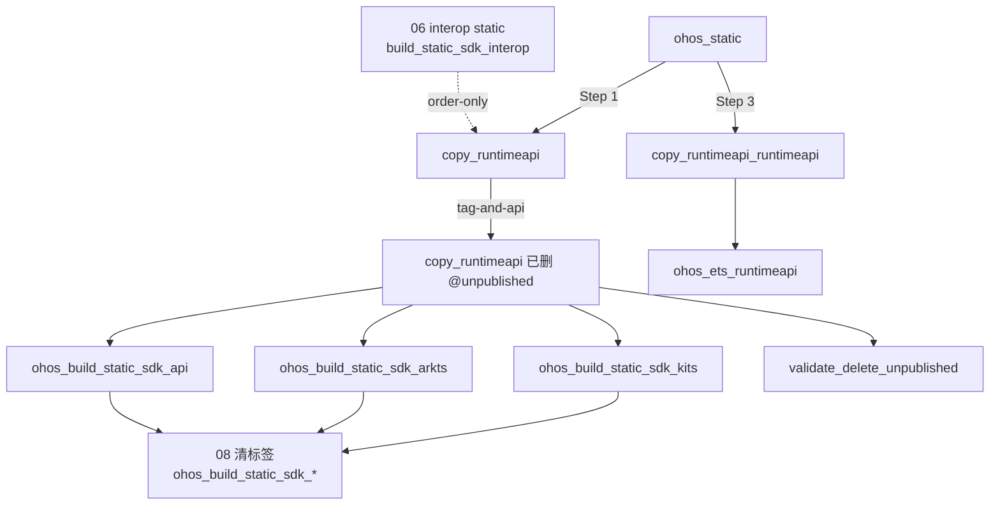

# 07 runtimeapi（static，删 `@unpublished`）

> 对应 [00-总览](./00-总览.md)「环节 07」。
> 脚本链：`interface/sdk-js/copy_runtimeapi.py` → `interface/sdk-js/build-tools/delete_unpublished_plugin.js`；
> 校验：`arkcompiler/ets_frontend/ets2panda/bindings/diagnostics.py`。
> 本环节只作用于 static SDK，输入来自 [05-装配](./05-装配.md)，随后由 [08-清标签](./08-清标签.md) 处理。

## 1. 环节职责

| 项 | 内容 |
| -- | ---- |
| 只作用于 | **static SDK** |
| 归属领域 | sdk（`interface/sdk-js/copy_runtimeapi.py` 等，interface/sdk-js 仓）+ 语言（`arkcompiler/ets_frontend/ets2panda/bindings/diagnostics.py`，arkcompiler 仓） |
| 目标 | `action("copy_runtimeapi")`、`action("validate_delete_unpublished")`、`ohos_copy("ohos_ets_runtimeapi")` |
| 输入 | `out/<产品>/ohos_static`（static 装配目录） |
| 输出 | `out/<产品>/obj/interface/sdk-js/copy_runtimeapi`（删标签+API）+ `out/<产品>/obj/interface/sdk-js/copy_runtimeapi_runtimeapi`（保留原始） |
| 一句话 | 生成两份副本：一份给 `ets/static/*` 打包，一份给 ets-loader runtimeapi |

## 2. `copy_runtimeapi` 调用关系

```gn
action("copy_runtimeapi") {
  deps = [ ":build_static_sdk_interop", ":ohos_ets_static" ]
  script = "//interface/sdk-js/copy_runtimeapi.py"
  args = [
    "--static-sdk-path",  rebase_path(ohos_ets_static_path),          # out/<产品>/ohos_static
    "--output-path",      rebase_path(target_out_dir + "/copy_runtimeapi"),
    "--runtimeapi-path",  rebase_path(target_out_dir + "/copy_runtimeapi_runtimeapi"),
    "--node-js",          rebase_path(nodejs),
    "--unpublished-tool", rebase_path("//interface/sdk-js/build-tools/delete_unpublished_plugin.js"),
    "--sdk-path",         rebase_path(build_sdk_path),                # out/<产品>/ohos_ets
  ]
}
```

## 3. `copy_runtimeapi.py` 处理流程

脚本常量 `STATIC_SUBDIRS = ["api", "kits", "arkts"]`。



| 步骤 | 输入 | 输出 | 说明 |
| ---- | ---- | ---- | ---- |
| Step 1 | `out/<产品>/ohos_static` | `out/<产品>/obj/interface/sdk-js/copy_runtimeapi` | `rmtree` 后 `copytree`，保留原始标签 |
| Step 2 | `out/<产品>/ohos_static` | 原地 | `tag-only` 调用被注释，**当前不执行** |
| Step 3 | `out/<产品>/ohos_static` | `out/<产品>/obj/interface/sdk-js/copy_runtimeapi_runtimeapi` | 与 Step 1 相同的原始副本 |
| Step 4 | `out/<产品>/obj/interface/sdk-js/copy_runtimeapi` | 原地 | `delete_unpublished_plugin.js --mode tag-and-api` |

> 设计注释：必须在 tag-only 之前先拷贝原始 static SDK，否则标签被删后无法识别要删的 API。
> 当前 tag-only 未启用，Step 3 直接拷贝未处理的 static SDK。

子进程环境：Node 全部转绝对路径；Linux 下若
`out/<产品>/ohos_ets/build-tools/ets2panda/lib` 存在则加入 `LD_LIBRARY_PATH`；
只检查 `returncode != 0` 并打印，不中断 Python 主流程。

## 4. `delete_unpublished_plugin.js` 处理



两种模式：

| 模式 | 行为 |
| ---- | ---- |
| `tag-only` | 只删 `@unpublished` 所在行，保留 JSDoc 其余内容和 API 声明 |
| `tag-and-api` | 删除整个 JSDoc 注释块 + API 声明 |

`tag-and-api` 额外：记录被删顶层导出名以清理悬空 import/export、修复枚举尾逗号、
连续空行压缩（3+ → 2）。

## 5. 校验与 runtimeapi 输出

### 5.1 `validate_delete_unpublished`

```gn
action("validate_delete_unpublished") {
  deps = [ ":copy_runtimeapi" ]
  external_deps = [ "ets_frontend:ohos_ets_bindings", ohos_ets_koala_wrapper_deps, ohos_ets_ui_plugins_deps ]
  script = "//arkcompiler/ets_frontend/ets2panda/bindings/diagnostics.py"
  args = [ "--build-tools", ..., "--node", ..., "--sdk-path", target_out_dir + "/copy_runtimeapi",
           "--init-ast-cache", "--stamp", target_out_dir + "/validate_delete_unpublished.stamp" ]
  outputs = [ target_out_dir + "/validate_delete_unpublished.stamp" ]
}
```

用 ets2panda 解析删 `@unpublished` 后的声明，初始化 AST cache，输出 `.stamp` 成功标记。

### 5.2 `ohos_ets_runtimeapi`

| 项 | 内容 |
| -- | ---- |
| 源 | `out/<产品>/obj/interface/sdk-js/copy_runtimeapi_runtimeapi`（保留 `@unpublished` API） |
| 安装 | `ets/static/build-tools/ets-loader/runtimeapi` |
| 用途 | 供 ets-loader 运行时使用，不暴露给应用编译期 |

## 6. 产物关系



| 目录 | `@unpublished` 标签 | `@unpublished` API | 用途 |
| ---- | ------------------- | ------------------ | ---- |
| `out/<产品>/ohos_static` | 保留 | 保留 | 内部中转 |
| `out/<产品>/obj/interface/sdk-js/copy_runtimeapi` | 删除 | 删除 | `ets/static/{api,arkts,kits}` |
| `out/<产品>/obj/interface/sdk-js/copy_runtimeapi_runtimeapi` | 保留 | 保留 | `ets/static/build-tools/ets-loader/runtimeapi` |

## 7. 关键细节

- 本环节在 ninja 中 **order-only 依赖 [06-interop](./06-interop.md) 的 `build_static_sdk_interop`**：
  `copy_runtimeapi` 的 deps 含 `build_static_sdk_interop.stamp`（保证 static 工具链先就绪），
  但**数据上不消费** interop 产物，输入只有 `ohos_static` / `ohos_ets`；
- 同一份 static SDK 拷贝两次（Step 1、Step 3），Step 2 未执行；
- Step 4 原地处理（`--input` 与 `--output` 都是 `out/<产品>/obj/interface/sdk-js/copy_runtimeapi`）；
- `kits/` 下空文件保留，其余空文件删除；
- `LD_LIBRARY_PATH` 只在 Linux 生效；
- 处理顺序：先 `copy_runtimeapi` 删 `@unpublished`（本环节 07），
  再由 [08-清标签](./08-清标签.md) 的 `ohos_build_static_sdk_*` 删 `@noninterop`。

## 8. 相关文件

| 文件 | 作用 |
| ---- | ---- |
| `interface/sdk-js/copy_runtimeapi.py` | 拷贝 static SDK 并调度 `@unpublished` 处理 |
| `interface/sdk-js/build-tools/delete_unpublished_plugin.js` | `@unpublished` 标签/API 删除 |
| `interface/sdk-js/BUILD.gn` | `copy_runtimeapi`、`validate_delete_unpublished`、`ohos_ets_runtimeapi` |
| `arkcompiler/ets_frontend/ets2panda/bindings/diagnostics.py` | 声明校验 |
