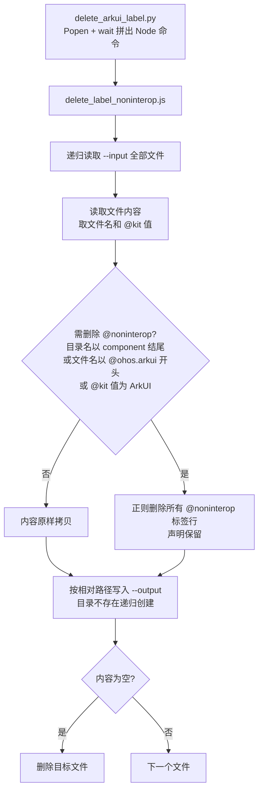

# 08 清标签（`ohos_handle_declaration_template`）

> 对应 [00-总览](./00-总览.md)「环节 08」。
> 脚本链：`interface/sdk-js/delete_arkui_label.py`（Python 转发）
> → `interface/sdk-js/build-tools/delete_label_noninterop.js`（干活的 Node 脚本）。
> dynamic 输入来自 [05-装配](./05-装配.md)；static 输入经 [07-runtimeapi](./07-runtimeapi.md) 处理，
> 与 [06-interop](./06-interop.md) 的 `@noninterop` 成员清理同源（本环节只删标签行，见下文）。

## 1. 环节职责

| 项 | 内容 |
| -- | ---- |
| GN 模板 | `ohos_handle_declaration_template`（`BUILD.gn:173`），7 个最终目标 |
| 脚本 | `interface/sdk-js/delete_arkui_label.py` → `interface/sdk-js/build-tools/delete_label_noninterop.js` |
| 归属领域 | sdk（interface/sdk-js 仓） |
| 输入 | `out/<产品>/ohos_dynamic/{api,arkts,component,kits}` 或 `out/<产品>/obj/interface/sdk-js/copy_runtimeapi/{api,arkts,kits}` |
| 输出 | `out/<产品>/obj/interface/sdk-js/ohos_build_{dynamic,static}_sdk_{api,arkts,component,kits}` |
| 一句话 | 对 ArkUI 相关文件删除 `@noninterop` 标签行，声明保留；未命中原样复制 |

## 2. 模板定义与依赖

```gn
template("ohos_handle_declaration_template") {
  action_with_pydeps(target_name) {
    deps = [ ":ohos_ets_dynamic" ]
    if (sdk_build_arkts) {
      deps += [ ":copy_runtimeapi", ":ohos_ets_static", ":validate_delete_unpublished" ]
    }
    deps += [ ":${target_name}_info" ]
    script = "//interface/sdk-js/delete_arkui_label.py"
    args = [
      "--root-build-dir",          rebase_path("//", root_build_dir),
      "--input-interface-sdk",     rebase_path(input_project_dir),
      "--output-arkui-interface-sdk", rebase_path("${target_out_dir}/${target_name}"),
      "--node-js",                 rebase_path(nodejs, root_build_dir),
    ]
  }
}
```

实例与安装目录：

| 目标 | 输入 | 安装目录 |
| ---- | ---- | -------- |
| `ohos_build_dynamic_sdk_api` | `out/<产品>/ohos_dynamic/api` | `ets/dynamic/api` |
| `ohos_build_dynamic_sdk_arkts` | `out/<产品>/ohos_dynamic/arkts` | `ets/dynamic/arkts` |
| `ohos_build_dynamic_sdk_component` | `out/<产品>/ohos_dynamic/component` | `ets/dynamic/component` |
| `ohos_build_dynamic_sdk_kits` | `out/<产品>/ohos_dynamic/kits` | `ets/dynamic/kits` |
| `ohos_build_static_sdk_api` | `out/<产品>/obj/interface/sdk-js/copy_runtimeapi/api` | `ets/static/api` |
| `ohos_build_static_sdk_arkts` | `out/<产品>/obj/interface/sdk-js/copy_runtimeapi/arkts` | `ets/static/arkts` |
| `ohos_build_static_sdk_kits` | `out/<产品>/obj/interface/sdk-js/copy_runtimeapi/kits` | `ets/static/kits` |

> `ohos_build_dynamic_sdk_api` 额外把
> `bundle/bundleStatusCallback.d.ts` 声明为 output，供 `bundle_api` 安装到
> `ets/dynamic/build-tools/ets-loader/declarations`（仅 `sdk_build_public != "true"` 时）。

## 3. 处理流程



判断条件（任一成立即命中 ArkUI）：

1. 输入路径以 `component` 结尾；
2. 文件名以 `@ohos.arkui` 开头；
3. 文件头 `@kit` 值为 `ArkUI`。

删除正则：

```js
content.replace(/^\s*\*\s*\@noninterop\s*[\r\n]/mg, '')
```

只删标签行，不删声明本身。

## 4. 影响范围

| 目标 | 典型命中内容 |
| ---- | ------------ |
| `ohos_build_dynamic_sdk_component` | 整个 `component` 目录（路径以 component 结尾） |
| `ohos_build_dynamic_sdk_api` / `arkts` / `kits` | `@ohos.arkui*` 文件、`@kit ArkUI` 文件 |
| `ohos_build_static_sdk_*` | 与 dynamic 相同判定，处理的是 `out/<产品>/obj/interface/sdk-js/copy_runtimeapi/*` |

## 5. 关键细节

- Python 侧不做文件处理，只负责拼命令并等待，**不检查 Node 子进程返回码**；
- `@noninterop` 只在最终安装副本被删；`ohos_dynamic` / `ohos_static` / `copy_runtimeapi*`
  仍保留原始标签；
- `outputs` 只有目录（无 `.timestamp`），ninja 以目录 mtime 判新旧；
- 模板生成 `<target>_info`（`generate_module_info`，`module_type = "jsdoc"`）登记安装模块；
- `sdk_build_arkts == true` 时追加的 `copy_runtimeapi` / `ohos_ets_static` /
  `validate_delete_unpublished` 处理 static `@unpublished` 相关内容。
- 与 [06-interop](./06-interop.md) 的区分：06 在 interop 副本上**删 `@noninterop` 成员**（声明级），
  本环节在安装副本上**只删 `@noninterop` 标签行**（声明保留），二者同源于 `@noninterop` 但互不消费；
  dynamic 输入直取 [05-装配](./05-装配.md) 的 `ohos_dynamic`，static 输入取 [07-runtimeapi](./07-runtimeapi.md) 的 `copy_runtimeapi`。

## 6. 常加的改动

- **调整标签删除规则** → 改本环节。注意它**只删标签**，目录删除在环节 03/04。

## 7. 相关文件

| 文件 | 作用 |
| ---- | ---- |
| `interface/sdk-js/BUILD.gn` | `ohos_handle_declaration_template` 与 7 个最终目标 |
| `interface/sdk-js/delete_arkui_label.py` | Node 工具的 Python 包装 |
| `interface/sdk-js/build-tools/delete_label_noninterop.js` | 删除 `@noninterop` 标签行 |
| `interface/sdk-js/interface_config.gni` | `ohos_dynamic` / `ohos_static` 路径 |
